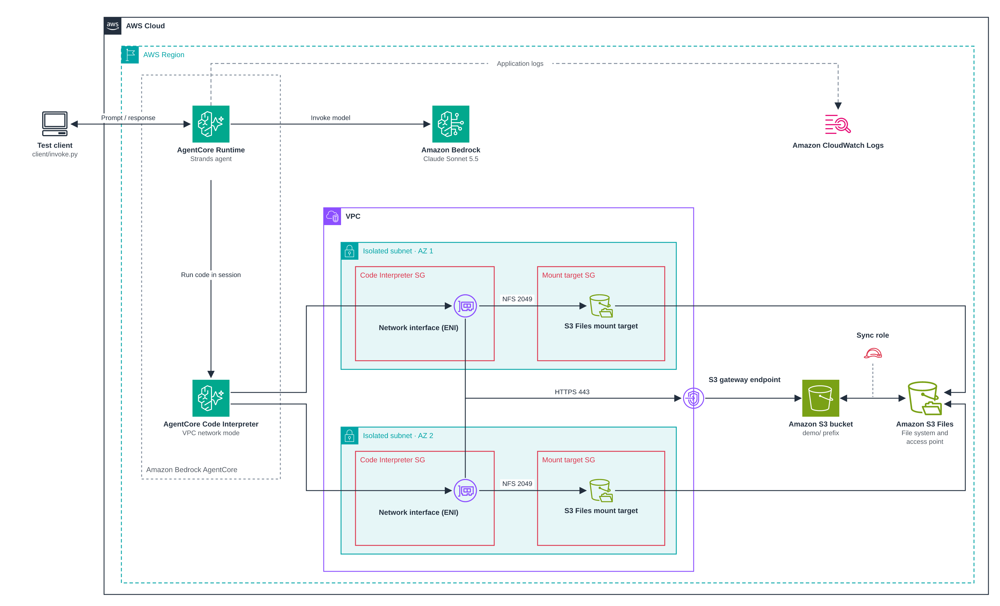

# Run agent-generated code in Amazon Bedrock AgentCore Code Interpreter with Amazon S3 Files

This pattern shows how an AI agent can write Python code and run it safely, in an isolated sandbox that can read files from an Amazon S3 bucket.

An agent hosted on Amazon Bedrock AgentCore Runtime answers questions about files by asking the model to write Python code, then runs that code in an Amazon Bedrock AgentCore Code Interpreter session instead of in the agent's own environment. The session mounts the files from the bucket through an Amazon S3 Files file system, so the code reads them with ordinary file operations. Code can do what a model can't do reliably on its own, such as exact calculations over many rows, joining data across files, and reading parts of a file that aren't page text, like form fields and attachments.

The sandbox limits what generated code can do:

* It runs in an Amazon VPC with no internet access, so it can't download anything or send data to other hosts. See [Internet access considerations](https://docs.aws.amazon.com/bedrock-agentcore/latest/devguide/agentcore-vpc.html#agentcore-internet-access). The only other way out of the VPC is an Amazon S3 gateway endpoint that serves read requests for the document bucket only; see [Why the Code Interpreter can read the bucket directly](#why-the-code-interpreter-can-read-the-bucket-directly).
* It mounts the files read-only, so it can't change or delete them. See [S3 Files actions for clients](https://docs.aws.amazon.com/AmazonS3/latest/userguide/s3-files-security-iam.html#s3-files-security-iam-client-actions).
* The Code Interpreter's execution role can mount the file system and read the same files from the bucket, and nothing else. The agent's own role has no access to the bucket.
* The agent waits 2 minutes for each code run by default, which is the [`python_repl` default](https://github.com/strands-agents/harness-sdk/blob/a2524a556ce014d0909bad41822264c3d98ecd1e/strands-py/src/strands/vended_tools/python_repl/python_repl.py#L27), and never more than 5 minutes. When the request ends, it stops the session, including any code that is still running. A session ends after 15 minutes in any case; see `sessionTimeoutSeconds` in [StartCodeInterpreterSession](https://docs.aws.amazon.com/bedrock-agentcore/latest/APIReference/API_StartCodeInterpreterSession.html).

Learn more about this pattern at Serverless Land Patterns: https://serverlessland.com/patterns/agentcore-runtime-code-interpreter-s3-python-cdk

Important: this application uses various AWS services and there are costs associated with these services after the Free Tier usage - please see the [AWS Pricing page](https://aws.amazon.com/pricing/) for details. You are responsible for any AWS costs incurred. No warranty is implied in this example.

## Requirements

* [Create an AWS account](https://portal.aws.amazon.com/gp/aws/developer/registration/index.html) if you do not already have one and log in. The IAM user that you use must have sufficient permissions to make necessary AWS service calls and manage AWS resources.
* [AWS CLI](https://docs.aws.amazon.com/cli/latest/userguide/install-cliv2.html) installed and configured
* [Git Installed](https://git-scm.com/book/en/v2/Getting-Started-Installing-Git)
* [Node.js](https://nodejs.org/) with `npx`, which the scripts use to run the [AWS Cloud Development Kit](https://docs.aws.amazon.com/cdk/v2/guide/getting-started.html) (AWS CDK) CLI. The target account and Region must be [bootstrapped](https://docs.aws.amazon.com/cdk/v2/guide/bootstrapping.html) for AWS CDK.
* [Python](https://www.python.org/downloads/) 3.10 or later, with `pip` and `venv`. Docker is not required: `cdk synth` downloads the agent's Linux arm64 dependencies with `pip`, because [AgentCore Runtime direct code deployment](https://docs.aws.amazon.com/bedrock-agentcore/latest/devguide/runtime-get-started-code-deploy-python.html) supports only arm64.
* Access to Anthropic Claude Sonnet 5.5 in Amazon Bedrock. See [Access Amazon Bedrock foundation models](https://docs.aws.amazon.com/bedrock/latest/userguide/model-access.html).
* An AWS Region where Amazon Bedrock AgentCore Runtime, AgentCore Code Interpreter, Amazon S3 Files and the Claude Sonnet 5.5 global inference profile are all available. Check the [AgentCore Regions](https://docs.aws.amazon.com/bedrock-agentcore/latest/devguide/agentcore-regions.html) page and the [Claude Sonnet 5.5 model card](https://docs.aws.amazon.com/bedrock/latest/userguide/model-card-anthropic-claude-sonnet-5-5.html).

## Deployment Instructions

1. Create a new directory, navigate to that directory in a terminal and clone the GitHub repository:
    ```bash
    git clone https://github.com/aws-samples/serverless-patterns
    ```
1. Change directory to the pattern directory:
    ```bash
    cd serverless-patterns/agentcore-runtime-code-interpreter-s3/python/cdk
    ```
1. Pick the Availability Zone IDs for your Region, as described in [Choosing Availability Zones](#choosing-availability-zones).
1. Deploy the stack, passing the zone IDs as context:
    ```bash
    ./deploy.sh -c availabilityZoneIds=<az-id-1>,<az-id-2>
    ```
    The script creates a Python virtual environment in `.venv`, installs the AWS CDK app and test client dependencies, and runs `cdk deploy --require-approval never` from the `cdk` directory, so it doesn't ask you to confirm the IAM and security group changes. Any arguments are passed to `cdk deploy`.
1. Note the `AgentRuntimeArn`, `AgentLogGroupName` and `DocumentBucketName` outputs. The test client and the log script read the runtime ARN and the log group name from the stack outputs.

### Choosing Availability Zones

The Code Interpreter runs in VPC network mode, because AgentCore mounts Amazon S3 Files file systems only into Code Interpreter sessions that use a VPC (see [File system configurations for AgentCore Code Interpreter](https://docs.aws.amazon.com/bedrock-agentcore/latest/devguide/code-interpreter-filesystem-configurations.html)). AgentCore supports VPC connectivity only in specific Availability Zones in each Region, and creating the Code Interpreter fails if one of its subnets is in an unsupported zone.

To choose the zones:

1. Open [Supported Availability Zones](https://docs.aws.amazon.com/bedrock-agentcore/latest/devguide/agentcore-vpc.html#agentcore-supported-azs) in the AgentCore Developer Guide and find the row for your Region. AWS updates the table as support expands.
1. Copy two or more of the zone IDs in that row and pass them, separated by commas, for example `./deploy.sh -c availabilityZoneIds=usw2-az1,usw2-az2` in US West (Oregon). The stack creates one subnet and one S3 Files mount target in each zone.

The table lists zone IDs rather than zone names such as `us-west-2a`, because zone IDs refer to the same zones in every account. See [Availability Zone IDs](https://docs.aws.amazon.com/ram/latest/userguide/working-with-az-ids.html). Not every account can use every zone ID. If the deployment fails because a zone ID doesn't exist, list the zone IDs available to your account and choose IDs that are in both lists:

```bash
aws ec2 describe-availability-zones --region <region> \
  --query 'AvailabilityZones[?ZoneType==`availability-zone`].ZoneId' --output text
```

If your Region isn't in the table, or the table lists fewer than two zones for it, deploy the pattern in a different Region.

Without `availabilityZoneIds`, the stack uses the first two zones that AWS CloudFormation returns for the Region ([`Fn::GetAZs`](https://docs.aws.amazon.com/AWSCloudFormation/latest/TemplateReference/intrinsic-function-reference-getavailabilityzones.html)), which AgentCore might not support. If it doesn't, the deployment fails and rolls back. The rollback can end in `ROLLBACK_FAILED`; see [If stack deletion fails on the subnets or security group](#if-stack-deletion-fails-on-the-subnets-or-security-group).

Use the same `-c availabilityZoneIds=...` value on every later `./deploy.sh` and `cdk diff`. Changing the zones of an existing deployment replaces the subnets and everything placed in them, because CloudFormation can't change a subnet's [`AvailabilityZoneId`](https://docs.aws.amazon.com/AWSCloudFormation/latest/TemplateReference/aws-resource-ec2-subnet.html#cfn-ec2-subnet-availabilityzoneid) in place. `./destroy.sh` doesn't need the value, because it deletes the deployed stack as it is.

## How it works



For each request, the agent:

1. Starts a Code Interpreter session and mounts the S3 Files access point at `/mnt/s3data`, so the files under the bucket's `demo/` prefix appear in that directory. See [File system configurations for AgentCore Code Interpreter](https://docs.aws.amazon.com/bedrock-agentcore/latest/devguide/code-interpreter-filesystem-configurations.html).
1. Asks the model to answer the prompt. To read the files, the model writes Python code and runs it with the Strands [`python_repl`](https://strandsagents.com/docs/api/python/strands.vended_tools.python_repl.python_repl/) tool. A small [custom Strands sandbox](https://strandsagents.com/docs/user-guide/sdk/sandbox/custom-sandbox/) (`agent/sandbox.py`) sends that code to the Code Interpreter session instead of running it in the runtime, and returns the output to the model. The model can run code several times before it answers.
1. Streams the model's text response back to the caller, then stops the session.

The stack creates the following resources:

* **Amazon VPC** with an isolated private subnet in each of the chosen Availability Zones. It has no internet gateway and no NAT gateway. An Amazon S3 gateway endpoint lets the Code Interpreter read the document bucket.
* **Amazon S3 bucket** with versioning, which [S3 Files requires](https://docs.aws.amazon.com/AmazonS3/latest/userguide/s3-files-prereq-policies.html). Block Public Access is on and the bucket policy denies requests that don't use TLS.
* **Amazon S3 Files file system** that exposes the `demo/` prefix of the bucket as a file system. S3 Files assumes a dedicated IAM role to synchronize the file system with the bucket; see [IAM role for accessing your bucket from the file system](https://docs.aws.amazon.com/AmazonS3/latest/userguide/s3-files-prereq-policies.html#s3-files-prereq-iam-creation-role). The file system has a mount target in each subnet and an access point that runs file operations as POSIX user and group `1000`. That user can read the files, because S3 Files gives objects uploaded to the bucket `root:root` ownership and permissions that let any user read them; see [POSIX permissions in S3 Files](https://docs.aws.amazon.com/AmazonS3/latest/userguide/s3-files-posix-permissions.html).
* **AgentCore Code Interpreter** (custom) in VPC network mode. Its security group allows only outbound NFS traffic (TCP 2049) to the mount targets, as described in the [S3 Files security group prerequisites](https://docs.aws.amazon.com/AmazonS3/latest/userguide/s3-files-prereq-policies.html#s3-files-prereq-security-groups), and HTTPS (TCP 443) to Amazon S3 through the gateway endpoint. Its execution role has `s3files:ClientMount` and `s3files:GetAccessPoint` on the file system, limited to the access point. Without `s3files:ClientWrite` the mount is read-only. The role can also read objects under `demo/` and list that prefix, as explained in [Why the Code Interpreter can read the bucket directly](#why-the-code-interpreter-can-read-the-bucket-directly).
* **AgentCore Runtime** that hosts a [Strands Agents](https://strandsagents.com/) agent as a Python 3.14 [direct code deployment](https://docs.aws.amazon.com/bedrock-agentcore/latest/devguide/runtime-get-started-code-deploy.html). The runtime uses public network mode, the [CDK construct's default](https://docs.aws.amazon.com/cdk/api/v2/python/aws_cdk.aws_bedrockagentcore/Runtime.html), so it reaches the Amazon Bedrock and AgentCore APIs without VPC endpoints. Only the Code Interpreter is in the VPC. The agent uses Claude Sonnet 5.5 through the [global cross-Region inference](https://docs.aws.amazon.com/bedrock/latest/userguide/global-cross-region-inference.html) profile. Its execution role can start, invoke and stop sessions on the Code Interpreter, and has no access to the S3 bucket. The agent logs every piece of code it runs, and the first 2,000 characters of its output, to Amazon CloudWatch Logs.

### Why the Code Interpreter can read the bucket directly

S3 Files serves small and large files in different ways:

* When code first opens a directory, S3 Files copies the data of files smaller than 128 KiB (the default `sizeLessThan`) onto the file system. Reads of those files go over NFS through the mount target.
* For larger files, S3 Files copies only the metadata. The mount client in the session reads their data directly from the S3 bucket, which gives higher throughput. See [Understanding how synchronization works](https://docs.aws.amazon.com/AmazonS3/latest/userguide/s3-files-synchronization.html#s3-files-sync-bucket-accessible) and the [`nodirects3read` mount option](https://github.com/aws/efs-utils#s3-files-specific-mount-options) in the `amazon-efs-utils` documentation.

AgentCore runs the mount itself, so the pattern can't turn direct reads off. For direct reads, the S3 Files documentation asks for an IAM policy on the mounting client's role that allows `s3:GetObject`, `s3:GetObjectVersion` and `s3:ListBucket` on the linked bucket; see [IAM role for attaching your file system to AWS compute resources](https://docs.aws.amazon.com/AmazonS3/latest/userguide/s3-files-prereq-policies.html#s3-files-prereq-iam-compute-role). The client also needs a network path to Amazon S3. Without both, the first read of each file of 128 KiB or more in a session waits for the S3 request to time out, and only then falls back to NFS, which adds several seconds per file.

The pattern adds three things for direct reads, each limited to what the mount client needs:

* **IAM permissions on the Code Interpreter's execution role:** `s3:GetObject` and `s3:GetObjectVersion` on objects under `demo/`, the prefix that the file system exposes, and `s3:ListBucket` on the bucket with an `s3:prefix` condition that limits listing to `demo/`. The role has no write or delete permissions on the bucket.
* **An Amazon S3 gateway endpoint** in the VPC, because the subnets have no internet gateway or NAT gateway. Gateway endpoints for Amazon S3 have no additional charge; see [Gateway endpoints for Amazon S3](https://docs.aws.amazon.com/vpc/latest/privatelink/vpc-endpoints-s3.html). Its [endpoint policy](https://docs.aws.amazon.com/vpc/latest/privatelink/vpc-endpoints-access.html#vpc-endpoint-policies-gateway) allows the same read actions on the same resources, and only for the Code Interpreter's execution role (`aws:PrincipalArn` condition). Code in a session therefore can't use the endpoint to reach other buckets, even with credentials from somewhere else, and can't write to any bucket through it.
* **A security group rule** that allows HTTPS (TCP 443) to the [AWS-managed prefix list](https://docs.aws.amazon.com/vpc/latest/userguide/working-with-aws-managed-prefix-lists.html) for Amazon S3, as the gateway endpoint documentation requires. CloudFormation can't return the prefix list ID, so a small custom resource looks it up with `DescribeManagedPrefixLists` when the stack is created.

The execution role's credentials are available to the code that runs in the session, so the code can also read objects under `demo/` through the Amazon S3 API. That's the same data the code can already read through the mount. Read through the API, the files aren't subject to the access point's POSIX user; see [POSIX permissions and direct S3 access](https://docs.aws.amazon.com/AmazonS3/latest/userguide/s3-files-posix-permissions.html#s3-files-posix-permissions-direct-s3-access).

The project is organized as follows:

* `agent/` contains the agent (`main.py`), its system prompt (`system_prompt.md`), the Code Interpreter sandbox (`sandbox.py`), the structured log events they write (`log_events.py`) and their dependencies.
* `cdk/` contains the AWS CDK app. The stack in `cdk/stack/` creates one construct per part of the architecture from `cdk/l3_constructs/`, and `cdk/bundling/` packages the agent code and its dependencies for AgentCore.
* `client/` contains a test client that invokes the agent and prints the streamed response (`invoke.py`), and a script that prints the code the agent ran and its results from the logs (`logs.py`).
* `samples/` contains a script that generates sample files for testing.

## Testing

The `samples/generate.py` script creates two fictional files for testing:

* `statement.pdf`, a bank statement for March 2026. Besides the transaction table, it holds data that isn't part of the page text: document metadata, filled-in form fields, a comment on one transaction and an embedded `adjustments.csv` attachment.
* `ledger.xlsx`, the company's ledger for the same month, with a few planted differences from the statement.

Reconciling the two files takes exact row-by-row comparison and reading the PDF's internal objects, which the agent does by writing and running Python code in the Code Interpreter session.

To run the whole test with one command, run `./test.sh` from the pattern directory. The script:

1. Asks whether to show the code that the agent ran after each answer, as described in [See the code that the agent ran](#see-the-code-that-the-agent-ran). If you answer no, or run the script without a terminal, it prints the command that shows the code instead.
1. Reads the bucket name from the `DocumentBucketName` stack output.
1. Generates and uploads the sample files, if they aren't in the bucket yet.
1. Asks the agent the two questions below.

To run the steps yourself:

1. From the pattern directory, activate the virtual environment that `deploy.sh` created and generate the files:
    ```bash
    source .venv/bin/activate
    pip install -r samples/requirements.txt
    python samples/generate.py
    ```
    The script writes the files to `samples/output/` and prints the differences and hidden data that the agent should find.
1. Upload both files to the `demo/` prefix of the bucket. The bucket name is in the `DocumentBucketName` stack output:
    ```bash
    aws s3 cp samples/output/ s3://<DocumentBucketName>/demo/ --recursive
    ```
    S3 Files [synchronizes the file system with the bucket](https://docs.aws.amazon.com/AmazonS3/latest/userguide/s3-files-synchronization.html) in the background, so new files can take a short time to appear under `/mnt/s3data`. If the agent reports that a file is missing, wait a minute and ask again.
1. Ask the agent to reconcile the files:
    ```bash
    python client/invoke.py "Reconcile statement.pdf with ledger.xlsx. List transactions that are only in one of the files and transactions whose amounts differ. Check the PDF's comments and attachments for anything that explains a difference."
    ```
1. Ask about the data that isn't on the page:
    ```bash
    python client/invoke.py "What form fields does statement.pdf contain, and what are their values? Is the statement approved? What does its metadata say?"
    ```

The responses are printed as they stream from the agent, after a `Session ID:` line. If you deployed the stack under a different name, pass it with `--stack-name`. Compare the answers with the output of `generate.py`.

### See the code that the agent ran

The agent writes each prompt, each piece of code it runs and each result from the Code Interpreter to the runtime's log group in Amazon CloudWatch Logs, `/aws/bedrock-agentcore/runtimes/<agent-runtime-id>-DEFAULT`, as JSON. See [View logs](https://docs.aws.amazon.com/AmazonCloudWatch/latest/monitoring/view-observability-data-cloudwatch.html#view-logs). The stack keeps 7 days of logs and puts the log group name in the `AgentLogGroupName` output. To print them in a readable form, grouped by request:

```bash
python client/logs.py
```

For each request, the script prints the prompt and then every run in order: the code, its exit code, and its standard output and standard error. Output longer than 2,000 characters is truncated in the logs. By default the script reads the last 30 minutes; change that with `--minutes`. To show only some requests, pass the session IDs that `invoke.py` printed, each with `--session-id`. If you deployed the stack under a different name, pass it with `--stack-name`.

## Cleanup

1. Delete the stack:
    ```bash
    ./destroy.sh
    ```
    The script runs `cdk destroy --force` from the `cdk` directory, so it deletes the stack without asking you to confirm. Stack deletion empties the S3 bucket, including all object versions, and deletes it.
1. Confirm the stack has been deleted:
    ```bash
    aws cloudformation list-stacks --query "StackSummaries[?contains(StackName,'AgentCoreRuntimeCodeInterpreterS3Stack')].StackStatus"
    ```

### If stack deletion fails on the subnets or security group

Stack deletion can end in `DELETE_FAILED`, with errors such as "The subnet ... has dependencies and cannot be deleted" or "resource sg-... has a dependent object". The same can happen when a failed deployment rolls back and ends in `ROLLBACK_FAILED`.

This is expected behavior of AgentCore VPC connectivity, not a problem with the stack. When the Code Interpreter is created in VPC network mode, AgentCore creates network interfaces in its subnets, using its security group. AgentCore owns and manages these interfaces, and they are attached to AWS-owned infrastructure, so you can't detach or delete them yourself. After the Code Interpreter is deleted, they can remain for up to 8 hours, as described in [VPC connectivity for Amazon Bedrock AgentCore Runtime and tools](https://docs.aws.amazon.com/bedrock-agentcore/latest/devguide/agentcore-vpc.html#vpc-connectivity-agentcore). Until they are removed, the subnets and the security group can't be deleted.

To finish the cleanup:

1. Check whether the AgentCore network interfaces are still in the stack's VPC. Their interface type is `agentic_ai` and they have the tag `AmazonBedrockAgentCoreManaged=true`:
    ```bash
    aws ec2 describe-network-interfaces \
      --filters Name=vpc-id,Values=<vpc-id> Name=tag:AmazonBedrockAgentCoreManaged,Values=true \
      --query 'NetworkInterfaces[].[NetworkInterfaceId,Status]' --output table
    ```
    You can find the VPC ID in the stack's resources in the AWS CloudFormation console.
1. When the command returns no network interfaces, run `./destroy.sh` again.

You can't deploy the stack again until the old stack is deleted, because CloudFormation doesn't create a stack while one with the same name still exists.

----
Copyright 2026 Amazon.com, Inc. or its affiliates. All Rights Reserved.

SPDX-License-Identifier: MIT-0
