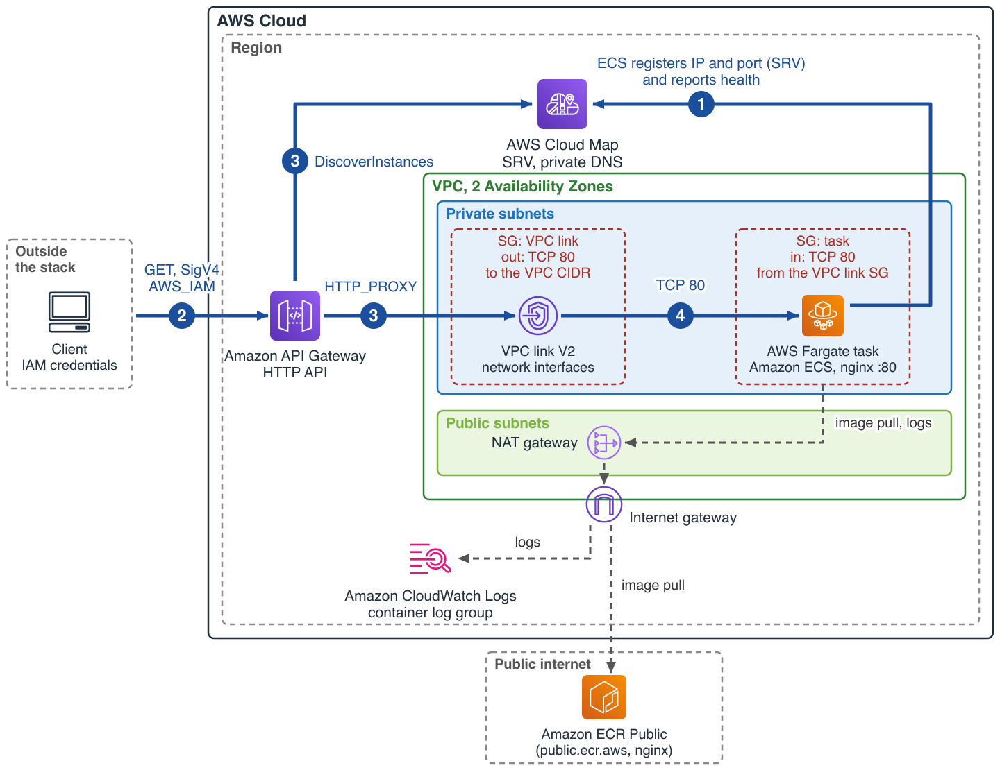

# Amazon API Gateway HTTP API to Amazon ECS on AWS Fargate through AWS Cloud Map

This pattern deploys an Amazon API Gateway HTTP API whose integration target is an AWS Cloud Map service, so requests reach Amazon Elastic Container Service (Amazon ECS) tasks on AWS Fargate through a VPC link without a load balancer. The Amazon ECS service registers each task in AWS Cloud Map, and API Gateway looks the targets up there. The existing [apigw-fargate-cdk](https://github.com/aws-samples/serverless-patterns/tree/main/apigw-fargate-cdk) and [apigw-vpclink-pvtnlb-fargate-cdk-python](https://github.com/aws-samples/serverless-patterns/tree/main/apigw-vpclink-pvtnlb-fargate-cdk-python) patterns put an Application Load Balancer or a Network Load Balancer between the two; here the AWS Cloud Map service registration takes that place. Callers sign requests with AWS Identity and Access Management (IAM) credentials (SigV4).

Learn more about this pattern at Serverless Land Patterns: https://serverlessland.com/patterns/apigw-cloudmap-fargate-typescript-cdk

Important: this application uses various AWS services and there are costs associated with these services after the Free Tier usage - please see the [AWS Pricing page](https://aws.amazon.com/pricing/) for details. You are responsible for any AWS costs incurred. No warranty is implied in this example.

## Requirements

* [Create an AWS account](https://portal.aws.amazon.com/gp/aws/developer/registration/index.html) if you do not already have one and log in. The IAM user that you use must have sufficient permissions to make necessary AWS service calls and manage AWS resources.
* [AWS CLI](https://docs.aws.amazon.com/cli/latest/userguide/install-cliv2.html) v2 installed and configured. The Testing commands use `aws configure export-credentials` and `aws logs tail`. Your principal needs `execute-api:Invoke` on the API, read access to the services named in the Testing commands, and `ecs:UpdateService` for step 6.
* [curl](https://curl.se/) 7.75 or later, for the `--aws-sigv4` option, and bash or zsh
* [Node.js 22 or later](https://nodejs.org/en/download/) installed
* [AWS CDK v2](https://docs.aws.amazon.com/cdk/v2/guide/getting_started.html) and an account and Region [bootstrapped](https://docs.aws.amazon.com/cdk/v2/guide/bootstrapping.html) for it
* [Git](https://git-scm.com/book/en/v2/Getting-Started-Installing-Git) installed
* The stack deploys to the Region that the CDK resolves from your environment. Run the Testing commands in that Region, for example `export AWS_REGION=us-west-2` (and `AWS_PROFILE` if you use a named profile).

## Supported Regions

Deployed and tested in us-west-2 and eu-central-1: the [VPC link V2 documentation](https://docs.aws.amazon.com/apigateway/latest/developerguide/apigateway-vpc-links-v2.html) lists every Availability Zone ID of both Regions as supported. A VPC link V2 supports only the zone IDs listed there (in us-east-1 the list leaves out use1-az3), and the stack does not pin Availability Zones. Check which zone IDs your account maps to with `aws ec2 describe-availability-zones --query 'AvailabilityZones[].[ZoneName,ZoneId]' --output text`.

## Architecture



Numbers 1 to 4 match the steps under How it works. The dashed path is the image pull and the container logs: they leave the private subnets through the NAT gateway and the internet gateway because the stack creates no VPC endpoints.

## How it works

1. The Amazon ECS service has a service registry entry that points at an AWS Cloud Map service with `SRV` records, the task's container name and container port. For each running task, Amazon ECS registers an instance with the task's private IP address and port and reports the container health check result to AWS Cloud Map. According to the [Amazon ECS documentation](https://docs.aws.amazon.com/AmazonECS/latest/developerguide/service-discovery.html), an instance is `UNHEALTHY` until the container health check returns a value, then `HEALTHY`.
2. A client sends a `GET` request signed with SigV4. The routes require `AWS_IAM` authorization, so an unsigned request is rejected by API Gateway.
3. The integration is `HTTP_PROXY` over a VPC link V2, and its URI is the ARN of the AWS Cloud Map service. According to the [API Gateway documentation](https://docs.aws.amazon.com/apigateway/latest/developerguide/http-api-develop-integrations-private.html), API Gateway uses `DiscoverInstances` to find the resources and distributes requests across the healthy ones, so the registered attributes must include an IP address and a port.
4. The request goes through the VPC link network interfaces to the task. The task answers with a page that names the task.

The one non-obvious setting is the record type. The AWS CDK default for a Fargate task (`awsvpc` network mode) is an `A` record, which holds no port. The stack sets `dnsRecordType: SRV` with the container and its port, as the [API Gateway documentation](https://docs.aws.amazon.com/apigateway/latest/developerguide/http-api-develop-integrations-private.html) requires for Amazon ECS. In a test with the default `A` record the task was `HEALTHY`, its Cloud Map instance had an IP address and no `AWS_INSTANCE_PORT`, and every signed call returned HTTP 500. The component whose removal breaks the design is the AWS Cloud Map service registration: without it the integration has no targets (with the only instance deregistered by hand, a signed call returned HTTP 500). Amazon ECS Service Connect is the other option the documentation names.

## Important Notes

* **What bills while the stack exists:** the Fargate task, the NAT gateway (the tasks are in private subnets and pull the public image through it), the AWS Cloud Map resources and discovery calls, the Amazon Route 53 private hosted zone behind the namespace, API Gateway requests and Amazon CloudWatch Logs. Check the pricing page of each service for current rates. The stack uses one NAT gateway and one task, so it is not highly available.
* **VPC link V2:** it is immutable (subnets and security groups cannot change), the HTTP API, VPC link and AWS Cloud Map service must be in the same account, and a link with no traffic for 60 days becomes `INACTIVE` ([documentation](https://docs.aws.amazon.com/apigateway/latest/developerguide/apigateway-vpc-links-v2.html)).
* **Stage name:** according to the [API Gateway documentation](https://docs.aws.amazon.com/apigateway/latest/developerguide/http-api-develop-integrations-private.html), private integrations include the stage portion of the API endpoint in the request to your backend. The stack uses the `$default` stage, which has no stage segment in the invoke URL. In the test, a signed request for `/does-not-exist.html` reached nginx with exactly that path.
* **Network and access:** the VPC link security group has no inbound rule and allows outbound only on port 80 inside the VPC; the task security group keeps the default outbound rule for the image pull. Traffic between the VPC link and the task is plain HTTP. Any principal with `execute-api:Invoke` on the API can call it.

## Deployment Instructions

1. Clone the repository:
    ```bash
    git clone https://github.com/aws-samples/serverless-patterns
    cd serverless-patterns/apigw-cloudmap-fargate/typescript/cdk
    ```

2. Install dependencies and build:
    ```bash
    npm install
    npm run build
    ```

3. Bootstrap CDK once per account and Region, then deploy:
    ```bash
    npx cdk bootstrap
    npx cdk deploy
    ```

## Testing

1. Define helpers. Run this block again in any new terminal, and again when the exported credentials expire. `curl --user` puts the secret key on the command line, where other users of the machine can see it, so use a scratch machine or session:
    ```bash
    out() { aws cloudformation describe-stacks --stack-name ApigwCloudMapFargateStack --query "Stacks[0].Outputs[?OutputKey=='$1'].OutputValue" --output text; }
    API=$(out ApiUrl); CLUSTER=$(out ClusterName); SVC=$(out EcsServiceName); NS=$(out CloudMapNamespaceName)
    CMNAME=$(out CloudMapServiceName); LG=$(out ContainerLogGroupName)
    REGION=${AWS_REGION:-${AWS_DEFAULT_REGION:-$(aws configure get region)}}
    eval "$(aws configure export-credentials --format env)"
    sigv4() { curl -s --aws-sigv4 "aws:amz:${REGION}:execute-api" --user "$AWS_ACCESS_KEY_ID:$AWS_SECRET_ACCESS_KEY" -H "x-amz-security-token: $AWS_SESSION_TOKEN" "$@"; }
    ```

2. Wait until an Amazon ECS task is registered as `HEALTHY` in AWS Cloud Map, then read the registration. `DiscoverInstances` is the call API Gateway makes:
    ```bash
    until [ "$(aws servicediscovery discover-instances --namespace-name $NS --service-name $CMNAME --health-status HEALTHY --query 'length(Instances)' --output text)" -ge 1 ]; do sleep 10; done
    aws servicediscovery discover-instances --namespace-name $NS --service-name $CMNAME --query 'Instances[].[HealthStatus,Attributes.AWS_INSTANCE_IPV4,Attributes.AWS_INSTANCE_PORT]' --output text
    ```
   Expected: one line with `HEALTHY`, a private IP address and port `80`.

3. Compare with the task's own network interface. This is an independent read of the same address:
    ```bash
    aws ecs describe-tasks --cluster $CLUSTER --tasks $(aws ecs list-tasks --cluster $CLUSTER --service-name $SVC --query 'taskArns[]' --output text) --query 'tasks[].attachments[].details[?name==`privateIPv4Address`].value[]' --output text
    ```
   Expected: the IP address from step 2.

4. Call the API without a signature, then with one:
    ```bash
    curl -s -w ' HTTP %{http_code}\n' "$API/"
    sigv4 -w ' HTTP %{http_code}\n' "$API/"
    ```
   Expected: `{"message":"Forbidden"} HTTP 403` for the first call. The signed call prints `served by task <host name of the task>` (the task's private DNS name, for example `ip-10-0-1-2.us-west-2.compute.internal`) and ` HTTP 200` on the next line. The container writes that page at start-up, so the response shows that the request reached a task.

5. Read the container log. nginx logs each request it served:
    ```bash
    aws logs tail $LG --since 15m
    ```
   Expected: a health check line from `127.0.0.1` (user agent `Wget`) every 30 seconds, and for the signed call a `GET / HTTP/1.1` line with status 200 and user agent `curl`, whose client address is a private address in your subnets (the network interfaces of the VPC link). The unsigned call does not appear because API Gateway rejects it. Log lines can arrive a few seconds late: if the signed call is not listed yet, run the command again.

6. Scale to two tasks and wait until both answer, then count the answers:
    ```bash
    aws ecs update-service --cluster $CLUSTER --service $SVC --desired-count 2 --query 'service.desiredCount'
    until [ "$(for i in $(seq 6); do sigv4 "$API/"; done | sort -u | grep -c 'served by task')" -ge 2 ]; do sleep 5; done
    aws servicediscovery discover-instances --namespace-name $NS --service-name $CMNAME --query 'Instances[].[HealthStatus,Attributes.AWS_INSTANCE_IPV4]' --output text
    for i in $(seq 20); do sigv4 "$API/"; done | sort | uniq -c
    ```
   Expected: two `HEALTHY` instances and the 20 responses split over two `served by task` lines. API Gateway sends requests only to instances that AWS Cloud Map reports as `HEALTHY`, so the loop waits for the new task: in the test it answered about 90 seconds after the scale-out. The split is not guaranteed to be even (11 and 9, 8 and 12, 13 and 7, 12 and 8 in the tests).

## Cleanup

1. Delete the stack. This deletes the VPC with its NAT gateway, the VPC link, the service and the log group with its logs. The README creates nothing outside the stack, and the CDK bootstrap resources stay:
    ```bash
    npx cdk destroy
    ```

2. Confirm the stack has been deleted:
    ```bash
    aws cloudformation describe-stacks --stack-name ApigwCloudMapFargateStack
    ```
    Expected: an error that the stack does not exist (if the error is about expired credentials, export fresh ones and run it again).

----
Copyright 2026 Amazon.com, Inc. or its affiliates. All Rights Reserved.

SPDX-License-Identifier: MIT-0
