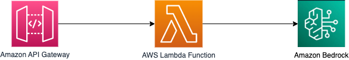

# Amazon API Gateway to AWS Lambda to Amazon Bedrock using AWS SDK for Java and CDK

This sample project deploys an Amazon API Gateway REST API with an AWS Lambda integration. The Lambda function is written in Java, sends the prompt to Anthropic Claude Haiku 5.5 with the Amazon Bedrock [Converse API](https://docs.aws.amazon.com/bedrock/latest/userguide/conversation-inference.html) and returns a response containing the generated content.

Learn more about this pattern at Serverless Land Patterns: https://serverlessland.com/patterns/apigw-lambda-bedrock-java

Important: this application uses various AWS services and there are costs associated with these services after the Free Tier usage - please see the [AWS Pricing page](https://aws.amazon.com/pricing/) for details. You are responsible for any AWS costs incurred. No warranty is implied in this example.

## Requirements

- [Create an AWS account](https://portal.aws.amazon.com/gp/aws/developer/registration/index.html) if you do not already have one and log in. The IAM user that you use must have sufficient permissions to make necessary AWS service calls and manage AWS resources.
- Access to Anthropic Claude Haiku 5.5 in Amazon Bedrock (see [Prerequisite](#prerequisite)).
- [AWS CLI](https://docs.aws.amazon.com/cli/latest/userguide/install-cliv2.html) installed and configured
- [Git](https://git-scm.com/book/en/v2/Getting-Started-Installing-Git)
- [Java](https://aws.amazon.com/corretto/) 
- [Maven 3](https://maven.apache.org/)
- [AWS Cloud Development Kit](https://docs.aws.amazon.com/cdk/latest/guide/cli.html) (AWS CDK)


## Prerequisite
This pattern uses Anthropic Claude Haiku 5.5 (`anthropic.claude-haiku-5-5`) through the `global.anthropic.claude-haiku-5-5` [global cross-Region inference profile](https://docs.aws.amazon.com/bedrock/latest/userguide/global-cross-region-inference.html). Bedrock serves this model on demand only through an inference profile, and a global profile can route requests to any supported Region. The first time you use an Anthropic model in an account, submit the Anthropic use case form from the model catalog in the Amazon Bedrock console. See [Access Amazon Bedrock foundation models](https://docs.aws.amazon.com/bedrock/latest/userguide/model-access.html).

## Deployment Instructions

1. Create a new directory, navigate to that directory in a terminal and clone the GitHub repository:
   ```bash
   git clone https://github.com/aws-samples/serverless-patterns
   ```
2. Change directory to the pattern directory:
   ```bash
   cd apigw-lambda-bedrock/java/cdk/infrastructure
   ```

3. From the command line, configure AWS CDK:
   ```bash
   cdk bootstrap ACCOUNT-NUMBER/REGION # e.g.
   cdk bootstrap 1111111111/us-east-1
   cdk bootstrap --profile test 1111111111/us-east-1
   ```
4. From the command line, use AWS CDK to deploy the AWS resources for the pattern as specified in the `src/main/java/com/example/InfrastructureStack.java` file:
   ```bash
   deploy.sh
   ```

## How it works

This CDK project uses the Amazon Bedrock Converse API with Anthropic Claude Haiku 5.5 to generate content based on a given prompt. This is exposed through a serverless REST API. Please refer to the architecture diagram below:



Here's a breakdown of the steps:

1. **Amazon API Gateway**: Receives the HTTP POST request containing the prompt.

2. **AWS Lambda**: Triggered by the API Gateway, this function sends the prompt to Amazon Bedrock with the Converse API in the AWS SDK for Java. It calls Anthropic Claude Haiku 5.5 through the global inference profile, with a fixed limit of 1,024 output tokens for simplicity.

3. **Amazon Bedrock**: Based on the given prompt, Anthropic Claude Haiku 5.5 generates the content and returns the response to Lambda.

4. **Response**: Lambda processes the Bedrock output and sends it back to the user via the API Gateway.

## Testing

Test the deployed content generation API by providing a prompt. You can use [curl](https://curl.se/) to send a HTTP POST request to the API. Replace `BedrockRestApi` with the API URL in the CDK output, which has a name beginning with `ApiGatewayLambdaBedrockStack.LambdaBedrockAPIEncpoind` :

```bash
curl -d '{"prompt": "Please calculate with step-by-step explanation: 2+2*2"}' -H 'Content-Type: application/json'  <BedrockRestApi>
```

The API returns a response with generated content. Your output may vary:

```
{
	"response": "Following the order of operations, multiplication comes before addition.\n\n1. Multiply: 2 * 2 = 4\n2. Add: 2 + 4 = 6\n\nSo 2 + 2 * 2 = 6."
}
```


## Cleanup

1. To delete the resources deployed to your AWS account via AWS CDK, run the following command:

```bash
cdk destroy
```


---

Copyright 2023 Amazon.com, Inc. or its affiliates. All Rights Reserved.

SPDX-License-Identifier: MIT-0
