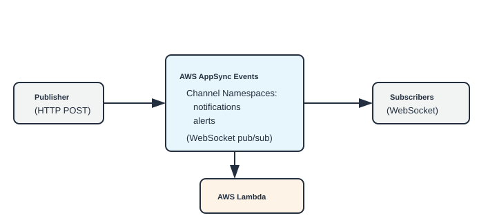

# AWS AppSync Events - In-Flight Event Interception with AWS Lambda

This pattern deploys an AWS AppSync Events API with a **Direct Lambda OnPublish interceptor** - an AWS Lambda function that intercepts, validates, and enriches events in-flight before they reach subscribers. Unlike the existing `appsync-events-bedrock-cdk` and `appsync-events-lambda-agentcore-cdk` patterns (which use Lambda as a *publisher*), this pattern uses Lambda as a real-time event *processor* wired directly into the AppSync channel namespace.

Use cases: payload validation, PII redaction, event enrichment with external data, rate limiting per publisher, and schema enforcement before delivery.

Learn more about this pattern at Serverless Land Patterns: https://serverlessland.com/patterns/appsync-events-lambda-cdk

Important: this application uses various AWS services and there are costs associated with these services after the Free Tier usage - please see the [AWS Pricing page](https://aws.amazon.com/pricing/) for details.

## Requirements

* [AWS CLI](https://docs.aws.amazon.com/cli/latest/userguide/install-cliv2.html) installed and configured
* [Node.js 22+](https://nodejs.org/en/download/) installed
* [AWS CDK v2](https://docs.aws.amazon.com/cdk/v2/guide/getting-started.html) installed

## Architecture



## How it works

1. Publishers send events via HTTP POST to the AWS AppSync Events endpoint.
2. The AWS Lambda function processes and enriches events before delivery.
3. AWS AppSync Events delivers messages to all WebSocket subscribers on that channel.
4. Channel namespaces (`notifications`, `alerts`) organize topics.

## Deployment

1. Clone the repository and navigate to the pattern directory:
   ```bash
   git clone https://github.com/aws-samples/serverless-patterns
   cd serverless-patterns/appsync-events-lambda-cdk
   ```

2. Install dependencies:
   ```bash
   npm install
   ```

3. Bootstrap CDK (one-time per account/region):
   ```bash
   cdk bootstrap
   ```

4. Deploy the stack:
   ```bash
   cdk deploy
   ```

## Testing

Only the `notifications` channel namespace has the OnPublish interceptor. An event published to a `notifications/...` channel runs the AWS Lambda function before delivery. An event published to an `alerts/...` channel is not intercepted: the `alerts` namespace has no handler, and AWS AppSync forwards the events it receives unchanged, so no enrichment appears. This is expected and not a fault.

1. Open a subscriber first. In the AWS AppSync console, open the API named `AppsyncEventsLambdaStack-EventsApi`, choose the **Pub/Sub Editor** tab, choose **Connect** in the **Subscribe** section, enter `/notifications/*` as the channel, and choose **Subscribe**.

2. Publish an event (replace the values from the `cdk deploy` output):
   ```bash
   curl -X POST "https://<HttpEndpoint>/event" \
     -H "x-api-key: <ApiKeyValue>" \
     -H "Content-Type: application/json" \
     -d '{"channel":"notifications/general","events":["{\"message\":\"Hello from CDK\"}"]}'
   ```

3. In the subscriber logs table, the event carries the original `message` plus the fields added by the interceptor: `processedAt` (an ISO 8601 timestamp), `enriched` (`true`) and `messageId` (`msg-...`).

4. Confirm that the function ran by tailing its log group right after the publish (use the `LogGroupName` value from the `cdk deploy` output):
   ```bash
   aws logs tail <LogGroupName> --since 5m
   ```
   The output includes the line `OnPublish interceptor invoked for 1 event(s)`.

5. To compare, publish the same body to `"channel":"alerts/general"` and subscribe to `/alerts/*`. The subscriber receives the event without `processedAt`, `enriched` and `messageId`, and the log group has no new line.

## Cleanup

```bash
cdk destroy
```
