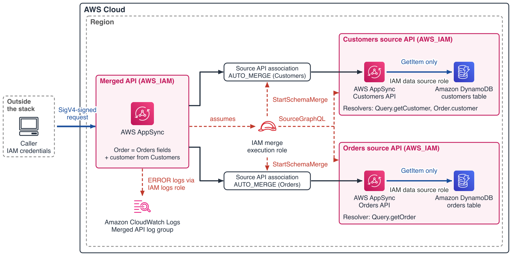

# AWS AppSync Merged API over two source APIs backed by Amazon DynamoDB

This pattern deploys two AWS AppSync source GraphQL APIs, each with its own Amazon DynamoDB table, and one AWS AppSync Merged API that combines their schemas and resolvers into a single endpoint protected by AWS Identity and Access Management (IAM). A single GraphQL document can read from both tables through that endpoint.

Learn more about this pattern at Serverless Land Patterns: https://serverlessland.com/patterns/appsync-merged-api-typescript-cdk

Important: this application uses various AWS services and there are costs associated with these services after the Free Tier usage - please see the [AWS Pricing page](https://aws.amazon.com/pricing/) for details. You are responsible for any AWS costs incurred. No warranty is implied in this example.

## Requirements

* [Create an AWS account](https://portal.aws.amazon.com/gp/aws/developer/registration/index.html) if you do not already have one and log in. The IAM user that you use must have sufficient permissions to make necessary AWS service calls and manage AWS resources.
* [AWS CLI](https://docs.aws.amazon.com/cli/latest/userguide/install-cliv2.html) version 2 installed and configured (the commands below were written against 2.31.3)
* [Node.js 22 or later](https://nodejs.org/en/download/) installed
* [AWS CDK v2](https://docs.aws.amazon.com/cdk/v2/guide/getting_started.html) installed (`npm install -g aws-cdk`), and `cdk bootstrap` run once for the account and Region
* [Git](https://git-scm.com/book/en/v2/Getting-Started-Installing-Git) installed
* [curl](https://curl.se/) 7.75 or later (for `--aws-sigv4`)

## Supported Regions

The stack takes the Region from your AWS CLI configuration. It was deployed and tested in us-west-2 and eu-central-1. The [Merging APIs in AWS AppSync](https://docs.aws.amazon.com/appsync/latest/devguide/merged-api.html) page does not list Regions for Merged APIs, so check that the feature is available before you deploy elsewhere.

## Architecture



Solid arrows carry the request and the associations. Dashed red arrows show the IAM roles that the Merged API assumes and the calls that the merge execution role is allowed to make.

## How it works

1. The Orders API and the Customers API are separate AWS AppSync GraphQL APIs. Each has its own schema (`schema/`), its own table, a data source whose role can only call `dynamodb:GetItem` on that table, and `APPSYNC_JS` resolvers (`resolvers/`).
2. The Customers schema declares `Order.customer` on the `Order` type that the Orders schema owns. The Merged API combines both declarations of `Order` into one type and resolves `customer` with the Customers resolver, using the `customerId` returned by the Orders resolver.
3. `Definition.fromSourceApis` creates the Merged API and one source API association per source API with `AUTO_MERGE`, so AWS AppSync merges again when a source API changes. The stack then waits for the sources to exist before it creates the associations.
4. The merge execution role is the component the design cannot work without: AWS AppSync assumes it to run the source API resolvers for a Merged API request. Its policy, written by the CDK construct, allows `appsync:SourceGraphQL` on each source API (its ARN and the resources below it) and `appsync:StartSchemaMerge` on each association ARN, and nothing else. The policy refers to the associations, so CloudFormation creates it after them. In both test deployments the first automatic merge of both associations ended in `MERGE_SUCCESS` without a manual merge; Testing step 1 shows the status and the command to start a merge by hand.
5. All three APIs use `AWS_IAM`. The [documentation](https://docs.aws.amazon.com/appsync/latest/devguide/merged-api.html) requires the Merged API to offer the primary authorization mode of each source API, so one shared mode keeps the merge valid.

## Important Notes

* The Orders and Customers APIs stay reachable on their own endpoints for IAM principals that are allowed to call them (not exercised in testing). Only IAM principals with `appsync:GraphQL` on an API can query it.
* The AWS AppSync log group for the Merged API (`MergedApiLogGroup` output) is created by a CDK helper function that sets the retention to one week. The stack's request path has no AWS Lambda function.
* For a multi-team CI/CD pipeline around Merged APIs, see [aws-appsync-merged-api-ci-cd-sample](https://github.com/aws-samples/aws-appsync-merged-api-ci-cd-sample). This pattern is a single stack.

## Deployment Instructions

1. Clone the repository:
    ```bash
    git clone https://github.com/aws-samples/serverless-patterns
    cd serverless-patterns/appsync-merged-api/typescript/cdk
    ```

2. Install dependencies:
    ```bash
    npm install
    ```

3. Bootstrap the account and Region once, then deploy:
    ```bash
    npx cdk bootstrap
    npx cdk deploy
    ```

4. Note the stack outputs: `MergedApiUrl`, `MergedApiId`, `OrdersTableName`, `CustomersTableName`, `OrdersApiId`, `CustomersApiId` and `MergedApiLogGroup`.

## Testing

1. Read the outputs again in a new shell and check that both associations merged. Each row prints the association ID, the source API ID, the status, the last merge date and the status detail. Repeat the check until both show `MERGE_SUCCESS` and a merge date:
    ```bash
    STACK=AppsyncMergedApiStack
    out() { aws cloudformation describe-stacks --stack-name "$STACK" --query "Stacks[0].Outputs[?OutputKey=='$1'].OutputValue" --output text; }
    MERGED_API_ID=$(out MergedApiId)
    for ASSOC in $(aws appsync list-source-api-associations --api-id "$MERGED_API_ID" --query 'sourceApiAssociationSummaries[].associationId' --output text); do
      aws appsync get-source-api-association --merged-api-identifier "$MERGED_API_ID" --association-id "$ASSOC" \
        --query 'sourceApiAssociation.[associationId,sourceApiId,sourceApiAssociationStatus,lastSuccessfulMergeDate,sourceApiAssociationStatusDetail]' --output text
    done
    ```
    If a row shows `MERGE_FAILED`, read its status detail, fix the cause, then start a merge by hand. Replace `ASSOCIATION_ID` with the first value of that row:
    ```bash
    aws appsync start-schema-merge --merged-api-identifier "$MERGED_API_ID" --association-id ASSOCIATION_ID
    ```

2. Write one item to each table:
    ```bash
    aws dynamodb put-item --table-name "$(out OrdersTableName)" --item '{"id":{"S":"order-1001"},"customerId":{"S":"customer-42"},"status":{"S":"SHIPPED"},"total":{"N":"129.5"}}'
    aws dynamodb put-item --table-name "$(out CustomersTableName)" --item '{"id":{"S":"customer-42"},"name":{"S":"Ana Silva"},"email":{"S":"ana@example.com"}}'
    ```

3. Send a request without a signature. Expected: `401`:
    ```bash
    URL=$(out MergedApiUrl)
    curl -s -o /dev/null -w '%{http_code}\n' -X POST "$URL" -H 'content-type: application/json' -d '{"query":"{ getOrder(id: \"order-1001\") { id } }"}'
    ```

4. Sign the same kind of request with your current AWS credentials (`--aws-sigv4`) and read from both tables in one GraphQL document. The Region comes from the endpoint URL. If your credentials are not temporary, remove the `x-amz-security-token` header:
    ```bash
    eval "$(aws configure export-credentials --format env)"
    REGION=$(echo "$URL" | cut -d. -f3)
    curl -s -X POST "$URL" --aws-sigv4 "aws:amz:${REGION}:appsync" --user "$AWS_ACCESS_KEY_ID:$AWS_SECRET_ACCESS_KEY" \
      -H "x-amz-security-token: $AWS_SESSION_TOKEN" -H 'content-type: application/json' \
      -d '{"query":"{ getOrder(id: \"order-1001\") { id status total customer { name email } } getCustomer(id: \"customer-42\") { id name } }"}'
    ```
    Expected: `{"data":{"getOrder":{"id":"order-1001","status":"SHIPPED","total":129.5,"customer":{"name":"Ana Silva","email":"ana@example.com"}},"getCustomer":{"id":"customer-42","name":"Ana Silva"}}}`. `getOrder` reads the orders table, its `customer` field reads the customers table, and `getCustomer` reads the customers table directly.

5. To see why a request failed, read the Merged API log group:
    ```bash
    aws logs tail "$(out MergedApiLogGroup)" --since 15m
    ```

## Cleanup

1. Save the log group name, then delete the stack. In the template the associations depend on the source APIs, so CloudFormation deletes the associations first. This permanently deletes both DynamoDB tables and their items:
    ```bash
    STACK=AppsyncMergedApiStack
    LOG_GROUP=$(aws cloudformation describe-stacks --stack-name "$STACK" --query "Stacks[0].Outputs[?OutputKey=='MergedApiLogGroup'].OutputValue" --output text)
    npx cdk destroy
    ```

2. The helper function that sets the log retention does not remove the log groups. Delete the Merged API log group and the helper function's log group:
    ```bash
    aws logs delete-log-group --log-group-name "$LOG_GROUP"
    aws logs describe-log-groups --log-group-name-prefix "/aws/lambda/${STACK}-LogRetention" --query 'logGroups[].logGroupName' --output text
    ```
    Delete each group the second command prints with `aws logs delete-log-group --log-group-name <name>`.

----
Copyright 2026 Amazon.com, Inc. or its affiliates. All Rights Reserved.

SPDX-License-Identifier: MIT-0
