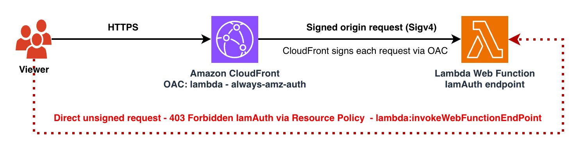

# Amazon CloudFront Origin Access Control for AWS Lambda Web Function

This pattern demonstrates how to secure an **AWS Lambda Web Function** behind Amazon CloudFront using Origin Access Control (OAC). Lambda Web Functions (launched October 2026) let you run a standard Node.js HTTP server — Express, Fastify, Hono, or the built-in `http` module — as a serverless function. This pattern restricts access to the Web Function so it can only be invoked through your CloudFront distribution, using an `IamAuth` endpoint and AWS Signature Version 4 (SigV4): CloudFront signs each origin request on the viewer's behalf, so callers never sign requests themselves.

**Important Note:**
This application leverages multiple AWS services, and there are associated costs beyond the Free Tier usage. Please refer to the [AWS Pricing page](https://aws.amazon.com/pricing/) for specific details. You are accountable for any incurred AWS costs. This example solution does not imply any warranty.

## Architecture

## How Lambda Web Functions differ from Lambda (event) functions

A Lambda Web Function uses a three-part resource model — a **Web Function** (container), one or more immutable **revisions** (code + configuration), and one or more **endpoints** (HTTPS entry points that route traffic to revisions). Your code is a real HTTP server that listens on the host:port Lambda provides (`AWS_LAMBDA_HTTP_ENDPOINT`), rather than an event handler that returns a response object. Web Functions currently support the Node.js runtime, and code is supplied **only** as a `.zip` package in an Amazon S3 bucket.

## Requirements
* [Create an AWS account](https://portal.aws.amazon.com/gp/aws/developer/registration/index.html) if you do not already have one and log in. The IAM user that you use must have sufficient permissions to make necessary AWS service calls and manage AWS resources.
* [AWS CLI](https://docs.aws.amazon.com/cli/latest/userguide/install-cliv2.html) installed and configured
* [Git Installed](https://git-scm.com/book/en/v2/Getting-Started-Installing-Git)
* [AWS Serverless Application Model](https://docs.aws.amazon.com/serverless-application-model/latest/developerguide/serverless-sam-cli-install.html) (AWS SAM) installed
* `zip` on your PATH (used to package `src/` into the deployment archive)
* Permissions for the deploying identity to create the IAM execution role (`iam:PassRole`).
* (Manual path only) An Amazon S3 bucket with **versioning enabled (required by Lambda)** to hold the Web Function `.zip` deployment package. The Quick start `deploy.sh` creates a versioning-enabled bucket for you if you don't pass one.

## Deployment Instructions
Create a new directory, navigate to that directory in a terminal and clone the GitHub repository:

    git clone https://github.com/aws-samples/serverless-patterns

Change directory to the solution directory:

    cd serverless-patterns/cloudfront-lambdawebfunction-oac-sam

### Quick start (recommended)

From the solution directory, run the deploy script. It resolves your region, creates the code
S3 bucket if needed, packages `src/` and uploads it, then runs `sam build` and `sam deploy`:

    ./deploy.sh

Optional flags: `./deploy.sh --stack-name NAME --bucket BUCKET --key KEY --region REGION`.
Set your AWS credentials and a Region where Lambda Web Functions is available first — the script fails fast if no region is resolvable.

Re-run `./deploy.sh` any time to ship new code — each run uploads a fresh `.zip` and creates
a new immutable revision.

### Manual steps

Prefer to run the steps yourself (package → upload to S3 → `sam build` → `sam deploy --guided`)?
See [DEPLOYMENT.md](DEPLOYMENT.md) for the exact copy-paste commands, including the
non-interactive deploy, versioning, testing, and cleanup. The deploy script above automates
exactly those steps.

**Note:** `sam deploy` does not upload your Web Function code — you must zip and upload `src/` to `s3://<CodeBucket>/<CodeKey>` first (DEPLOYMENT.md Step 1), or the stack fails with *"The specified S3 object does not exist"*.

## How it works

The SAM template creates a Lambda Web Function, an initial revision whose code is read from your S3 `.zip` package, and an `IamAuth` endpoint that routes 100% of traffic to that revision. A CloudFront distribution is configured with the endpoint's domain as a custom origin, and an Origin Access Control (OAC) of origin type `lambda` with signing behavior `always-amz-auth` is attached to the origin. With this signing behavior, CloudFront signs every origin request with SigV4, and the `IamAuth` endpoint authorizes it — so the Web Function endpoint cannot be invoked directly on its own domain, only through CloudFront. A resource-based permission grants the CloudFront service principal `lambda:InvokeWebFunctionEndpoint`, scoped to this distribution. Caching is disabled by default since Web Function responses are dynamic.

## Testing

**Access the Web Function endpoint directly**
- Copy the Web Function endpoint domain value from the SAM deployment output key **'WebFunctionEndpointDomain'**
- Try accessing `https://<that-domain>/` using a web browser
- The request is **denied** because the endpoint uses `IamAuth` and the request is unsigned.

**Access the Web Function through the CloudFront Distribution domain name**
- Copy the CloudFront Distribution Domain Name value from the SAM deployment output key **'CloudFrontDomainName'**
- Try accessing the CloudFront domain name in a web browser.
- You should see a page with a success message starting with **"Hello from AWS !!! ..."**

## Observing multi-concurrency

A single warm Web Function execution environment serves **multiple concurrent requests** — the key difference from a classic event function, which handles one request per environment. The sample server tracks how many requests this environment is handling at once and returns that count in the response.

The revision's `ServiceConfig.MaxConcurrencyPerEnvironment` (set to `64` in `template.yaml`, range 1–128) caps how many requests one environment handles simultaneously. The sample also reads two environment variables set via `ServiceConfig.EnvironmentVariables` (`APP_NAME`, `LOG_LEVEL`).

To see concurrency climb above 1, send a short burst of parallel requests at the CloudFront domain and watch the reported count rise:

    # Using hey (https://github.com/rakyll/hey)
    hey -n 200 -c 20 https://<CloudFrontDomainName>/

    # ...or a quick parallel curl burst
    for i in $(seq 1 20); do curl -s https://<CloudFrontDomainName>/ & done; wait

Set `LOG_LEVEL` to `debug` (in the template's `EnvironmentVariables`) to also log the in-flight count per request to CloudWatch Logs.

## Deploying new code (new revisions)

Revisions are immutable. To ship new code, upload a new `.zip` to S3 and deploy again — because the revision is a create-only resource, changing the code location or configuration creates a new revision. Pin `CodeVersionId` to the new S3 object version so each revision references an immutable object version.

## Production hardening

This pattern is a working baseline. The security-critical pieces (`IamAuth` + OAC, a scoped code-bucket policy, a scoped CloudFront invoke policy) are built in. It also sets conservative endpoint throttling/scaling caps by default (see below). The following are still left to the adopter because the right value is workload-specific — set them when you take this to production:

- **Endpoint throttling and scaling caps (`ThrottleConfig.RateLimit`, `ScalingConfig.MaxEnvironments`).** By default an endpoint is bounded only by your account's regional quotas, which are shared across every endpoint in the account. A traffic spike or a runaway client can therefore consume account-wide capacity before anything throttles at this endpoint. This template sets `RateLimit: 100` (requests/sec) and `MaxEnvironments: 10` on `MyWebFunctionEndpoint` as a conservative starting point — combined with `MaxConcurrencyPerEnvironment: 64`, that caps the endpoint at 640 concurrent in-flight requests. Tune both from your actual expected peak RPS and concurrency; `RateLimit` only accepts 0, 100–1000 in steps of 100, or 2000–10000 in steps of 1000.
- **CloudWatch Logs retention.** Lambda auto-creates the Web Function's log group(s) with **no expiration**. For cost and governance, set an explicit retention (e.g. 30 or 90 days). You can manage this with an `AWS::Logs::LogGroup` resource once you confirm the exact log-group name(s) the runtime creates for your function.
- **Graceful shutdown (`SIGTERM`).** This stateless sample has nothing to flush on shutdown, so it registers no `SIGTERM` handler. A real application should handle `SIGTERM` to drain in-flight requests and close connections (databases, caches) cleanly before the execution environment is removed.
- **Dedicate the code bucket.** The stack attaches an `AWS::S3::BucketPolicy` to `CodeBucket`, which **replaces the entire bucket policy**. The bucket lives outside the stack, so pointing `--bucket` at an existing shared bucket overwrites its policy (and removes it on `sam delete`). Use a bucket dedicated to this pattern, or let the Quick start `deploy.sh` create one.
- **Customer-managed KMS key.** The revision encrypts code and environment variables with an AWS-owned key by default. Compliance-driven workloads can supply a customer-managed key via the revision's `KmsKeyArn`.

These are intentionally *not* baked into the baseline so the pattern stays generic; add the ones your workload needs.

## Cleanup

**Delete the stack**

    sam delete

**Confirm the stack has been deleted**

    aws cloudformation list-stacks --query "StackSummaries[?contains(StackName,'STACK_NAME')].StackStatus"

Delete the `app.zip` object(s) from your S3 bucket separately if you no longer need them.

----
Copyright 2026 Amazon.com, Inc. or its affiliates. All Rights Reserved.

SPDX-License-Identifier: MIT-0
