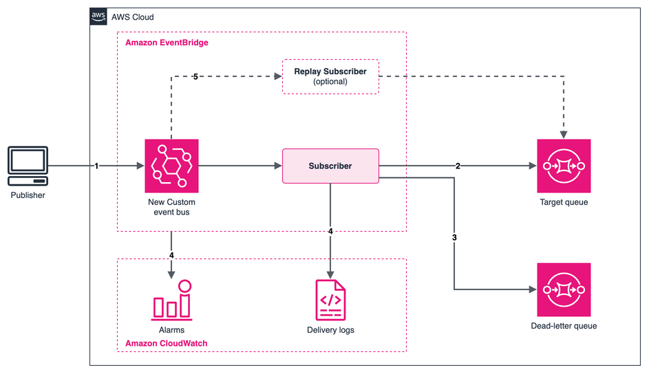

# Amazon EventBridge new Custom event bus to Amazon SQS with observability

This pattern deploys an Amazon EventBridge new Custom event bus with one Subscriber that delivers matching events to an Amazon SQS queue, with a second queue as the dead-letter destination. It also sets up the telemetry you need to follow one event from the publish call to the target: Subscriber delivery logs in Amazon CloudWatch Logs and five Amazon CloudWatch alarms. You can then break delivery on purpose, see how the metrics, logs and alarms report it, and recover the failed events by replaying them from the bus.

Important: this application uses various AWS services and there are costs associated with these services after the Free Tier usage - please see the [AWS Pricing page](https://aws.amazon.com/pricing/) for details. You are responsible for any AWS costs incurred. No warranty is implied in this example.

## Requirements

* [Create an AWS account](https://portal.aws.amazon.com/gp/aws/developer/registration/index.html) if you do not already have one and log in. The IAM user that you use must have sufficient permissions to make necessary AWS service calls and manage AWS resources.
* [AWS CLI](https://docs.aws.amazon.com/cli/latest/userguide/install-cliv2.html) version 2 installed and configured. The version must include the `eventsv2` commands. This pattern was tested with 2.38.1.
* [Git Installed](https://git-scm.com/book/en/v2/Getting-Started-Installing-Git)
* [AWS Serverless Application Model](https://docs.aws.amazon.com/serverless-application-model/latest/developerguide/serverless-sam-cli-install.html) (AWS SAM) installed
* A Region where the new Custom event bus is available. This pattern was tested in `us-east-1`.

## Deployment Instructions

1. Create a new directory, navigate to that directory in a terminal and clone the GitHub repository:
    ```
    git clone https://github.com/aws-samples/serverless-patterns
    ```
1. Change directory to the pattern directory:
    ```
    cd serverless-patterns/eventbridge-custom-bus-sqs-observability/sam
    ```
1. From the command line, use AWS SAM to deploy the AWS resources for the pattern as specified in the template.yaml file:
    ```
    sam deploy --guided
    ```
1. During the prompts:
    * Enter a stack name. The names of the bus and the Subscriber are built from it, so keep it short.
    * Enter the desired AWS Region.
    * Keep the defaults for `LogLevel` (`INFO`), `IncludePayload` (`ON_ERROR_ONLY`) and `GrantTargetAccess` (`true`).
    * Allow SAM CLI to create IAM roles with the required permissions.

    Once you have run `sam deploy --guided` mode once and saved arguments to a configuration file (samconfig.toml), you can use `sam deploy` in future to use these defaults.

1. Note the outputs from the SAM deployment process. These contain the resource names and ARNs which are used for testing.

## How it works



1. **Publish.** A publisher calls `put-events`. The new Custom event bus stores each event for one day, which is also the replay window.
1. **Deliver.** The Subscriber matches events that have `detail.orderId`, assumes the delivery role, and sends them to the target queue.
1. **Handle failures.** If the first attempt and both retries fail, the Subscriber writes a failure record to the dead-letter queue. The record holds the event ID, error code and retry count, not the event itself.
1. **Observe.** The Subscriber writes a delivery record for every attempt to CloudWatch Logs. EventBridge publishes metrics in the `AWS/EventsV2` namespace, and five alarms watch publish failures, throttling, failed attempts, dead-lettered events, and failed dead-letter writes.
1. **Recover.** To get a failed event back, create a replay Subscriber that reads from the bus at a point in time and filters on the event ID. The Testing section walks through it.

### Good to know

* Logging needs two settings: the Subscriber's log configuration and a CloudWatch Logs delivery. The template sets both.
* `LogLevel=INFO` also records successful deliveries. With `ERROR` you only see failures, so you cannot tell a delivered event from a dead-lettered one in the logs alone.
* Each delivery attempt writes its own record, so an event that fails all three attempts produces three error records.
* `IncludePayload=FULL` copies every event body into the log group. Use it only while you debug.
* The filter uses the `DATA` scope. `PutEvents` nests your data under `detail`, so it matches. `PutRawEvents` keeps fields at the top level, so those events do not match.
* Both queues use SSE-SQS encryption, and the delivery role can only be assumed by Subscribers in your account and Region.
* For production, consider an AWS KMS key for the bus, queues and log group, alarm actions, and longer retry and retention values. The template comments show where each change goes.

## Testing

1. Store the stack outputs in variables. Replace `STACK_NAME` with the name you chose:
    ```bash
    STACK_NAME=STACK_NAME
    get_output() { aws cloudformation describe-stacks --stack-name "$STACK_NAME" \
      --query "Stacks[0].Outputs[?OutputKey=='$1'].OutputValue" --output text; }
    EVENT_BUS_ARN=$(get_output EventBusArn)
    SUBSCRIBER_ARN=$(get_output SubscriberArn)
    TARGET_QUEUE_URL=$(get_output TargetQueueUrl)
    DLQ_URL=$(get_output DeadLetterQueueUrl)
    LOG_GROUP=$(get_output SubscriberLogGroupName)
    ```
    Wait about a minute after the deployment before you publish, so that the log delivery is active.

1. Publish an event and note the event ID in the response:
    ```bash
    EVENT_ID=$(aws eventsv2 put-events --event-bus-arn "$EVENT_BUS_ARN" --entries \
      '[{"Source":"com.example.orders","DetailType":"OrderPlaced","Detail":"{\"orderId\":\"1001\",\"total\":42.5}"}]' \
      --query 'Entries[0].EventId' --output text)
    echo "$EVENT_ID"
    ```

1. Read the event from the target queue. The data you published is under `detail`:
    ```bash
    aws sqs receive-message --queue-url "$TARGET_QUEUE_URL" --wait-time-seconds 5 \
      --query 'Messages[0].Body' --output text
    ```

1. Read the delivery records for that event. They can take a minute or two to arrive:
    ```bash
    aws logs filter-log-events --log-group-name "$LOG_GROUP" \
      --filter-pattern "\"$EVENT_ID\"" --query 'events[].message'
    ```
    You should see a `SUBSCRIBER_MATCHED` record and an `EVENT_DELIVERY_ATTEMPT` record with `outcome` set to `SUCCESS` and `terminal_kind` set to `EVENTS_DELIVERED`.

1. Break delivery on purpose. Update the stack so that the delivery role loses its permission on the target queue. Parameters that you do not pass return to their defaults:
    ```bash
    sam deploy --stack-name "$STACK_NAME" --capabilities CAPABILITY_IAM --resolve-s3 \
      --parameter-overrides GrantTargetAccess=false
    ```
    IAM changes take a short time to apply. Wait two minutes, then record the time and publish:
    ```bash
    sleep 120
    REPLAY_START=$(date +%s)
    FAILED_ID=$(aws eventsv2 put-events --event-bus-arn "$EVENT_BUS_ARN" --entries \
      '[{"Source":"com.example.orders","DetailType":"OrderPlaced","Detail":"{\"orderId\":\"1002\",\"total\":10}"}]' \
      --query 'Entries[0].EventId' --output text)
    ```
    The publish still returns `PUBLISHED`, because the bus accepted the event. The failure happens at delivery.

1. After about two minutes, look at what the logs, the dead-letter queue and the alarms recorded:
    * The delivery records for `$FAILED_ID` show three `EVENT_DELIVERY_ATTEMPT` records at `ERROR` with `ACCESS_DENIED` (the first attempt plus two retries), then an `ON_FAILURE_DESTINATION_DELIVERY_ATTEMPT` record with `terminal_kind` set to `ON_FAILURE_DESTINATION_DELIVERED`:
        ```bash
        aws logs filter-log-events --log-group-name "$LOG_GROUP" \
          --filter-pattern "\"$FAILED_ID\"" --query 'events[].message'
        ```
    * The dead-letter queue holds a record that names the event in `failedMessages[].eventId`. A single call can return fewer messages than the queue holds, so call it more than once:
        ```bash
        aws sqs receive-message --queue-url "$DLQ_URL" --max-number-of-messages 10 \
          --wait-time-seconds 5 --message-attribute-names All --query 'Messages[].Body'
        ```
    * Within a few minutes, the alarms `DeadLetteredAlarm` and `DeliveryAttemptsFailingAlarm` go to `ALARM`. They use five-minute periods:
        ```bash
        aws cloudwatch describe-alarms --alarm-name-prefix "$STACK_NAME" \
          --query 'MetricAlarms[].[AlarmName,StateValue]' --output text
        ```
    * To graph the metrics, open **CloudWatch**, **All metrics**, then **AWS/EventsV2**. To look up the exact dimension values, use `aws cloudwatch list-metrics --namespace AWS/EventsV2`, or derive them:
        ```bash
        BUS_DIM=${EVENT_BUS_ARN#*:event-busv2/}
        SUBSCRIBER_DIM=${SUBSCRIBER_ARN#*:subscriber/}
        ```

1. Recover the failed event. First restore the permission and wait two minutes:
    ```bash
    sam deploy --stack-name "$STACK_NAME" --capabilities CAPABILITY_IAM --resolve-s3 \
      --parameter-overrides GrantTargetAccess=true
    sleep 120
    ```
    Then create a Subscriber that replays only that event. It reads from the bus, starting at `REPLAY_START` and ending now, and filters on the event ID. The filter goes in a file because it is JSON inside JSON:
    ```bash
    cat > replay-filter.json <<EOF
    {"Filters":[{"Scope":"SYSTEM_METADATA","Pattern":"{\"aws:EventId\":[\"$FAILED_ID\"]}"}]}
    EOF
    REPLAY_ARN=$(aws eventsv2 create-subscriber --name "$STACK_NAME-replay" \
      --event-bus-arn "$EVENT_BUS_ARN" \
      --invoke-configuration "{\"TargetArn\":\"$(get_output TargetQueueArn)\",\"RoleArn\":\"$(get_output DeliveryRoleArn)\"}" \
      --filter-configuration file://replay-filter.json \
      --starting-position POINT_IN_TIME \
      --point-in-time-configuration "PointType=TIMESTAMP,StartingPoint=$REPLAY_START,EndPoint=$(date +%s)" \
      --on-failure-configuration "Arn=$(get_output DeadLetterQueueArn)" \
      --query SubscriberArn --output text)
    ```
    After a minute, the event is in the target queue. To replay more than one event, add more IDs to the `aws:EventId` list.

    Two limits apply to a replay. You can replay only events that are still within the bus retention window, which is one day in this template, so recover failed events before they expire or raise the retention. A replay also delivers the event again, so a target that is not idempotent can process it twice. Make the consumer idempotent before you rely on replay in production. The delivered message's `id` field is not the event ID from `put-events`, but it stays the same when the event is replayed, so it works as a deduplication key.

## Cleanup

1. Delete the replay Subscriber if you created one. The stack cannot delete the bus while a Subscriber that it did not create still exists, and the stack deletion fails with `DELETE_FAILED`:
    ```bash
    aws eventsv2 delete-subscriber --subscriber-arn "$REPLAY_ARN"
    ```
1. Delete the stack. SAM CLI asks you to confirm, so answer `y` to the prompts:
    ```bash
    sam delete --stack-name "$STACK_NAME"
    ```
----
Copyright 2026 Amazon.com, Inc. or its affiliates. All Rights Reserved.

SPDX-License-Identifier: MIT-0
