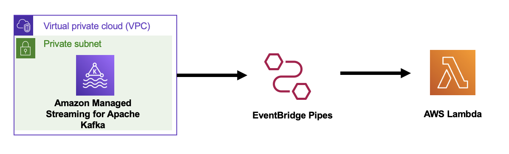

# EventBridge Pipes with Amazon MSK as source and Lambda function as target

This pattern shows how to use EventBridge Pipes with data coming in from Amazon MSK and process these messages using Lambda function.



Important: This application uses various AWS services and there are costs associated with these services after the Free Tier usage - please see the [AWS Pricing page](https://aws.amazon.com/pricing/) for details. You are responsible for any AWS costs incurred. No warranty is implied in this example.

## Requirements

* [Create an AWS account](https://portal.aws.amazon.com/gp/aws/developer/registration/index.html) if you do not already have one and log in. The IAM user that you use must have sufficient permissions to make necessary AWS service calls and manage AWS resources.
* [AWS CLI](https://docs.aws.amazon.com/cli/latest/userguide/install-cliv2.html) installed and configured
* [Git Installed](https://git-scm.com/book/en/v2/Getting-Started-Installing-Git)
* [AWS Serverless Application Model](https://docs.aws.amazon.com/serverless-application-model/latest/developerguide/serverless-sam-cli-install.html) (AWS SAM) installed

## Deployment Instructions

1. Create a new directory, navigate to that directory in a terminal and clone the GitHub repository:
    ``` 
    git clone https://github.com/aws-samples/serverless-patterns
    ```
1. Change directory to the pattern directory:
    ```
    cd eventbridge-pipes-msk-to-lambda
    ```
1. From the command line, use AWS SAM to deploy the AWS resources for the pattern as specified in the template.yml file:
    ```
    sam deploy --guided
    ```
1. During the prompts:
    * Enter a stack name
    * Enter the desired AWS Region
    * Enter MSK Kafka Version, defaults to **4.1.x.kraft**
    * Select MSK Cluster Instance Type, defaults to **kafka.m5.large**
    * Enter MSK Topic name
    * Allow SAM CLI to create IAM roles with the required permissions.

    Once you have run `sam deploy --guided` mode once and saved arguments to a configuration file (samconfig.toml), you can use `sam deploy` in future to use these defaults.

2. Note the outputs from the SAM deployment process. These contain the resource names and/or ARNs which are used for testing.

## How it works

Amazon MSK as an source operates similarly to using Amazon Simple Queue Service (Amazon SQS) or Amazon Kinesis. EventBridge internally polls for new messages from the source and then invokes the target. EventBridge reads the messages in batches and provides these to your function as an event payload. The maximum batch size is configurable. (The default is 100 messages). EventBridge reads the messages sequentially for each partition. After EventBridge processes each batch, it commits the offsets of the messages in that batch. If the pipe's target returns an error for any of the messages in a batch, EventBridge retries the entire batch of messages until processing succeeds or the messages expire.

The cluster doesn't use client authentication, and accepts both plaintext (port 9092) and TLS (port 9094) connections from the client security group and from itself. The brokers are in private subnets. For IAM authentication, see the [eventbridge-pipes-msk-iam-auth-to-lambda](../eventbridge-pipes-msk-iam-auth-to-lambda) pattern.

## Testing

To test sending messages into the Amazon MSK cluster, launch an Amazon Linux 2023 EC2 instance in one of the private subnets, with the `KafkaClientInstanceSecurityGroupID` security group from the `MSKCluster` nested stack outputs and an instance profile that has the `AmazonSSMManagedInstanceCore` managed policy. The VPC's NAT gateway lets the SSM agent reach Systems Manager, so the instance needs no public IP address or SSH. Connect to it with Session Manager, from the EC2 console (**Connect** > **Session Manager**) or with `aws ssm start-session --target <instance-id>`, then run `sudo su - ec2-user`. Install Java 17 or later (`sudo dnf install -y java-21-amazon-corretto-headless`) and the [Apache Kafka 4.1.2 client](https://archive.apache.org/dist/kafka/4.1.2/kafka_2.13-4.1.2.tgz), and use `--bootstrap-server` with the plaintext or TLS bootstrap brokers. Follow the [Step 3](https://docs.aws.amazon.com/msk/latest/developerguide/create-client-machine.html), [Step 4](https://docs.aws.amazon.com/msk/latest/developerguide/create-topic.html) and [Step 5](https://docs.aws.amazon.com/msk/latest/developerguide/produce-consume.html) to setup the client instance, MSK topic and publish messages. 

## Cleanup
 
1. Delete the stack
    ```bash
    sam delete
    ```
----
Copyright 2023 Amazon.com, Inc. or its affiliates. All Rights Reserved.

SPDX-License-Identifier: MIT-0