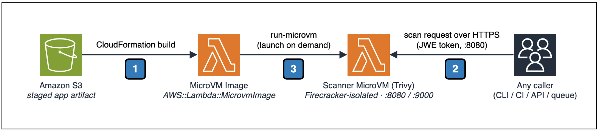

# Vulnerability and Security Scanning Tool on AWS Lambda MicroVMs

This pattern builds an AWS Lambda MicroVM image that runs a vulnerability and security scanner ([Trivy](https://trivy.dev/)) inside a Firecracker-isolated, single-tenant sandbox. Vulnerability scanners routinely process untrusted input, such as third-party container images, dependency trees, or user-supplied source code, so running them in a strongly isolated, disposable environment is a security best practice. AWS Lambda MicroVMs give each scan its own virtual-machine-level isolation boundary while retaining serverless simplicity, so a compromised or malicious artifact cannot affect other tenants or the host.

The pattern is a reusable building block, not a wired-up pipeline. CloudFormation provisions the scanner MicroVM image, the IAM build and execution roles, and a log group. Launching a MicroVM and submitting an artifact is a runtime operation, so you can plug the scanner into any trigger: an S3 event, an API, a CI/CD stage, or a queue consumer. The recommended usage is one fresh, single-tenant MicroVM per untrusted artifact, terminated after the scan.

Learn more about this pattern at Serverless Land Patterns: https://serverlessland.com/patterns/lambda-microvms-vuln-scanner

Important: this application uses various AWS services and there are costs associated with these services after the Free Tier usage - please see the [AWS Pricing page](https://aws.amazon.com/pricing/) for details. You are responsible for any AWS costs incurred. No warranty is implied in this example.

## Requirements

* [Create an AWS account](https://portal.aws.amazon.com/gp/aws/developer/registration/index.html) if you do not already have one and log in. The IAM user you use must have permission to create IAM roles, an S3 bucket, a CloudWatch log group, and Lambda MicroVM images.
* [AWS CLI v2](https://docs.aws.amazon.com/cli/latest/userguide/getting-started-install.html) installed and configured, with the `lambda-microvms` subcommand available. Lambda MicroVMs is a recent capability, so use a current CLI version.
* [Git](https://git-scm.com/book/en/v2/Getting-Started-Installing-Git) installed and configured.
* `zip`, `jq`, and `curl` available on your PATH.

Note: no Docker or SAM CLI is required. The Lambda MicroVMs build service runs your Dockerfile server-side from the uploaded artifact; you only need to zip and upload it.

## Compliance considerations

This pattern scans untrusted artifacts (third-party container images, dependency trees, or user-supplied source code). Those artifacts may contain personal data, protected health information (PHI), cardholder data (PCI), or other data subject to regulations such as GDPR, HIPAA, or PCI DSS. Under the [AWS Shared Responsibility Model](https://aws.amazon.com/compliance/shared-responsibility-model/), you are responsible for the data you submit to the scanner and for configuring the controls your compliance regime requires. Before using this pattern with regulated data, review your obligations and the relevant AWS compliance resources (for example, [AWS HIPAA Eligible Services](https://aws.amazon.com/compliance/hipaa-eligibility/) and the [AWS PCI DSS compliance page](https://aws.amazon.com/compliance/pci-dss-level-1-faqs/)), and apply the additional controls (encryption, access logging, data residency, retention) they call for. This sample is non-production example content and does not by itself make a workload compliant.

## How it works



The MicroVM image is a Firecracker snapshot built from a Dockerfile that packages the scanner application, with the Trivy binary baked in. CloudFormation creates the image with the native `AWS::Lambda::MicrovmImage` resource. From that image, a caller launches MicroVMs at runtime, each a single-tenant, VM-isolated sandbox with its own dedicated HTTPS endpoint.

The numbered callouts in the diagram correspond to the following steps:

1. **CloudFormation build (once, at deploy time).** `deploy.sh` zips the MicroVM app (Dockerfile, scanner, lifecycle hooks, and the Trivy binary) and uploads it to an Amazon S3 staging bucket. CloudFormation's `AWS::Lambda::MicrovmImage` resource reads that artifact from S3, runs the Dockerfile server-side, starts the application, and captures a Firecracker snapshot. The build calls the `ready` lifecycle hook (port 9000) to confirm the app initialized; the image reaches `CREATED` only after that hook returns HTTP 200. S3 is used only for this build-time handoff; it is not part of the scan path.

2. **Launch MicroVM (`run-microvm`, per artifact).** A caller runs a fresh, single-tenant MicroVM from the image. Lambda provisions it from the snapshot (near-instant startup, no boot or dependency-load delay) and returns a `microvmId` and an HTTPS `endpoint`. At runtime Lambda invokes the `run`, `resume`, `suspend`, and `terminate` hooks on port 9000; the MicroVM receives external traffic only after `run` returns HTTP 200. Because each untrusted artifact gets its own MicroVM, a malicious input cannot affect any other scan or the host.

3. **Scan request (HTTPS + JWE token, port 8080).** The caller sends the artifact to the MicroVM's dedicated HTTPS endpoint, presenting a short-lived JWE token in the `X-aws-proxy-auth` header (from `create-microvm-auth-token`). The scanner writes the artifact to a fresh directory and runs `trivy filesystem` against it, then returns a Trivy JSON report. Ingress reaches the scanner over the AWS-managed `HTTP_INGRESS` connector; Trivy pulls its vulnerability database over the `INTERNET_EGRESS` connector configured on the image. When the scan is done, the caller terminates the MicroVM.

Behind the scenes, the MicroVMs service assumes two IAM roles the stack provisions: a **build role** at image-build time (read the S3 artifact, write build logs) and an **execution role** at MicroVM runtime (write runtime logs to CloudWatch). The scanner needs no AWS API access of its own.

## Deployment Instructions

1. Clone the repository and change into the pattern directory:
    ```bash
    git clone https://github.com/aws-samples/serverless-patterns
    cd serverless-patterns/lambda-microvms-vuln-scanner
    ```
2. Run the deploy script. It ensures a staging S3 bucket, fetches the Trivy ARM64 binary into the app build context, zips and uploads the app, and deploys the CloudFormation stack (IAM build and execution roles, a log group, and the MicroVM image). The `AWS::Lambda::MicrovmImage` resource builds asynchronously; the deploy blocks until the image is active, which can take a few minutes.
    ```bash
    chmod +x scripts/deploy.sh
    ./scripts/deploy.sh vuln-scanner us-east-1
    ```
    Both arguments are optional. The stack name defaults to `vuln-scanner` and the region defaults to your configured CLI region. Override the Trivy version with `TRIVY_VERSION=0.74.0 ./scripts/deploy.sh ...` if needed.
3. On success the script prints the stack outputs and the `export` commands you need for testing.

### What gets created

| Resource | Purpose |
|---|---|
| `AWS::Lambda::MicrovmImage` | The scanner image (Trivy baked in), built from the S3 artifact. |
| IAM build role | Assumed by the MicroVMs service during image build: read the S3 artifact, write build logs. |
| IAM execution role | Assumed by a running MicroVM: write runtime logs. |
| CloudWatch log group | `/aws/lambda-microvms/<stack-label>` for build and runtime logs. |
| KMS key | Customer-managed key that encrypts the log group at rest (key rotation enabled). |
| S3 staging bucket | `<stack-name>-staging-<account-id>`, holds the uploaded app artifact. Created by `deploy.sh`, not by the stack. |

## Testing

Launching a MicroVM from the image and submitting an artifact is a runtime operation. Export the deploy outputs first (the deploy script prints these):

```bash
export REGION="us-east-1"
export STACK_NAME="vuln-scanner"
export IMAGE_ARN=$(aws cloudformation describe-stacks --stack-name $STACK_NAME --region $REGION \
  --query 'Stacks[0].Outputs[?OutputKey==`MicroVMImageArn`].OutputValue' --output text)
export EXECUTION_ROLE_ARN=$(aws cloudformation describe-stacks --stack-name $STACK_NAME --region $REGION \
  --query 'Stacks[0].Outputs[?OutputKey==`MicroVMExecutionRoleArn`].OutputValue' --output text)
```

1. Launch a fresh, single-tenant MicroVM from the scanner image:
    ```bash
    RESPONSE=$(aws lambda-microvms run-microvm \
      --image-identifier "$IMAGE_ARN" \
      --execution-role-arn "$EXECUTION_ROLE_ARN" \
      --idle-policy '{"maxIdleDurationSeconds":300,"suspendedDurationSeconds":300,"autoResumeEnabled":true}' \
      --ingress-network-connectors "arn:aws:lambda:${REGION}:aws:network-connector:aws-network-connector:HTTP_INGRESS" \
      --egress-network-connectors "arn:aws:lambda:${REGION}:aws:network-connector:aws-network-connector:INTERNET_EGRESS" \
      --maximum-duration-in-seconds 900 \
      --region "$REGION")
    MICROVM_ID=$(echo "$RESPONSE" | jq -r '.microvmId')
    ENDPOINT=$(echo "$RESPONSE" | jq -r '.endpoint')
    echo "MicroVM ID: $MICROVM_ID"
    echo "Endpoint:   $ENDPOINT"
    ```
2. Wait for the MicroVM to reach `RUNNING`, then get an auth token (all MicroVM endpoints require a JWE token in the `X-aws-proxy-auth` header):
    ```bash
    aws lambda-microvms get-microvm --microvm-identifier "$MICROVM_ID" --region "$REGION" --query state --output text

    TOKEN=$(aws lambda-microvms create-microvm-auth-token \
      --microvm-identifier "$MICROVM_ID" \
      --expiration-in-minutes 30 \
      --allowed-ports '[{"port":8080}]' \
      --region "$REGION" \
      --query 'authToken."X-aws-proxy-auth"' --output text)
    ```
3. Check scanner health, then submit an artifact to scan:
    ```bash
    curl "https://$ENDPOINT/health" -H "X-aws-proxy-auth: $TOKEN"

    # Scan a file by streaming its raw bytes (one fresh MicroVM per untrusted artifact):
    curl -X POST "https://$ENDPOINT/scan" \
      -H "Content-Type: application/octet-stream" \
      -H "X-aws-proxy-auth: $TOKEN" \
      -H "X-Artifact-Filename: requirements.txt" \
      --data-binary @./requirements.txt

    # Or scan a path that already exists inside the MicroVM (self-scan demo):
    curl -X POST "https://$ENDPOINT/scan" \
      -H "Content-Type: application/json" \
      -H "X-aws-proxy-auth: $TOKEN" \
      -d '{"target": "/app"}'
    ```
    `/health` returns `{"status": "ok"}`. `/scan` returns a Trivy JSON report. The first scan is slower because Trivy downloads its vulnerability database over the egress connector; subsequent scans in the same MicroVM reuse it.
4. Terminate the MicroVM when the scan is done (recommended: one MicroVM per artifact):
    ```bash
    aws lambda-microvms terminate-microvm --microvm-identifier "$MICROVM_ID" --region "$REGION"
    ```

### Scanner API

The guest application (`src/microvm-app/app.py`) exposes a deliberately simple HTTP contract on port 8080 so any caller can reuse it:

| Method & path | Request | Response |
|---|---|---|
| `GET /health` | none | `{"status": "ok"}` |
| `POST /scan` (raw bytes) | `Content-Type: application/octet-stream`, body is the artifact; optional `X-Artifact-Filename` header | Trivy JSON report of the uploaded artifact |
| `POST /scan` (path) | `Content-Type: application/json`, body `{"target": "/path"}` | Trivy JSON report of a path already inside the MicroVM |

## Plugging the scanner into a trigger

The pattern deliberately does not wire up a trigger. To automate scanning, call the launch → scan → terminate sequence above from wherever your artifacts arrive. For example, an S3 `ObjectCreated` Lambda can download the uploaded object, run a MicroVM, POST the bytes to `/scan`, store the report, and terminate the MicroVM, giving one isolated MicroVM per uploaded artifact. The same sequence works from an API handler, a CI/CD stage, or a queue consumer. Keep the per-artifact-MicroVM model so untrusted inputs are never processed in a shared environment.

## Project Structure

```
├── README.md                    # This file
├── template.yaml                # CloudFormation template (MicroVM image + IAM roles + log group)
├── example-pattern.json         # Serverless Land pattern metadata
├── images/
│   ├── architecture.drawio      # Architecture diagram (source)
│   └── architecture.png         # Architecture diagram (exported)
├── scripts/
│   └── deploy.sh                # Stages the app to S3 and deploys the stack
└── src/
    └── microvm-app/             # MicroVM guest application
        ├── Dockerfile           # Container image definition (built server-side by Lambda MicroVMs)
        ├── app.py               # Scanner service (port 8080)
        ├── hooks.py             # Lifecycle hook listener (port 9000)
        └── start.sh             # Entry point
```

## Cleanup

```bash
REGION="us-east-1"
STACK_NAME="vuln-scanner"

# 1. Terminate any running MicroVMs launched from the image
aws lambda-microvms list-microvms --region $REGION \
  --query "microvms[?imageArn=='$(aws cloudformation describe-stacks --stack-name $STACK_NAME --region $REGION --query 'Stacks[0].Outputs[?OutputKey==`MicroVMImageArn`].OutputValue' --output text)'].microvmId" --output text \
  | tr '\t' '\n' | while read id; do [ -n "$id" ] && aws lambda-microvms terminate-microvm --microvm-identifier "$id" --region $REGION; done

# 2. Delete the CloudFormation stack (removes the image, IAM roles, and log group)
aws cloudformation delete-stack --stack-name $STACK_NAME --region $REGION
aws cloudformation wait stack-delete-complete --stack-name $STACK_NAME --region $REGION

# 3. (Optional) remove the staging artifact and bucket
aws s3 rb "s3://${STACK_NAME}-staging-$(aws sts get-caller-identity --query Account --output text)" --force
```

## Troubleshooting

**The image build fails or the stack rolls back at `MicroVMImage`.**
Check the build logs in CloudWatch under `/aws/lambda-microvms/<stack-label>`. The most common causes are a Dockerfile that fails to build server-side, or the application not answering the build-time `ready` hook on port 9000 within the timeout. Confirm `start.sh` launches both `hooks.py` (port 9000) and `app.py` (port 8080).

**`run-microvm` or `create-microvm-auth-token` returns `AccessDeniedException`.**
Your calling identity needs `lambda:RunMicrovm`, `lambda:GetMicrovm`, `lambda:TerminateMicrovm`, `lambda:CreateMicrovmAuthToken`, and `lambda:PassNetworkConnector`, plus `iam:PassRole` on the execution role. The deploy identity separately needs permission to create the image and IAM roles.

**The MicroVM never reaches `RUNNING`, or goes to `FAILED`.**
Call `aws lambda-microvms get-microvm --microvm-identifier "$MICROVM_ID"` and read `stateReason`. Check the runtime logs in the same CloudWatch log group. A MicroVM that fails right after launch usually means the `run` hook did not return HTTP 200.

**`curl` to the endpoint hangs or returns 401/403.**
The endpoint requires a valid, unexpired JWE token in the `X-aws-proxy-auth` header, scoped to the port you are calling (8080). Re-mint the token with `create-microvm-auth-token` and make sure `--allowed-ports` includes `{"port":8080}`. Also confirm you launched the MicroVM with the `HTTP_INGRESS` ingress connector.

**`/scan` returns `{"scanner": "stub", ...}` instead of a Trivy report.**
The Trivy binary is not in the image. `deploy.sh` fetches the ARM64 Trivy binary into the build context at package time and bakes it in via the Dockerfile `COPY`. Re-run the deploy and confirm the "fetching Trivy" step completed without error.

**Trivy returns an empty report or a database error.**
Trivy downloads its vulnerability database on first use. Confirm the MicroVM was launched with the `INTERNET_EGRESS` egress connector so it can reach the feed. The first scan is slower while the database downloads.

**`NoSuchBucket` during the upload step of `deploy.sh`.**
A newly created S3 bucket is not always immediately reachable. The script waits for the bucket with `head-bucket` before uploading; if you hit this on a very fresh bucket, re-run the deploy (the bucket now exists and the upload proceeds).

**Deploy aborts with a region error on `create-bucket`.**
Outside `us-east-1`, S3 requires a `LocationConstraint`. The script handles this automatically based on the region argument; make sure the region you pass matches your intended region.

----
Copyright 2026 Amazon.com, Inc. or its affiliates. All Rights Reserved.

SPDX-License-Identifier: MIT-0
