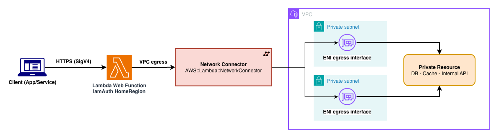

# AWS Lambda Web Function with private VPC egress (SAM)

This pattern gives an AWS Lambda Web Function private network egress into your Amazon VPC through a Lambda network connector. Outbound calls from the function go through network interfaces that Lambda creates in your subnets, so the HTTP server can reach private resources such as internal APIs, databases and caches that aren't exposed to the internet.

The endpoint uses the `IamAuth` authentication type, so it accepts only requests signed with AWS Signature Version 4. The application is a plain Node.js `http` server with no dependencies that can call one private URL and report the result.

Learn more about this pattern at Serverless Land Patterns: https://serverlessland.com/patterns/lambda-web-vpc-nodejs-sam

Important: this application uses various AWS services and there are costs associated with these services after the Free Tier usage - please see the [AWS Pricing page](https://aws.amazon.com/pricing/) for details. You are responsible for any AWS costs incurred. No warranty is implied in this example.

## Architecture



## Requirements

* [Create an AWS account](https://portal.aws.amazon.com/gp/aws/developer/registration/index.html) if you do not already have one and log in. The IAM user that you use must have sufficient permissions to make necessary AWS service calls and manage AWS resources.
* Latest [AWS CLI](https://docs.aws.amazon.com/cli/latest/userguide/install-cliv2.html) installed and configured
* [Git Installed](https://git-scm.com/book/en/v2/Getting-Started-Installing-Git)
* [AWS Serverless Application Model](https://docs.aws.amazon.com/serverless-application-model/latest/developerguide/serverless-sam-cli-install.html) (AWS SAM) installed, **version 1.171.0 or later** (`sam --version`).
* A VPC with two private subnets in different Availability Zones. The subnets need a route to anything your app calls outside the VPC, such as other AWS services, through a NAT gateway or VPC endpoints. A web function in a VPC has no public route unless you provide one.

## Deployment Instructions

1. Create a new directory, navigate to that directory in a terminal and clone the GitHub repository:
    ```
    git clone https://github.com/aws-samples/serverless-patterns
    ```
1. Change directory to the pattern directory:
    ```
    cd serverless-patterns/lambda-web-vpc/nodejs/sam
    ```
1. Build the application. `CodeUri` is the local `src/` directory, so the AWS SAM CLI packages it for you:
    ```bash
    export AWS_REGION=us-east-1
    sam build
    ```
1. Deploy the stack with your VPC details:
    ```bash
    sam deploy \
      --stack-name lambda-web-vpc-sam \
      --capabilities CAPABILITY_IAM \
      --region $AWS_REGION \
      --resolve-s3 \
      --parameter-overrides VpcId=vpc-0123456789abcdef0 VpcSubnetIds=subnet-0123456789abcdef0,subnet-0fedcba9876543210
    ```
    Or run `sam deploy --guided` and answer the prompts. The parameters are:
    * `VpcId`: the VPC the subnets belong to.
    * `VpcSubnetIds`: exactly two subnet IDs in different Availability Zones.
    * `VpcSecurityGroupId` (optional): a security group for the network interfaces. Leave it out and the stack creates an egress-only security group.
    * `NetworkProtocol` (optional): `IPv4` (default) or `DualStack`.
    * `InternalTargetUrl` (optional): a private URL inside the VPC for the app to call. See [Testing](#testing).

    To use more subnets or security groups, add them to the `SubnetIds` and `SecurityGroupIds` lists in the connector's `VpcConfig` in `template.yaml`.

    The AWS SAM CLI uploads the code to a versioning-enabled, Lambda-readable bucket in a separate `lambda-web-vpc-sam-<hash>-WebFunctionCode` stack, which `sam delete` removes.
1. Note the `WebFunctionEndpointDomain` output.

To deploy a code change, run `sam build && sam deploy` again. CloudFormation creates a new revision and moves the endpoint to it.

## How it works

`template.yaml` declares three resources:

* **`NetworkConnector`** (`AWS::Serverless::NetworkConnector`) with `ComputeTypes: [WebFunction]`. SAM expands it into an `AWS::Lambda::NetworkConnector`, which creates network interfaces in your two subnets, and an operator role with the AWS managed `AWSLambdaNetworkConnectorOperatorPolicy` that Lambda uses to manage those interfaces.
* **`ConnectorSecurityGroup`** (`AWS::EC2::SecurityGroup`), created only when you don't pass `VpcSecurityGroupId`. It allows all outbound traffic and no inbound traffic.
* **`WebFunction`** (`AWS::Serverless::WebFunction`) with `AuthType: IamAuth` and `EndpointType: HomeRegion`. SAM expands it into `AWS::Lambda::WebFunction`, an immutable `AWS::Lambda::WebFunctionRevision` (code and configuration), an `AWS::Lambda::WebFunctionEndpoint` routed 100% to that revision, and a logs-only execution role. The revision's `EgressNetworkConnectorArn` is the connector's version-qualified ARN, so all outbound traffic from the function goes through your VPC.

A revision that uses a network connector supports only `HomeRegion` endpoints, not `MultiRegion` or `PerRegion`. If you need multi-Region routing, you can't use VPC egress on the same revision.

The server reads its listen address from the `AWS_LAMBDA_HTTP_ENDPOINT` environment variable that the runtime sets. When `INTERNAL_TARGET_URL` is set, each request calls that URL and the page shows the result.

## Testing

### Call the endpoint

Every request must be SigV4-signed for the `lambda` service and carry an `x-amz-content-sha256` header with the hash of the body (the value below is the hash of an empty body). This example uses `curl --aws-sigv4` (curl 7.75 or later) with temporary credentials, such as those from AWS CloudShell, IAM Identity Center or an assumed role. The caller needs `lambda:InvokeWebFunctionEndpoint` on the endpoint.

```bash
export ENDPOINT=$(aws cloudformation describe-stacks --stack-name lambda-web-vpc-sam \
  --region $AWS_REGION --query "Stacks[0].Outputs[?OutputKey=='WebFunctionEndpointDomain'].OutputValue" --output text)
eval "$(aws configure export-credentials --format env)"

curl -s -w '\nHTTP %{http_code}\n' \
  --aws-sigv4 "aws:amz:${AWS_REGION}:lambda" \
  --user "${AWS_ACCESS_KEY_ID}:${AWS_SECRET_ACCESS_KEY}" \
  -H "x-amz-security-token: ${AWS_SESSION_TOKEN}" \
  -H "x-amz-content-sha256: e3b0c44298fc1c149afbf4c8996fb92427ae41e4649b934ca495991b7852b855" \
  "https://${ENDPOINT}/" | grep -o 'Not configured\|Unreachable\|Reachable\|HTTP [0-9]*' | sort -u
# HTTP 200
# Not configured
```

An unsigned request is rejected before it reaches your code:

```bash
curl -s -o /dev/null -w '%{http_code}\n' "https://$ENDPOINT/"
# 403
```

### Call a private target

To test the egress path, redeploy with `InternalTargetUrl` set to an HTTP endpoint that is reachable only inside the VPC, for example an internal Application Load Balancer or a small server on Amazon EC2 or Amazon ECS:

```bash
sam deploy --stack-name lambda-web-vpc-sam --capabilities CAPABILITY_IAM --region $AWS_REGION --resolve-s3 \
  --parameter-overrides VpcId=vpc-0123456789abcdef0 VpcSubnetIds=subnet-0123456789abcdef0,subnet-0fedcba9876543210 \
  InternalTargetUrl=http://10.0.1.25/
```

The target's security group must allow inbound traffic from the connector's security group. The page reports one of three states:

| State | When | What the page shows |
|---|---|---|
| **Not configured** | `InternalTargetUrl` is not set | Amber status and a prompt to set `INTERNAL_TARGET_URL`. The endpoint works; the app just doesn't call a target. |
| **Reachable** | The target responded | Green status with the HTTP status, latency, content type, size and part of the response body. This proves the call went through your VPC. |
| **Unreachable** | The call failed | Red status with the reason, for example `timeout (check routing / security groups)`. This is almost always subnet routing or a security group rule. |

View the logs:

```bash
aws logs tail /aws/lambda/web/lambda-web-vpc-sam --region $AWS_REGION --follow
```

## Production hardening

* **Endpoint caps.** The template sets `ScalingConfig.MaxEnvironments: 10` and `ThrottleConfig.RateLimit: 100` (requests per second). With `MaxConcurrencyPerEnvironment: 64`, that caps the endpoint at 640 in-flight requests, so a traffic spike can't use account-wide capacity first. Tune both for your peak load. `RateLimit` accepts 0, 100 to 1000 in steps of 100, or 2000 to 10000 in steps of 1000.
* **Security group egress.** The created security group allows all outbound traffic. For production, pass your own `VpcSecurityGroupId` that allows only the CIDRs, prefix lists and ports your function calls.
* **Log retention.** Lambda creates the log groups `/aws/lambda/web/<stack-name>` and `/aws/lambda/web/<stack-name>.local` with no expiration. Add `AWS::Logs::LogGroup` resources with `RetentionInDays` for both.
* **Graceful shutdown.** The sample is stateless and registers no `SIGTERM` handler. A real application should handle `SIGTERM` to finish in-flight requests and close connections.
* **Customer managed KMS key.** Lambda encrypts the code and environment variables with an AWS owned key. Set `KmsKeyArn` on the web function to use your own key.

## Cleanup

1. Delete the stack. This removes the web function with its revision and endpoint, the network connector and its network interfaces, the security group, the roles and the code bucket stack:
    ```bash
    sam delete --stack-name lambda-web-vpc-sam --region $AWS_REGION --no-prompts
    ```
1. Delete the log groups the runtime created:
    ```bash
    aws logs delete-log-group --log-group-name /aws/lambda/web/lambda-web-vpc-sam --region $AWS_REGION
    aws logs delete-log-group --log-group-name /aws/lambda/web/lambda-web-vpc-sam.local --region $AWS_REGION
    ```

----
Copyright 2026 Amazon.com, Inc. or its affiliates. All Rights Reserved.

SPDX-License-Identifier: MIT-0
