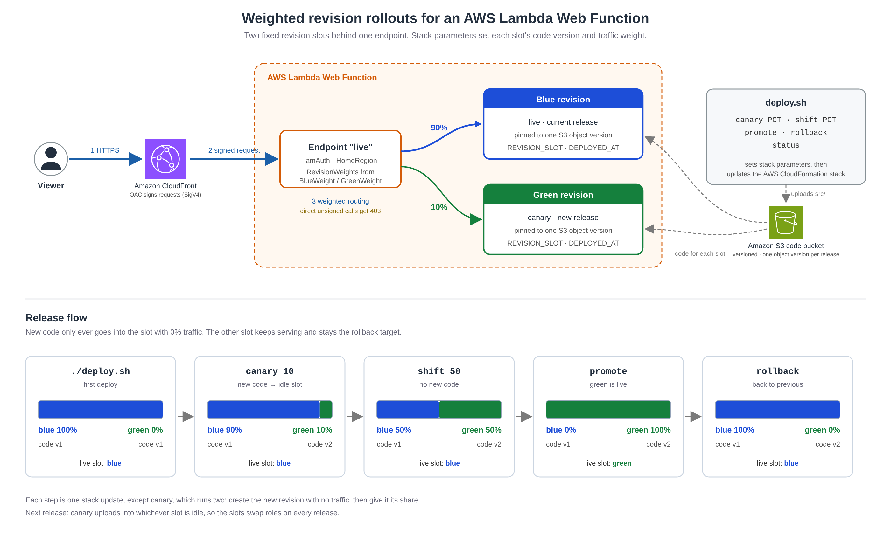

# Weighted revision rollouts for an AWS Lambda Web Function behind Amazon CloudFront

This pattern shows how to release new code to an **AWS Lambda Web Function** gradually: send a small share of traffic to the new release (a canary), increase it, then promote or roll back. Two fixed revision slots, **blue** and **green**, share one endpoint. Stack parameters set each slot's code version and traffic weight, so the template always matches what's serving traffic. Amazon CloudFront with Origin Access Control (OAC) sits in front, so you can watch the traffic split in a browser.

The Lambda documentation recommends turning off automatic deployment and setting revision weights yourself for production workloads, and using automatic deployment to the latest revision for development and staging ([Deployment patterns](https://docs.aws.amazon.com/lambda/latest/dg/web-functions-deployment.html)). This pattern implements the production approach as infrastructure as code.

**Important:** this application uses various AWS services and there are costs associated with these services after the Free Tier usage. See the [AWS Pricing page](https://aws.amazon.com/pricing/) for details. You are responsible for any AWS costs incurred. No warranty is implied in this example.

## Requirements

* [Create an AWS account](https://portal.aws.amazon.com/gp/aws/developer/registration/index.html) if you do not already have one and log in. The IAM user that you use must have sufficient permissions to make necessary AWS service calls and manage AWS resources.
* [AWS CLI](https://docs.aws.amazon.com/cli/latest/userguide/install-cliv2.html) installed and configured
* [Git installed](https://git-scm.com/book/en/v2/Getting-Started-Installing-Git)
* [AWS Serverless Application Model](https://docs.aws.amazon.com/serverless-application-model/latest/developerguide/serverless-sam-cli-install.html) (AWS SAM) CLI installed
* `zip` on your PATH
* A Region where Lambda Web Functions is available. See the [Lambda Web Functions documentation](https://docs.aws.amazon.com/lambda/latest/dg/web-functions.html) for the current list.

## Deployment Instructions

1. Clone the repository and change to the pattern directory:

       git clone https://github.com/aws-samples/serverless-patterns
       cd serverless-patterns/lambda-web-weighted-rollout/nodejs/sam

2. Deploy. The script creates a versioning-enabled code bucket, uploads `src/`, and creates the stack with the same code in both slots and 100% of traffic on blue:

       ./deploy.sh

   The script uses the first Region it finds: the `--region` flag, then `AWS_REGION`, then `AWS_DEFAULT_REGION`, then your AWS CLI profile's default Region. If none is set, it stops with an error. To deploy somewhere else, run `./deploy.sh --region REGION`.

   The first deploy takes about 5 minutes, mostly waiting for the CloudFront distribution. When it finishes, the script prints a **Rollout status** section with the CloudFront URL, each slot's weight and role, and the next command to run.

Every command accepts `--stack-name NAME` and `--region REGION`. Use the same stack name on every command. The first deploy also accepts `--bucket BUCKET` and `--key KEY`; later commands read both from the stack. Run `./deploy.sh --help` for the full list.

## How it works



```
Viewer ──HTTPS──▶ CloudFront ──SigV4 (OAC)──▶ Web Function endpoint (IamAuth)
                                                 ├── blue revision   (weight from BlueWeight)
                                                 └── green revision  (weight from GreenWeight)
```

`template.yaml` declares:

- **Two revision slots,** `BlueRevision` and `GreenRevision` (`AWS::Lambda::WebFunctionRevision`). Each is pinned to its own S3 object version of the same key, and passes `REVISION_SLOT`, `CODE_VERSION_ID`, and `DEPLOYED_AT` to the app.
- **One endpoint** (`AWS::Lambda::WebFunctionEndpoint`, `IamAuth`, `HomeRegion`) whose `RevisionWeights` comes from the `BlueWeight` and `GreenWeight` parameters. A slot with weight 0 is left out of the list, because each weight must be from 1 to 100 and the weights must add up to 100.
- **CloudFront with OAC** (origin type `lambda`, signing behavior `always-amz-auth`) and an `AWS::Lambda::ResourcePolicy` that allows only this distribution to invoke the endpoint. Direct requests to the endpoint's own domain get 403.
- **A code bucket policy** that lets `lambda.amazonaws.com` read the code, scoped to this account and to this stack's Web Function revisions.
- **Both log groups** (`/aws/lambda/web/<stack>-web-function` and its `.local` companion) with 30-day retention, and throttling and scaling caps on the endpoint.

### Why two fixed slots

Revisions are immutable, so new code always means a new revision. If the template declared one revision, every code change would replace the revision that's serving traffic. With two slots, new code only ever goes into the slot that has 0% of traffic. The other slot keeps serving, and it stays available as the rollback target until the next release.

The endpoint references both slots with `!GetAtt`, so you never copy revision IDs into the template. The SAM `AWS::Serverless::WebFunction` resource also supports `RevisionWeights`, but its keys are literal revision IDs and it generates one revision per deployment, so a canary would need template edits between deployments.

### Release flow

| Command | Stack updates | Result |
|---|---|---|
| `./deploy.sh` | 1 | First deploy: same code in both slots, blue 100% |
| `./deploy.sh canary PCT` | 2 | Uploads `src/` into the idle slot (no traffic yet), then sends it PCT% (1–99) |
| `./deploy.sh shift PCT` | 1 | Changes the running canary's share (1–99). No new code |
| `./deploy.sh promote` | 1 | Canary gets 100% and becomes the live slot |
| `./deploy.sh rollback` | 1 | During a canary: 100% back to the live slot. After a promote: back to the previous release |
| `./deploy.sh status` | 0 | Prints slots, weights, deploy times, and the next step |

`canary` runs two stack updates because the endpoint can route only to revisions that are already `Active`: the first update creates the new revision with no traffic, and the second gives it its share.

The script guards against unsafe steps. `canary` refuses to run while a canary is in progress, because both slots would be serving traffic. Change the share with `shift`, or run `rollback` first to release different code. Running plain `./deploy.sh` on an existing stack re-applies the template with the current slots and weights; it never ships new code.

The page and status show only facts fixed when a revision is created: its slot, release, and deploy time. A revision can't know its current weight, because weights change without creating a new revision.

## Testing

The commands below use `AWS_REGION`. Set it to the Region you deployed to. This line uses your environment's Region, or else your AWS CLI profile's default:

    export AWS_REGION="${AWS_REGION:-$(aws configure get region)}"

1. Get the CloudFront URL and confirm the first release:

       URL=$(aws cloudformation describe-stacks --stack-name lambda-web-weighted-rollout --region "${AWS_REGION}" \
         --query "Stacks[0].Outputs[?OutputKey=='CloudFrontUrl'].OutputValue" --output text)
       curl -s "${URL}/version"

   Expect `"slot":"blue"` and `"release":"v1"`. Open the URL in a browser to see the page, which has a blue header.

2. Confirm the endpoint can't be called directly:

       ENDPOINT=$(aws cloudformation describe-stacks --stack-name lambda-web-weighted-rollout --region "${AWS_REGION}" \
         --query "Stacks[0].Outputs[?OutputKey=='WebFunctionEndpointDomain'].OutputValue" --output text)
       curl -s -o /dev/null -w "%{http_code}\n" "https://${ENDPOINT}/"

   Expect `403`.

3. Make a release. In `src/index.js`, change `RELEASE` to `'v2'` and `ACCENT` to another color, then start a canary:

       ./deploy.sh canary 20

4. Watch the split. In the browser, choose **Sample 20 requests**, or run:

       for i in $(seq 50); do curl -s "${URL}/version?n=${i}" | grep -o '"release":"v[0-9]*"'; done | sort | uniq -c

   Expect roughly 40 `v1` and 10 `v2`. Small samples vary.

5. Increase the share, then promote or roll back:

       ./deploy.sh shift 50
       ./deploy.sh promote          # all traffic to v2
       ./deploy.sh rollback         # back to v1, which is still in the other slot

   Run `./deploy.sh status` at any time to see the current weights.

### Monitoring a canary

Web Function metrics have no revision dimension, so they can't separate the canary's errors from the live slot's. The app writes one JSON log line per request with its slot, release, path, and status. In CloudWatch Logs Insights, query the log group `/aws/lambda/web/lambda-web-weighted-rollout-web-function`:

    filter ispresent(slot)
    | stats count(*) as requests by slot, release, status

Decide your error and latency thresholds before you start the canary, then `shift` or `promote` only if the canary meets them.

## Limitations

- **Manual promotion.** Lambda Web Functions don't shift traffic or roll back on alarms by themselves. Each step in this pattern is a decision you make. To automate it, run the same commands from a pipeline with your own checks.
- **Two revisions at most.** An endpoint routes to at most two revisions at a time, so there's one canary at a time.
- **Change weights only through the stack.** If you change the endpoint's weights in the console or with the `aws lambda-web` CLI, the stack parameters no longer match what's serving traffic, and the next `deploy.sh` command overwrites your change.
- **Identical releases.** Running `canary` without changing `src/` still creates a new revision with a new code version. The page shows the same release in both slots.

## Cleanup

    export AWS_REGION="${AWS_REGION:-$(aws configure get region)}"   # the Region you deployed to
    export STACK_NAME=lambda-web-weighted-rollout        # deploy.sh default
    export CODE_KEY=web-function/app.zip                 # deploy.sh default
    export CODE_BUCKET="${STACK_NAME}-code-$(aws sts get-caller-identity --query Account --output text)-${AWS_REGION}"   # deploy.sh default; set your own if you passed --bucket

    sam delete --stack-name "${STACK_NAME}" --region "${AWS_REGION}"

Deleting the stack removes the Web Function, both revisions, the endpoint, the CloudFront distribution, and the log groups. It does **not** remove the code bucket, which lives outside the stack and also holds the packaged templates under `sam-artifacts/`. The bucket is versioned, so `aws s3 rm` would only add a delete marker and every earlier version would stay and keep billing ([Deleting object versions](https://docs.aws.amazon.com/AmazonS3/latest/userguide/DeletingObjectVersions.html)).

If the bucket is dedicated to this pattern (for example, the one `./deploy.sh` created), remove every object version and delete marker, then delete the bucket:

    aws s3api list-object-versions --bucket "${CODE_BUCKET}" --region "${AWS_REGION}" \
      --query '[Versions,DeleteMarkers][][].[Key,VersionId]' --output text \
      | while read -r key version; do
          aws s3api delete-object --bucket "${CODE_BUCKET}" --region "${AWS_REGION}" \
            --key "$key" --version-id "$version"
        done
    aws s3 rb "s3://${CODE_BUCKET}" --region "${AWS_REGION}"

If you brought a shared bucket, don't delete it. Remove only the `${CODE_KEY}` and `sam-artifacts/` versions instead.

----
Copyright 2026 Amazon.com, Inc. or its affiliates. All Rights Reserved.

SPDX-License-Identifier: MIT-0
