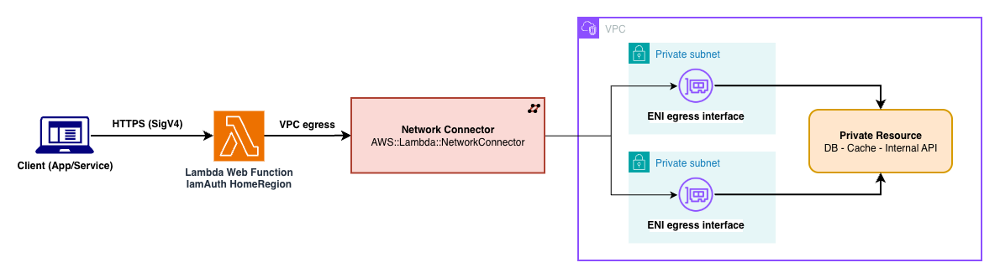

# AWS Lambda Web Function with private VPC egress

This pattern demonstrates how to give an **AWS Lambda Web Function** private network egress into your Amazon VPC using a **Lambda network connector**. With the connector attached, outbound calls from your Web Function are routed through elastic network interfaces (ENIs) in your VPC subnets, so your HTTP server can reach private resources — internal APIs, databases, caches — that are not exposed to the internet.

**Important Note:**
This application leverages multiple AWS services, and there are associated costs beyond the Free Tier usage. Please refer to the [AWS Pricing page](https://aws.amazon.com/pricing/) for specific details. You are accountable for any incurred AWS costs. This example solution does not imply any warranty.

## Architecture

## Key constraint: HomeRegion endpoints only

A Web Function revision that references a network connector supports **only `HomeRegion` endpoints** — not `MultiRegion` or `PerRegion`. If you need multi-Region routing, you cannot also use VPC egress on the same revision. This pattern therefore uses a single `HomeRegion` endpoint.

## How Lambda Web Functions and network connectors fit together

A Lambda Web Function uses a three-part resource model — a **Web Function** (container), immutable **revisions** (code + configuration), and **endpoints** (HTTPS entry points). To route outbound traffic through your VPC, you create an `AWS::Lambda::NetworkConnector` (which provisions ENIs in your subnets) and reference its **version-qualified ARN** from the revision's `ServiceConfig.EgressNetworkConnectorArn`. Your code is a standard Node.js HTTP server that binds to the host and port Lambda provides via the `AWS_LAMBDA_HTTP_ENDPOINT` environment variable. Code is supplied only as a `.zip` package in an Amazon S3 bucket.

## Requirements
* [Create an AWS account](https://portal.aws.amazon.com/gp/aws/developer/registration/index.html) if you do not already have one and log in. The IAM user that you use must have sufficient permissions to make necessary AWS service calls and manage AWS resources.
* [AWS CLI](https://docs.aws.amazon.com/cli/latest/userguide/install-cliv2.html) installed and configured
* [Git Installed](https://git-scm.com/book/en/v2/Getting-Started-Installing-Git)
* [AWS Serverless Application Model](https://docs.aws.amazon.com/serverless-application-model/latest/developerguide/serverless-sam-cli-install.html) (AWS SAM) installed
* An existing VPC with:
  - One or more **private subnets** (two or more in different Availability Zones recommended for resilience).
  - Egress to any AWS services your app calls (for example Amazon S3) via a **NAT gateway** or **VPC interface/gateway endpoints** — a Web Function in a VPC does not have a public route unless you provide one.
  - Optionally, a **security group** permitting the outbound traffic your app needs (you can attach more than one if you compose SGs, but one is typical). If you don't provide any, the stack creates an egress-only security group for you.
* An Amazon S3 bucket (versioning recommended) to hold the Web Function `.zip` deployment package.

## Deployment Instructions

    git clone https://github.com/aws-samples/serverless-patterns/lambdawebfunction-vpc-sam
    cd lambdawebfunction-vpc-sam

### Quick start (recommended)

From the solution directory, run the deploy script with your VPC networking details. It
resolves your region, creates the code S3 bucket if needed, packages `src/` and uploads it,
then runs `sam build` and `sam deploy`:

    ./deploy.sh --vpc-id vpc-aaa --subnets subnet-aaa,subnet-bbb

`--vpc-id` and `--subnets` are required. `--security-groups` is optional — omit it and the
stack creates an egress-only security group for you, or pass `--security-groups sg-aaa`
to bring your own (comma-separate more than one only if you compose SGs). Other optional flags:
`--stack-name NAME --bucket BUCKET --key KEY --network-protocol IPv4|DualStack --region REGION`.
Set your AWS credentials and a Web Functions Region (us-east-1, us-east-2, us-west-2,
ap-northeast-1, eu-west-1) first — the script fails fast if no region is resolvable.

`--internal-target-url` is also optional: it points the sample app at a private HTTP
endpoint inside your VPC to demonstrate egress. Omit it for a normal deploy (the page
then shows the egress status as **Not configured**); see [Testing](#testing) for how to use it.

Re-run `./deploy.sh` any time to ship new code — each run uploads a fresh `.zip` and creates
a new immutable revision.

### Manual steps

Prefer to run the steps yourself (package → upload to S3 → `sam build` → `sam deploy --guided`
with the VPC parameters)? See [DEPLOYMENT.md](DEPLOYMENT.md) for the exact copy-paste commands,
including the non-interactive deploy, versioning, testing, and cleanup. The deploy script above
automates exactly those steps.

## How it works

The template creates a Lambda network connector that provisions ENIs in your chosen subnets and security groups, associated with the `WebFunction` compute type. It then creates a Web Function and an initial revision whose `ServiceConfig.EgressNetworkConnectorArn` points at the connector's version-qualified ARN, so the function's outbound traffic is routed through your VPC. An `IamAuth` `HomeRegion` endpoint routes all traffic to the revision. A dedicated operator role grants Lambda the EC2 permissions needed to manage ENIs on your behalf.

## Testing

Testing the egress path has three steps: point the sample at a private target, invoke the (`IamAuth`) endpoint with a signed request, then read the result on the returned page. Each step is covered in a subsection below.

### Set a private target

To exercise the egress path, use the `--internal-target-url` flag introduced above to point the sample at a private endpoint reachable only inside your VPC (for example an internal ALB, or a small HTTP server on EC2/ECS) at deploy time:

    ./deploy.sh --vpc-id vpc-aaa --subnets subnet-aaa,subnet-bbb \
      --internal-target-url http://<private-ip-or-internal-dns>/

This sets `INTERNAL_TARGET_URL` on the new revision (leave the flag off and the page shows **Not configured**). The sample app probes that URL and the returned page reports the result: **Reachable** (with HTTP status and latency) when VPC egress works, **Unreachable** (subnet routing or security-group rules) otherwise.

### Invoking the `IamAuth` endpoint

Because the endpoint uses `IamAuth`, every request must be **SigV4-signed with the service name `lambda`**. Invoke from inside the account (CloudShell, or an EC2 instance with an instance role) so credentials are picked up and signed correctly. Replace `<WebFunctionEndpointDomain>` below with your endpoint domain from the stack outputs (`WebFunctionEndpointDomain`):

    python3 - <<'EOF'
    import urllib.request, hashlib, re, html as _html
    import botocore.session
    from botocore.auth import SigV4Auth
    from botocore.awsrequest import AWSRequest
    url = "https://<WebFunctionEndpointDomain>/"
    creds = botocore.session.Session().get_credentials().get_frozen_credentials()
    req = AWSRequest(method="GET", url=url)
    req.headers["X-Amz-Content-SHA256"] = hashlib.sha256(b"").hexdigest()  # required empty-body hash
    SigV4Auth(creds, "lambda", "us-east-1").add_auth(req)
    resp = urllib.request.urlopen(urllib.request.Request(url, headers=dict(req.headers)))
    body = resp.read().decode()

    # Render the card's content as readable text (instead of dumping raw HTML).
    def grab(pat, default="n/a"):
        m = re.search(pat, body, re.S)
        return _html.unescape(m.group(1).strip()) if m else default
    title    = grab(r"<h1>([^<]+)</h1>").replace("\xa0", " ")
    subtitle = grab(r'
.*?
([^<]+)
')
    status   = grab(r'stat__num">([^<]+)<')
    detail   = grab(r'internal target ([^<]+)<')
    reply    = grab(r'resp__body">([^<]+)<', default=None)
    badge    = grab(r'class="badge">([^<]+)<')
    meta     = re.findall(r"<dt>([^<]+)</dt><dd>([^<]+)</dd>", body)
    print()
    print("=" * 60)
    print(f"# {title}\n")
    print(f"{subtitle}\n")
    print(f"HTTP {resp.status}  |  {len(body)} bytes\n")
    print(f"Egress status : {status}")
    print(f"Detail        : {detail}")
    if reply:
        print(f"Target reply  : {reply}")
    print()
    for k, v in meta:
        if k not in ("Status", "Latency", "Content-Type", "Size"):
            print(f"{k:<13}: {v}")
    print(f"\n{badge}")
    print("=" * 60)
    EOF

### What you'll see

The returned page reports one of three egress states, depending on whether `INTERNAL_TARGET_URL` is set and reachable:

| State | When | What the page shows |
|---|---|---|
| **Not configured** | `--internal-target-url` was not passed | Amber status "Not configured" and a prompt to set `INTERNAL_TARGET_URL`. The endpoint itself is working — the egress probe just didn't run. |
| **Reachable** | Target is set and responded | Green status "Reachable", plus a **Response from private target** panel with the HTTP status, latency, content-type, size, and a snippet of the actual response body (e.g. `Hello from a private VPC resource`). This is the end-to-end egress proof. |
| **Unreachable** | Target is set but the call failed | Red status "Unreachable" with the reason (for example `timeout (check routing / security groups)`). Almost always a subnet-routing or security-group issue, not a pattern defect — the target's security group must allow inbound from the connector's security group. |

The invoke script above renders the card's content as readable text in the terminal, so you see the same information without the raw HTML. For a **Reachable** result it prints:

    ============================================================
    # Hello from AWS !

    AWS Lambda Web Function with private VPC egress via a network connector

    HTTP 200  |  3749 bytes

    Egress status : Reachable
    Detail        : HTTP 200 in 7 ms via VPC egress
    Target reply  : Hello from a private VPC resource

    App          : lambda-web-function-vpc
    Egress       : VPC network connector (ENIs in your subnets)
    Listening on : 0.0.0.0:3000

    ⚡ Private resource reached through your VPC
    ============================================================

The colors described above (amber/green/red) are CSS styling visible only when the HTML is rendered in a browser; the terminal shows the same states as the text labels above.

## Deploying new code (new revisions)

Revisions are immutable. Upload a new `.zip` to S3 and deploy again to create a new revision. Pin `CodeVersionId` to the new S3 object version for reproducibility.

## Production hardening

This pattern is a working baseline. The security-critical pieces (`IamAuth` on the endpoint, a scoped code-bucket policy, and VPC egress through a network connector) are built in. It also sets conservative endpoint throttling/scaling caps by default (see below). The following are still left to the adopter because the right value is workload-specific — set them when you take this to production:

- **Endpoint throttling and scaling caps (`ThrottleConfig.RateLimit`, `ScalingConfig.MaxEnvironments`).** By default an endpoint is bounded only by your account's regional quotas, which are shared across every endpoint in the account. A traffic spike or a runaway client can therefore consume account-wide capacity before anything throttles at this endpoint. This template sets `RateLimit: 100` (requests/sec) and `MaxEnvironments: 10` on `MyWebFunctionEndpoint` as a conservative starting point — combined with `MaxConcurrencyPerEnvironment: 64`, that caps the endpoint at 640 concurrent in-flight requests. Tune both from your actual expected peak RPS and concurrency; `RateLimit` only accepts 0, 100–1000 in steps of 100, or 2000–10000 in steps of 1000.
- **Security group egress scoping.** When you don't bring your own security group, the stack creates an egress-only group that allows all outbound traffic (`0.0.0.0/0`). For production, scope egress to only the destinations your function actually calls — the private CIDRs, prefix lists, and ports of your internal targets — so the connector ENIs follow least-privilege. Bring your own tightened security group via `--security-groups` (or the `VpcSecurityGroupIds` parameter).
- **CloudWatch Logs retention.** Lambda auto-creates the Web Function's log group(s) with **no expiration**. For cost and governance, set an explicit retention (e.g. 30 or 90 days). You can manage this with an `AWS::Logs::LogGroup` resource once you confirm the exact log-group name(s) the runtime creates for your function.
- **Graceful shutdown (`SIGTERM`).** This stateless sample has nothing to flush on shutdown, so it registers no `SIGTERM` handler. A real application should handle `SIGTERM` to drain in-flight requests and close connections (databases, caches) cleanly before the execution environment is removed.
- **Customer-managed KMS key.** The revision encrypts code and environment variables with an AWS-owned key by default. Compliance-driven workloads can supply a customer-managed key via the revision's `KmsKeyArn`.

These are intentionally *not* baked into the baseline so the pattern stays generic; add the ones your workload needs.

## Cleanup

    sam delete

Deleting the stack removes the Web Function, its revisions and endpoint, and the network connector (including all its versions). Delete the `app.zip` object(s) from S3 separately if no longer needed.

----
Copyright 2026 Amazon.com, Inc. or its affiliates. All Rights Reserved.

SPDX-License-Identifier: MIT-0
