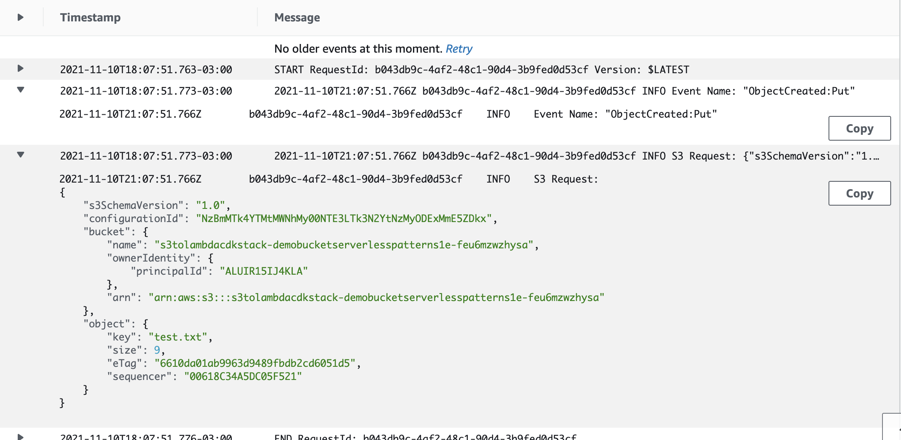

# MSK to Lambda

This CDK stack deploys an Amazon MSK provisioned cluster (Apache Kafka 4.1.x in KRaft mode), a Lambda function that consumes a topic on it, a Kafka client EC2 instance in a private subnet, and the IAM resources required to run the application. Learn more about this pattern at https://serverlessland.com/patterns/msk-lambda-cdk.

When items are published to the Amazon MSK topic, the changes are sent to a stream. This pattern configures a Lambda function to poll this stream, and log some information to CloudWatch. The function is invoked with a payload containing the information of the event.

Important: this application uses various AWS services and there are costs associated with these services after the Free Tier usage - please see the [AWS Pricing page](https://aws.amazon.com/pricing/) for details. You are responsible for any AWS costs incurred. No warranty is implied in this example.

## Requirements

- [Create an AWS account](https://portal.aws.amazon.com/gp/aws/developer/registration/index.html) if you do not already have one and log in. The IAM user that you use must have sufficient permissions to make necessary AWS service calls and manage AWS resources.
- [AWS CLI](https://docs.aws.amazon.com/cli/latest/userguide/install-cliv2.html) installed and configured
- [Node and NPM](https://nodejs.org/en/download/) installed
- [Git Installed](https://git-scm.com/book/en/v2/Getting-Started-Installing-Git)
- [AWS Cloud Development Kit](https://docs.aws.amazon.com/cdk/latest/guide/getting_started.html#getting_started_install) (AWS CDK) installed

## Useful commands

 * `npm run build`   compile typescript to js
 * `npm run watch`   watch for changes and compile
 * `cdk deploy`      deploy this stack to your default AWS account/region
 * `cdk diff`        compare deployed stack with current state
 * `cdk synth`       emits the synthesized CloudFormation template

## Deployment Instructions

1. Create a new directory, navigate to that directory in a terminal and clone the GitHub repository:
   ```sh
   git clone https://github.com/aws-samples/serverless-patterns
   ```
1. Change directory to the pattern directory:
   ```sh
   cd msk-lambda-cdk
   ```
1. From the command line, use npm to install dependencies:
   ```sh
   npm install
   ```
1. Finally, use AWS CDK to deploy the AWS resources for the pattern as specified in the `lib/msk-to-lambda-cdk-stack.ts` file:

   ```sh
   cdk bootstrap aws://accountnumber/region
   cdk deploy
   ```

## How it works

Lambda is a consumer application for your Kafka topic. It processes records from one or more partitions and sends the payload to the target function. Lambda continues to process batches until there are no more messages in the topic.

Lambda internally polls for new messages from the event source and then synchronously invokes the target Lambda function. Lambda reads the messages in batches and provides these to your function as an event payload. The maximum batch size is configurable. (The default is 100 messages.) 

The Lambda function’s event payload contains an array of records. Each array item contains details of the topic and Kafka partition identifier, together with a timestamp and base64 encoded message:

```
{   "eventSource": "aws:kafka",
    "eventSourceArn": "arn:aws:kafka:sa-east-1:123456789012:cluster/vpc-2priv-2pub/751d2973-a626-431c-9d4e-d7975eb44dd7-2",
    "records": {
      "mytopic-0": [
          {
            "topic": "mytopic"
            "partition": "0",
            "offset": 15,
            "timestamp": 1545084650987,
            "timestampType": "CREATE_TIME",
            "value": "SGVsbG8sIHRoaXMgaXMgYSB0ZXN0Lg==",
          }
      ]
    }
}
```

## Security

The cluster doesn't use client authentication. Clients connect over TLS on port 9094. The brokers are in private subnets, and the broker security group allows port 9094 only from:

- itself, which the Lambda event source mapping uses to reach the brokers
- the security group of the Kafka client instance

## Testing

The stack creates a Kafka client EC2 instance (Amazon Linux 2023) in a private subnet with Amazon Corretto 21 and the Apache Kafka 4.1.2 client installed. The instance has no SSH access and no public IP address. Connect to it with AWS Systems Manager Session Manager. The `KafkaClientInstanceId` stack output has the instance ID.

1. Connect to the instance in one of these ways:
   - In the [Amazon EC2 console](https://console.aws.amazon.com/ec2/), select the instance, choose **Connect**, choose the **Session Manager** tab, then choose **Connect**.
   - From your terminal, with the [Session Manager plugin for the AWS CLI](https://docs.aws.amazon.com/systems-manager/latest/userguide/session-manager-working-with-install-plugin.html) installed:
     ```bash
     aws ssm start-session --target <KafkaClientInstanceId>
     ```

1. Session Manager signs you in as `ssm-user`. Switch to `ec2-user`, which has the Kafka client and the `CLUSTER_ARN`, `AWS_REGION` and `TOPIC` environment variables:
   ```bash
   sudo su - ec2-user
   ```

1. Get the TLS bootstrap brokers and create the topic:
   ```bash
   BOOTSTRAP=$(aws kafka get-bootstrap-brokers --region $AWS_REGION --cluster-arn $CLUSTER_ARN --query 'BootstrapBrokerStringTls' --output text)
   ./kafka/bin/kafka-topics.sh --create --bootstrap-server $BOOTSTRAP --command-config kafka/client.properties --replication-factor 2 --partitions 1 --topic $TOPIC
   ```

1. Start a producer and type a few messages:
   ```bash
   ./kafka/bin/kafka-console-producer.sh --bootstrap-server $BOOTSTRAP --producer.config kafka/client.properties --topic $TOPIC
   ```

1. Check the CloudWatch Logs of the Lambda function. The `TransactionHandlerName` stack output has the function name.

## Documentation

- [Using Lambda with Amazon MSK](https://docs.aws.amazon.com/lambda/latest/dg/with-msk.html)
- [Using Amazon MSK as an event source for AWS Lambda](https://aws.amazon.com/blogs/compute/using-amazon-msk-as-an-event-source-for-aws-lambda/)



## Cleanup

1. Delete the stack
   ```bash
   cdk destroy
   ```
1. Confirm the stack has been deleted
   ```bash
   aws cloudformation list-stacks --query "StackSummaries[?contains(StackName,'STACK_NAME')].StackStatus"
   ```

---

Copyright 2021 Amazon.com, Inc. or its affiliates. All Rights Reserved.

SPDX-License-Identifier: MIT-0
