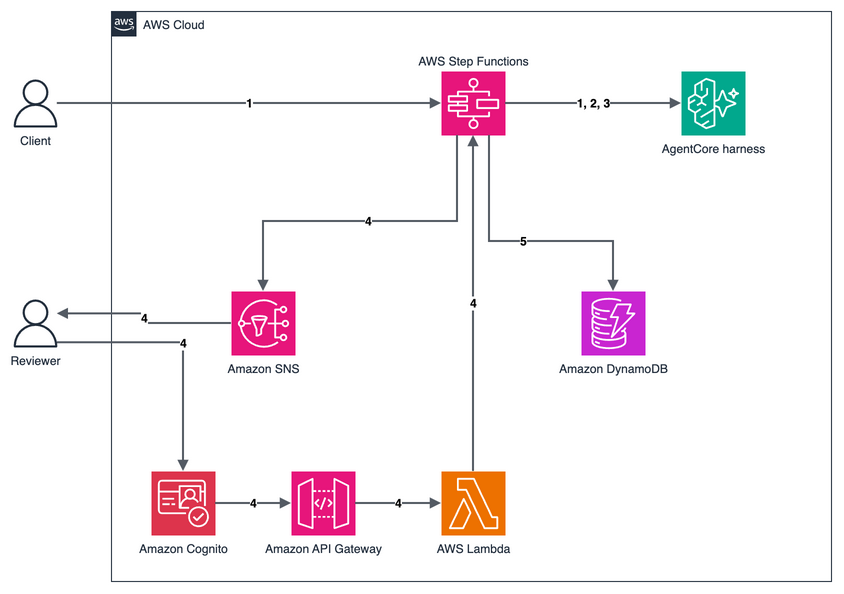

# AWS Step Functions conditional routing on an Amazon Bedrock AgentCore harness agent verdict

This pattern lets an AI agent's verdict decide which path a workflow takes. An AWS Step Functions workflow reviews a batch of card transactions with three agents, each a call to the same Amazon Bedrock AgentCore harness through the optimized `InvokeHarness` integration. A fraud analyst lists suspicious transactions, a compliance specialist explains them and ends with a verdict token, and a Choice state routes on that token. Clear fraud gets a drafted customer notification that waits for approval, unclear batches go to a person, and only a clean batch closes on its own. Approvers sign in with Amazon Cognito, and every outcome is recorded in Amazon DynamoDB.

Learn more about this pattern at Serverless Land Patterns: https://serverlessland.com/patterns/sfn-agentcore-harness-conditional-routing-python-sam

Important: this application uses various AWS services and there are costs associated with these services after the Free Tier usage - please see the [AWS Pricing page](https://aws.amazon.com/pricing/) for details. You are responsible for any AWS costs incurred. No warranty is implied in this example.

## Requirements

* [Create an AWS account](https://portal.aws.amazon.com/gp/aws/developer/registration/index.html) if you do not already have one and log in. The IAM user that you use must have sufficient permissions to make necessary AWS service calls and manage AWS resources.
* [AWS CLI](https://docs.aws.amazon.com/cli/latest/userguide/install-cliv2.html) version 2 installed and configured. This pattern was tested with 2.38.1.
* [Git Installed](https://git-scm.com/book/en/v2/Getting-Started-Installing-Git)
* [AWS Serverless Application Model](https://docs.aws.amazon.com/serverless-application-model/latest/developerguide/serverless-sam-cli-install.html) (AWS SAM) installed. This pattern was tested with 1.162.1.
* A Region where Amazon Bedrock AgentCore harness is available, with access to Amazon Nova Lite and Anthropic Claude Haiku 4.5 in Amazon Bedrock. This pattern was tested in `us-east-1`.
* An email address for the fraud reviewer.

## Deployment Instructions

1. Create a new directory, navigate to that directory in a terminal and clone the GitHub repository:
    ```
    git clone https://github.com/aws-samples/serverless-patterns
    ```
1. Change directory to the pattern directory:
    ```
    cd serverless-patterns/sfn-agentcore-harness-conditional-routing/python/sam
    ```
1. From the command line, use AWS SAM to build and deploy the AWS resources for the pattern as specified in the template.yaml file:
    ```
    sam build
    sam deploy --guided
    ```
1. During the prompts:
    * Enter a stack name of up to 30 characters, using letters, numbers and hyphens. The harness name is built from it.
    * Enter the desired AWS Region.
    * For `ApproverEmail`, enter the fraud reviewer's email address.
    * Keep the default for `AgentModelId`.
    * Allow SAM CLI to create IAM roles with the required permissions.

    Once you have run `sam deploy --guided` mode once and saved arguments to a configuration file (samconfig.toml), you can use `sam deploy` in future to use these defaults.

1. Note the outputs from the SAM deployment process. These contain the resource names and ARNs which are used for testing.

## How it works



1. **Detect.** You start the workflow with an account holder and a list of transactions. The first harness call, with a fraud analyst system prompt, lists the suspicious transactions and the reason for each.
1. **Explain.** The second call, with a compliance specialist system prompt, explains each finding with a confidence level and ends with one token: `RISK_IMMEDIATE`, `RISK_REVIEW`, or `RISK_NONE`.
1. **Route.** A Choice state reads the token. `RISK_IMMEDIATE` goes to a third call, with a fraud operations system prompt, that drafts a customer notification and case notes. Only `RISK_NONE` closes the batch without a person. A `RISK_REVIEW` verdict, a missing token, an incomplete reply, or a failed call goes to human review.
1. **Decide.** For a draft or a review, the workflow publishes an email through Amazon SNS with Approve and Reject links and waits for up to 24 hours. Each link opens the Cognito sign-in page. After sign-in, an AWS Lambda function behind Amazon API Gateway checks that the user is in the `approvers` group and returns the decision to the workflow.
1. **Record.** The workflow writes the route, the decision and the approver to DynamoDB.

### Good to know

* One harness acts as all three agents. Each call sets its own system prompt, and the calls override the harness default model with Claude Haiku 4.5.
* The workflow routes on a token, not on parsed JSON, so a reply that starts with extra text still routes correctly. A token that's missing or unclear never takes the automatic path.
* A finished execution only means the call completed. A refusal or a reply that a content filter stopped (`StopReason` of `content_filtered`) also finishes, so the workflow checks `StopReason` before it routes.
* The harness allows no tools. Without `AllowedTools`, a harness also offers built-in tools such as `shell` and `web_fetch`.
* Harness memory is turned off. Managed memory is shared by every session of the same actor, and Step Functions calls all use the same actor, so one customer's data could appear in another batch.
* Only the reviewer email address that you deploy with gets a Cognito user. Users can't sign themselves up, a user outside the `approvers` group gets an error page, and a link stops working after a decision or after the 24-hour wait ends.
* For production workloads, consider multi-factor authentication in Cognito, AWS KMS keys that you manage for the table and topic, and alarms on failed executions.

## Testing

1. Store the stack outputs in variables. Replace `STACK_NAME` with the name you chose:
    ```bash
    STACK_NAME=STACK_NAME
    get_output() { aws cloudformation describe-stacks --stack-name "$STACK_NAME" \
      --query "Stacks[0].Outputs[?OutputKey=='$1'].OutputValue" --output text; }
    WORKFLOW_ARN=$(get_output WorkflowArn)
    TABLE=$(get_output CaseTableName)
    ```

1. Check the reviewer's inbox for two emails. Confirm the subscription in the email from AWS Notifications. Keep the email from Amazon Cognito, which holds a temporary password.

1. Start one execution for each of the three sample batches in the `events` folder. `suspicious.json` has two identical large purchases in another country one minute apart, `review.json` has one unusual purchase, and `clean.json` has ordinary purchases:
    ```bash
    for batch in suspicious review clean; do
      aws stepfunctions start-execution --state-machine-arn "$WORKFLOW_ARN" \
        --name "$batch-$(date +%s)" --input "file://events/$batch.json"
    done
    ```

1. After about one minute, list the path each execution took:
    ```bash
    for arn in $(aws stepfunctions list-executions --state-machine-arn "$WORKFLOW_ARN" \
        --max-results 3 --query 'executions[].executionArn' --output text); do
      echo "${arn##*:}"
      aws stepfunctions get-execution-history --execution-arn "$arn" \
        --query 'events[?ends_with(type, `StateEntered`)].stateEnteredEventDetails.name' --output text
    done
    ```
    The suspicious batch ends at `RequestApproval`, and the clean batch ends at `RecordOutcome` after `AutoClose`. The review batch usually ends at `HumanReview`. The model decides the verdict, so a borderline batch can take a different path.

1. Open the email titled **Fraud action awaiting approval**. It holds the explanation and the drafted notification. Choose **Approve and send**, sign in with the reviewer email address and the temporary password, and set a new password. The page shows **Recorded: approved.**

1. Open the email titled **Transaction batch needs review**, choose **Reject (escalate)**, and sign in. The page shows **Recorded: rejected.**

1. Check the outcomes:
    ```bash
    aws dynamodb scan --table-name "$TABLE" \
      --query 'Items[].[executionName.S,route.S,decision.S,approver.S]' --output table
    ```
    The suspicious batch shows `ACTION` and `approved`, the review batch shows `HUMAN_REVIEW` and `rejected`, and the clean batch shows `AUTO_CLOSE`, `closed` and `none`.

## Cleanup

1. Stop any execution that is still waiting for a decision:
    ```bash
    for arn in $(aws stepfunctions list-executions --state-machine-arn "$WORKFLOW_ARN" \
        --status-filter RUNNING --query 'executions[].executionArn' --output text); do
      aws stepfunctions stop-execution --execution-arn "$arn"
    done
    ```
1. Delete the stack. SAM CLI asks you to confirm, so answer `y` to the prompts:
    ```bash
    sam delete --stack-name "$STACK_NAME"
    ```
----
Copyright 2026 Amazon.com, Inc. or its affiliates. All Rights Reserved.

SPDX-License-Identifier: MIT-0
