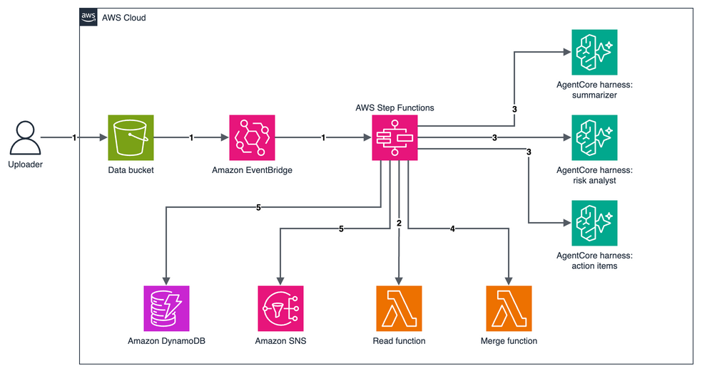

# AWS Step Functions parallel agents on one Amazon Bedrock AgentCore harness

This pattern runs three AI agents at the same time on one document and merges their answers. When you upload a text document to Amazon S3, an AWS Step Functions workflow reads it with an AWS Lambda function, then a Parallel state calls the same Amazon Bedrock AgentCore harness three times through the optimized `InvokeHarness` integration. Each call gets a different system prompt: a summarizer, a risk analyst and an action-item extractor. The workflow publishes the report only if all three agents finished their section. It stores the report in Amazon DynamoDB and sends it by email through Amazon SNS.

Learn more about this pattern at Serverless Land Patterns: https://serverlessland.com/patterns/sfn-agentcore-harness-parallel-python-sam

Important: this application uses various AWS services and there are costs associated with these services after the Free Tier usage - please see the [AWS Pricing page](https://aws.amazon.com/pricing/) for details. You are responsible for any AWS costs incurred. No warranty is implied in this example.

## Requirements

* [Create an AWS account](https://portal.aws.amazon.com/gp/aws/developer/registration/index.html) if you do not already have one and log in. The IAM user that you use must have sufficient permissions to make necessary AWS service calls and manage AWS resources.
* [AWS CLI](https://docs.aws.amazon.com/cli/latest/userguide/install-cliv2.html) version 2 installed and configured. This pattern was tested with 2.38.1.
* [Git Installed](https://git-scm.com/book/en/v2/Getting-Started-Installing-Git)
* [AWS Serverless Application Model](https://docs.aws.amazon.com/serverless-application-model/latest/developerguide/serverless-sam-cli-install.html) (AWS SAM) installed. This pattern was tested with 1.162.1.
* A Region where Amazon Bedrock AgentCore harness is available, with access to Amazon Nova Lite in Amazon Bedrock. This pattern was tested in `us-east-1`.

## Deployment Instructions

1. Create a new directory, navigate to that directory in a terminal and clone the GitHub repository:
    ```
    git clone https://github.com/aws-samples/serverless-patterns
    ```
1. Change directory to the pattern directory:
    ```
    cd serverless-patterns/sfn-agentcore-harness-parallel/python/sam
    ```
1. From the command line, use AWS SAM to build and deploy the AWS resources for the pattern as specified in the template.yaml file:
    ```
    sam build
    sam deploy --guided
    ```
1. During the prompts:
    * Enter a stack name of up to 30 characters, using letters, numbers and hyphens. The harness name is built from it.
    * Enter the desired AWS Region.
    * For `NotificationEmail`, enter the email address that should receive the reports.
    * Allow SAM CLI to create IAM roles with the required permissions.

    Once you have run `sam deploy --guided` mode once and saved arguments to a configuration file (samconfig.toml), you can use `sam deploy` in future to use these defaults.

1. Note the outputs from the SAM deployment process. These contain the resource names and ARNs which are used for testing.

## How it works



1. **Start.** You upload a `.txt` file under `docs/` in the bucket. Amazon EventBridge matches the S3 event and starts the workflow.
1. **Read.** A Lambda function reads the document and returns its text. It rejects files larger than 200,000 bytes, because the text travels in the state payload, which Step Functions limits to 256 KiB.
1. **Fan out.** A Parallel state calls the harness three times at once. The summarizer, risk analyst and action-item extractor each answer from the text in the message and end with `SECTION_COMPLETE`.
1. **Check and merge.** A Choice state continues only if all three calls ended normally and each answer holds `SECTION_COMPLETE`. A second Lambda function removes the marker and any `<thinking>` block and merges the three sections.
1. **Publish.** The workflow stores the report in DynamoDB and emails it through SNS.

### Good to know

* One harness acts as all three agents at the same time. Each call sets its own system prompt, and the harness default model, Amazon Nova Lite, answers all three.
* Each call uses `$uuid()` for its session ID. A session ID must be 33–100 characters, so a session ID built from a short execution name fails.
* The harness allows no tools, and each prompt says that the document is in the message. Without `AllowedTools`, a harness also offers built-in tools such as `shell` and `web_fetch`, and an agent might look for a file instead of reading the message.
* Harness memory is turned off. Managed memory is shared by every session of the same actor, and Step Functions calls all use the same actor, so one document's content could appear in another report.
* If any branch fails or doesn't finish its section, the workflow stops at `AnalysisFailed` and publishes nothing, so a partial report never goes out.
* For production workloads, consider AWS KMS keys that you manage for the bucket, table and topic, and alarms on failed executions. For larger documents, keep the text in S3 and pass a reference instead.

## Testing

1. Store the stack outputs in variables. Replace `STACK_NAME` with the name you chose:
    ```bash
    STACK_NAME=STACK_NAME
    get_output() { aws cloudformation describe-stacks --stack-name "$STACK_NAME" \
      --query "Stacks[0].Outputs[?OutputKey=='$1'].OutputValue" --output text; }
    BUCKET=$(get_output DataBucketName)
    WORKFLOW_ARN=$(get_output WorkflowArn)
    TABLE=$(get_output ReportTableName)
    ```

1. Confirm the subscription in the email from AWS Notifications.

1. Upload the sample document, a draft vendor agreement:
    ```bash
    aws s3 cp sample-agreement.txt "s3://$BUCKET/docs/sample-agreement.txt"
    ```

1. After about 30 seconds, check the execution and the path it took:
    ```bash
    EXECUTION_ARN=$(aws stepfunctions list-executions --state-machine-arn "$WORKFLOW_ARN" \
      --max-results 1 --query 'executions[0].executionArn' --output text)
    aws stepfunctions describe-execution --execution-arn "$EXECUTION_ARN" --query status --output text
    aws stepfunctions get-execution-history --execution-arn "$EXECUTION_ARN" \
      --query 'events[?ends_with(type, `StateEntered`)].stateEnteredEventDetails.name' --output text
    ```
    The status is `SUCCEEDED`. `SummarizeDocument`, `AnalyzeRisks` and `ExtractActions` all appear, and the path ends at `NotifyReady`.

1. Read the stored report. The email titled **Document insights ready** holds the same three sections:
    ```bash
    aws dynamodb get-item --table-name "$TABLE" \
      --key '{"documentKey":{"S":"docs/sample-agreement.txt"}}' \
      --query 'Item.[summary.S,risks.S,actions.S]' --output text
    ```
    The risks include the unnamed subcontractor that stores customer data outside the United States, and the action items name Jane Doe, John Doe and the finance team with their dates.

1. Upload a document that is too large for the state payload. The workflow fails at `ExtractText` with `DocumentTooLarge` and publishes nothing:
    ```bash
    for i in $(seq 1 400); do cat sample-agreement.txt; done > large.txt
    aws s3 cp large.txt "s3://$BUCKET/docs/large.txt"
    sleep 20
    aws stepfunctions list-executions --state-machine-arn "$WORKFLOW_ARN" --max-results 1 \
      --query 'executions[0].status' --output text
    ```
    The status is `FAILED`.

## Cleanup

1. Empty the bucket. The stack can't delete a bucket that holds objects:
    ```bash
    aws s3 rm "s3://$BUCKET" --recursive
    ```
1. Delete the stack. SAM CLI asks you to confirm, so answer `y` to the prompts:
    ```bash
    sam delete --stack-name "$STACK_NAME"
    ```
----
Copyright 2026 Amazon.com, Inc. or its affiliates. All Rights Reserved.

SPDX-License-Identifier: MIT-0
