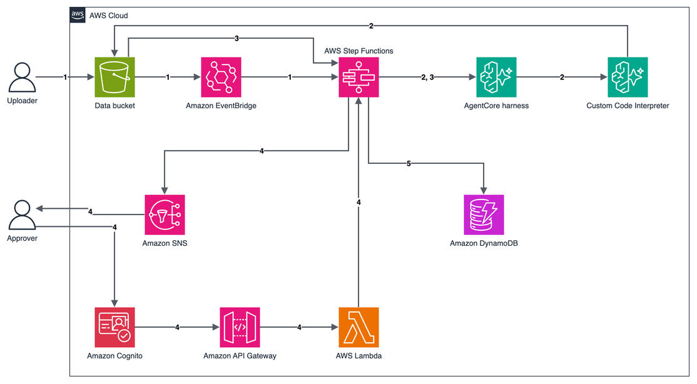

# AWS Step Functions sequential agents on Amazon Bedrock AgentCore harness with human approval

This pattern runs two AI agents in sequence on a CSV file that you upload to Amazon S3, then waits for a person to approve the result. An AWS Step Functions workflow calls one Amazon Bedrock AgentCore harness twice through the optimized `InvokeHarness` integration. The first call acts as a data analyst: its Python code runs in a custom AgentCore Code Interpreter, reads the file, and writes the figures back to S3. The second call turns the figures into a short report. The workflow emails the report with Approve and Reject links. The approver signs in with Amazon Cognito before the decision is recorded in Amazon DynamoDB.

Learn more about this pattern at Serverless Land Patterns: https://serverlessland.com/patterns/sfn-agentcore-harness-sequential-approval-python-sam

Important: this application uses various AWS services and there are costs associated with these services after the Free Tier usage - please see the [AWS Pricing page](https://aws.amazon.com/pricing/) for details. You are responsible for any AWS costs incurred. No warranty is implied in this example.

## Requirements

* [Create an AWS account](https://portal.aws.amazon.com/gp/aws/developer/registration/index.html) if you do not already have one and log in. The IAM user that you use must have sufficient permissions to make necessary AWS service calls and manage AWS resources.
* [AWS CLI](https://docs.aws.amazon.com/cli/latest/userguide/install-cliv2.html) version 2 installed and configured. This pattern was tested with 2.38.1.
* [Git Installed](https://git-scm.com/book/en/v2/Getting-Started-Installing-Git)
* [AWS Serverless Application Model](https://docs.aws.amazon.com/serverless-application-model/latest/developerguide/serverless-sam-cli-install.html) (AWS SAM) installed. This pattern was tested with 1.162.1.
* A Region where Amazon Bedrock AgentCore harness is available, with access to Amazon Nova Lite and Anthropic Claude Haiku 4.5 in Amazon Bedrock. This pattern was tested in `us-east-1`.
* An email address for the approver.

## Deployment Instructions

1. Create a new directory, navigate to that directory in a terminal and clone the GitHub repository:
    ```
    git clone https://github.com/aws-samples/serverless-patterns
    ```
1. Change directory to the pattern directory:
    ```
    cd serverless-patterns/sfn-agentcore-harness-sequential-approval/python/sam
    ```
1. From the command line, use AWS SAM to build and deploy the AWS resources for the pattern as specified in the template.yaml file:
    ```
    sam build
    sam deploy --guided
    ```
1. During the prompts:
    * Enter a stack name of up to 30 characters, using letters, numbers and hyphens. The names of the harness and the Code Interpreter are built from it.
    * Enter the desired AWS Region.
    * For `ApproverEmail`, enter the approver's email address.
    * Keep the default for `AgentModelId`.
    * Allow SAM CLI to create IAM roles with the required permissions.

    Once you have run `sam deploy --guided` mode once and saved arguments to a configuration file (samconfig.toml), you can use `sam deploy` in future to use these defaults.

1. Note the outputs from the SAM deployment process. These contain the resource names and ARNs which are used for testing.

## How it works



1. **Start.** You upload a CSV file under `input/` in the bucket. Amazon EventBridge matches the S3 event and starts the workflow.
1. **Analyze.** The workflow calls the harness with a data analyst system prompt. The agent writes Python that runs in the custom Code Interpreter. The code reads the CSV, computes revenue and return rates by region, and writes the figures to `results/<execution name>.json`.
1. **Verify and write.** The workflow reads that file itself and checks that it holds the figures. It then calls the harness again with a report writer system prompt.
1. **Approve.** The workflow publishes the report to an Amazon SNS topic with Approve and Reject links and waits for up to 24 hours. Each link opens the Cognito sign-in page. After sign-in, Cognito sends the approver to an Amazon API Gateway endpoint, and an AWS Lambda function checks that the user is in the `approvers` group before it returns the decision to the workflow.
1. **Record.** The workflow writes the report, the figures, the decision and the approver's email address to DynamoDB.

### Good to know

* One harness acts as both agents. Each call sets its own system prompt, model and allowed tools.
* The figures come from the file that the code wrote, not from the agent's reply. If the file is missing, isn't valid JSON or lacks the figures, the workflow fails instead of asking for approval.
* The managed Code Interpreter has no AWS credentials. The custom Code Interpreter uses a role that can read `input/` and write only under `results/`.
* Harness memory is turned off. Managed memory is shared by every session of the same actor, and Step Functions calls all use the same actor, so data from one file could appear in another run.
* Without `AllowedTools`, a harness also offers built-in tools such as `shell` and `web_fetch`. The harness allows only the Code Interpreter, and the report writer call allows no tools.
* Only the approver email address that you deploy with gets a Cognito user. Users can't sign themselves up, and a user outside the `approvers` group gets an error page. A link stops working after a decision or after the 24-hour wait ends.
* For production workloads, consider multi-factor authentication in Cognito, AWS KMS keys that you manage for the bucket, table and topic, and alarms on failed executions.

## Testing

1. Store the stack outputs in variables. Replace `STACK_NAME` with the name you chose:
    ```bash
    STACK_NAME=STACK_NAME
    get_output() { aws cloudformation describe-stacks --stack-name "$STACK_NAME" \
      --query "Stacks[0].Outputs[?OutputKey=='$1'].OutputValue" --output text; }
    BUCKET=$(get_output DataBucketName)
    WORKFLOW_ARN=$(get_output WorkflowArn)
    TABLE=$(get_output ReportTableName)
    ```

1. Check the approver's inbox for two emails. Confirm the subscription in the email from AWS Notifications. Keep the email from Amazon Cognito, which holds a temporary password.

1. Upload the sample file. It holds 200 orders across four sales regions:
    ```bash
    aws s3 cp sales.csv "s3://$BUCKET/input/sales.csv"
    ```

1. Find the execution and follow it. The two agent calls take about one minute in total:
    ```bash
    EXECUTION_ARN=$(aws stepfunctions list-executions --state-machine-arn "$WORKFLOW_ARN" \
      --max-results 1 --query 'executions[0].executionArn' --output text)
    aws stepfunctions get-execution-history --execution-arn "$EXECUTION_ARN" \
      --query 'events[?type==`TaskStateEntered` || type==`ChoiceStateEntered`].stateEnteredEventDetails.name'
    ```
    When the list ends with `RequestApproval`, the workflow is waiting for a decision.

1. Read the figures that the analyst's code wrote:
    ```bash
    aws s3 cp "s3://$BUCKET/results/${EXECUTION_ARN##*:}.json" -
    ```
    The sample file gives a total revenue of 57975.12 and a return rate of 0.2143 for the West region.

1. Open the email titled **Sales report awaiting approval** and choose the **Approve** link. Sign in with the approver email address and the temporary password, then set a new password. The page shows **Recorded: approved.**

1. Check the result:
    ```bash
    aws stepfunctions describe-execution --execution-arn "$EXECUTION_ARN" --query '[status,output]'
    aws dynamodb get-item --table-name "$TABLE" \
      --key "{\"executionName\":{\"S\":\"${EXECUTION_ARN##*:}\"}}" \
      --query 'Item.[decision.S,approver.S]' --output text
    ```
    The execution status is `SUCCEEDED`, and the item shows `approved` and the approver's email address. If you choose the link again, the page says that the request is no longer waiting for a decision.

1. Try a file that the analyst can't use. The workflow fails at `CheckFigures` instead of sending a report for approval:
    ```bash
    printf 'note,text\nhello,world\n' > bad.csv
    aws s3 cp bad.csv "s3://$BUCKET/input/bad.csv"
    sleep 90
    aws stepfunctions list-executions --state-machine-arn "$WORKFLOW_ARN" --max-results 1 \
      --query 'executions[0].status' --output text
    ```
    The status is `FAILED`.

## Cleanup

1. Stop any execution that is still waiting for a decision, and empty the bucket. The stack can't delete a bucket that holds objects:
    ```bash
    for arn in $(aws stepfunctions list-executions --state-machine-arn "$WORKFLOW_ARN" \
        --status-filter RUNNING --query 'executions[].executionArn' --output text); do
      aws stepfunctions stop-execution --execution-arn "$arn"
    done
    aws s3 rm "s3://$BUCKET" --recursive
    ```
1. Delete the stack. SAM CLI asks you to confirm, so answer `y` to the prompts:
    ```bash
    sam delete --stack-name "$STACK_NAME"
    ```
    If the stack can't delete the Code Interpreter while a session is still active, stop the sessions and run `sam delete` again:
    ```bash
    CI_ID=$(get_output CodeInterpreterId)
    for s in $(aws bedrock-agentcore list-code-interpreter-sessions --code-interpreter-identifier "$CI_ID" \
        --status READY --query 'items[].sessionId' --output text); do
      aws bedrock-agentcore stop-code-interpreter-session --code-interpreter-identifier "$CI_ID" --session-id "$s"
    done
    ```
----
Copyright 2026 Amazon.com, Inc. or its affiliates. All Rights Reserved.

SPDX-License-Identifier: MIT-0
