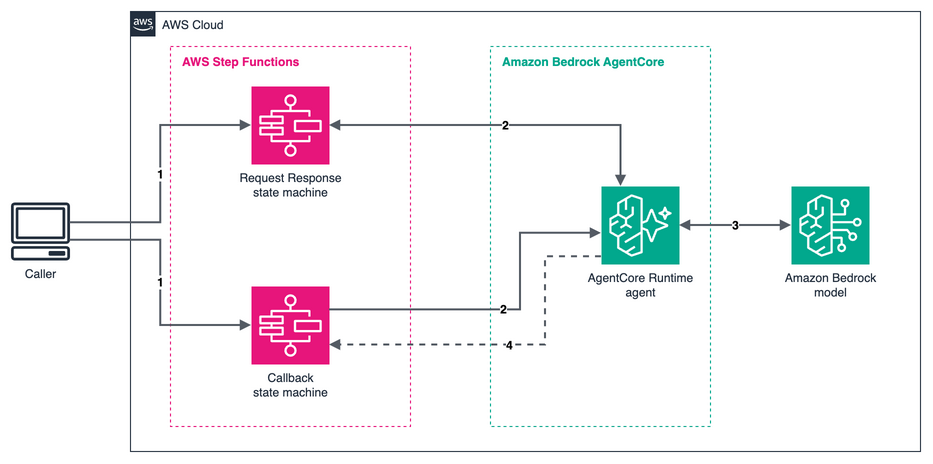

# AWS Step Functions to Amazon Bedrock AgentCore Runtime with a task-token callback

This pattern shows two ways for AWS Step Functions to invoke an Amazon Bedrock AgentCore Runtime agent through the AWS SDK service integration. One state machine uses the Request Response pattern and waits for the agent's HTTP response, for up to 15 minutes. The other uses the Wait for a Callback with a Task Token pattern for agent work that runs longer: the agent returns immediately, does its work in the background, and resumes the workflow with `SendTaskSuccess` or `SendTaskFailure`. One agent serves both state machines.

Important: this application uses various AWS services and there are costs associated with these services after the Free Tier usage - please see the [AWS Pricing page](https://aws.amazon.com/pricing/) for details. You are responsible for any AWS costs incurred. No warranty is implied in this example.

## Requirements

* [Create an AWS account](https://portal.aws.amazon.com/gp/aws/developer/registration/index.html) if you do not already have one and log in. The IAM user that you use must have sufficient permissions to make necessary AWS service calls and manage AWS resources.
* [AWS CLI](https://docs.aws.amazon.com/cli/latest/userguide/install-cliv2.html) version 2 installed and configured, with a default Region. This pattern was tested with 2.38.1.
* [Git Installed](https://git-scm.com/book/en/v2/Getting-Started-Installing-Git)
* [AWS Serverless Application Model](https://docs.aws.amazon.com/serverless-application-model/latest/developerguide/serverless-sam-cli-install.html) (AWS SAM) installed. This pattern was tested with SAM CLI 1.162.1.
* Python 3 and `zip`. The build downloads Linux ARM64 wheels, so it works on any operating system and does not need Docker.
* Access to the Amazon Bedrock model that the agent calls. The default is the `global.anthropic.claude-haiku-4-5-20251001-v1:0` inference profile. To use another model, set the `ModelId` parameter during deployment.
* A Region where Amazon Bedrock AgentCore Runtime is available. This pattern was tested in `us-east-1`.

## Deployment Instructions

1. Create a new directory, navigate to that directory in a terminal and clone the GitHub repository:
    ```
    git clone https://github.com/aws-samples/serverless-patterns
    ```
1. Change directory to the pattern directory:
    ```
    cd serverless-patterns/sfn-bedrock-agentcore-callback/python/sam
    ```
1. Create an S3 bucket for the agent code in your default Region. New buckets block public access and encrypt objects by default:
    ```bash
    REGION=$(aws configure get region)
    ACCOUNT_ID=$(aws sts get-caller-identity --query Account --output text)
    BUCKET=agentcore-code-$ACCOUNT_ID-$REGION
    aws s3 mb "s3://$BUCKET" --region "$REGION"
    ```
1. Package the agent and upload it. The script prints the S3 key of the zip:
    ```bash
    ./build.sh "$BUCKET"
    ```
1. From the command line, use AWS SAM to deploy the AWS resources for the pattern as specified in the template.yaml file:
    ```bash
    sam deploy --guided
    ```
1. During the prompts:
    * Enter a stack name of 42 characters or fewer. The agent's name is built from it.
    * Enter the same Region as the bucket.
    * For `AgentCodeBucket`, enter the bucket name.
    * For `AgentCodeKey`, enter the key that `build.sh` printed.
    * Keep the default for `ModelId`, or enter another model ID.
    * Allow SAM CLI to create IAM roles with the required permissions.

    Once you have run `sam deploy --guided` mode once and saved arguments to a configuration file (samconfig.toml), you can use `sam deploy` in future to use these defaults. After you change the agent code, run `./build.sh` again and pass the new key with `sam deploy --parameter-overrides AgentCodeKey=NEW_KEY`.

1. Note the outputs from the SAM deployment process. These contain the resource names and/or ARNs which are used for testing.

## How it works



1. **Start.** A caller starts an execution of either state machine with a prompt.
1. **Invoke.** The Task state calls `InvokeAgentRuntime` through the AWS SDK integration. The Request Response state machine waits for the agent's response, for up to 15 minutes. The callback state machine adds `.waitForTaskToken` and passes the task token in the payload, and the agent returns `{"status": "ACCEPTED"}` at once.
1. **Reason.** The agent calls the Amazon Bedrock model. For a callback, it does this in a background task.
1. **Call back.** For a callback, the agent sends the result with `SendTaskSuccess`, or the error with `SendTaskFailure`, and the execution resumes. `TimeoutSeconds` is set to 7200, so a lost callback can't leave an execution waiting for up to a year.

### Good to know

* The agent code in `agent/main.py` decides the pattern from the payload. Without `task_token`, it answers inline. With `task_token`, it calls back.
* `@app.async_task` marks the background work, so AgentCore keeps the session alive. Without it, the session can stop while the work runs, and the callback never arrives.
* The agent creates a new `Agent` object for each invocation, so invocations that share a runtime session don't share conversation history.
* `Accept` is set in the Task state's `Arguments`, not in `Payload`. In `Payload` it would reach the agent as data.
* The state machine role can call `bedrock-agentcore:InvokeAgentRuntime` on the runtime ARN and on the runtime ARN followed by `/*`. Step Functions authorizes the call against the runtime and against its endpoint, so with only one of them the call fails with `AccessDeniedException`.
* The agent's role can call `SendTaskSuccess`, `SendTaskFailure` and `SendTaskHeartbeat` on `*`, because the task token authorizes these calls. Without this grant, the agent runs but the execution waits until it times out.
* Both trust policies accept only the matching service in your account and Region, through `aws:SourceAccount` and `aws:SourceArn`.
* Request Response works in Standard and Express workflows. The callback pattern works in Standard workflows only.
* For production, the template comments show where to add heartbeats, VPC networking, execution logging, tracing and a customer managed AWS KMS key.

## Testing

1. Store the stack outputs in variables. Replace `STACK_NAME` with the name you chose:
    ```bash
    STACK_NAME=STACK_NAME
    get_output() { aws cloudformation describe-stacks --stack-name "$STACK_NAME" \
      --query "Stacks[0].Outputs[?OutputKey=='$1'].OutputValue" --output text; }
    RR_ARN=$(get_output RequestResponseStateMachineArn)
    CB_ARN=$(get_output CallbackStateMachineArn)
    AGENT_RUNTIME_ARN=$(get_output AgentRuntimeArn)
    ```
1. Start the Request Response state machine:
    ```bash
    EXEC=$(aws stepfunctions start-execution --state-machine-arn "$RR_ARN" \
      --input '{"prompt":"What is the capital of Japan? Answer in one word."}' \
      --query executionArn --output text)
    ```
1. After a few seconds, read the result:
    ```bash
    aws stepfunctions describe-execution --execution-arn "$EXEC" --query "[status,output]"
    ```
    The status is `SUCCEEDED`, and the output contains the agent's answer:
    ```json
    {"result":{"role":"assistant","content":[{"text":"Tokyo"}], ...}}
    ```
1. Start the callback state machine and read its result the same way:
    ```bash
    EXEC=$(aws stepfunctions start-execution --state-machine-arn "$CB_ARN" \
      --input '{"prompt":"What is the capital of Egypt? Answer in one word."}' \
      --query executionArn --output text)
    aws stepfunctions describe-execution --execution-arn "$EXEC" --query "[status,output]"
    ```
    While the agent works, the status is `RUNNING`. Run the `describe-execution` command again after a few seconds. After the agent calls `SendTaskSuccess`, the status is `SUCCEEDED` and the output is the JSON that the agent sent:
    ```json
    {"result": {"role": "assistant", "content": [{"text": "Cairo"}], ...}}
    ```
1. To see the failure path, redeploy with a model ID that does not exist, then start the callback state machine again:
    ```bash
    sam deploy --parameter-overrides ModelId=invalid-model-id
    EXEC=$(aws stepfunctions start-execution --state-machine-arn "$CB_ARN" \
      --input '{"prompt":"Hello"}' --query executionArn --output text)
    sleep 10
    aws stepfunctions describe-execution --execution-arn "$EXEC" --query "[status,error,cause]"
    ```
    The status is `FAILED`, the error is `AgentRuntimeError`, and the cause ends with `The provided model identifier is invalid.` The execution fails within seconds, not after `TimeoutSeconds`.
1. Restore the default model:
    ```bash
    sam deploy --parameter-overrides ModelId=global.anthropic.claude-haiku-4-5-20251001-v1:0
    ```

The agent's logs are in the CloudWatch Logs log group `/aws/bedrock-agentcore/runtimes/RUNTIME_ID-DEFAULT`, where `RUNTIME_ID` is the last part of `AGENT_RUNTIME_ARN`.

## Cleanup

1. Delete the agent's log group, which AgentCore creates outside the stack:
    ```bash
    aws logs delete-log-group --log-group-name "/aws/bedrock-agentcore/runtimes/${AGENT_RUNTIME_ARN##*/}-DEFAULT"
    ```
1. Delete the agent code and the bucket, which you created outside the stack:
    ```bash
    aws s3 rm "s3://$BUCKET" --recursive
    aws s3 rb "s3://$BUCKET"
    ```
1. Delete the stack. SAM CLI asks you to confirm, so answer `y` to the prompts:
    ```bash
    sam delete --stack-name "$STACK_NAME"
    ```

----
Copyright 2026 Amazon.com, Inc. or its affiliates. All Rights Reserved.

SPDX-License-Identifier: MIT-0
