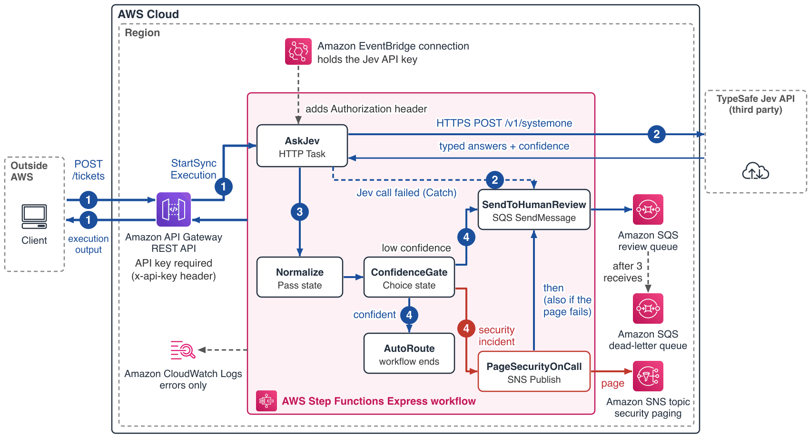

# AWS Step Functions Choice state with TypeSafe Jev: confidence-gated ticket triage

This pattern lets an AWS Step Functions Choice state decide whether to act on a model's answer. Amazon API Gateway starts an AWS Step Functions Express workflow synchronously, and an HTTP Task in the workflow calls the TypeSafe Jev API through an Amazon EventBridge connection that holds the API key, so no AWS Lambda function sits in the request path. Jev answers three typed questions about a support ticket, each with a confidence. The Choice state auto-routes the ticket only when Jev is confident. A suspected security incident pages on-call through Amazon SNS and still goes to a person. Everything else, including a ticket for which the Jev call failed, goes to an Amazon SQS human-review queue.

TypeSafe Jev is a third-party "System One" model: you send it a `state` (here, the ticket) plus typed questions, and it returns typed answers with a probability or confidence between 0 and 1, which map directly onto a Choice state. See the [TypeSafe API reference](https://docs.typesafe.ai/api).

Learn more about this pattern at Serverless Land Patterns: https://serverlessland.com/patterns/sfn-choice-jev-typescript-cdk

Important: this application uses various AWS services and there are costs associated with these services after the Free Tier usage - please see the [AWS Pricing page](https://aws.amazon.com/pricing/) for details. You are responsible for any AWS costs incurred. No warranty is implied in this example. Jev is a third-party service that you need a TypeSafe account and API key for, and TypeSafe bills it separately from AWS.

## Requirements

* [Create an AWS account](https://portal.aws.amazon.com/gp/aws/developer/registration/index.html) if you do not already have one and log in. The IAM user that you use must have sufficient permissions to make necessary AWS service calls and manage AWS resources.
* [AWS CLI](https://docs.aws.amazon.com/cli/latest/userguide/install-cliv2.html) installed and configured
* [Git Installed](https://git-scm.com/book/en/v2/Getting-Started-Installing-Git)
* [Node.js 22 or later](https://nodejs.org/en/download/) installed
* [AWS CDK v2](https://docs.aws.amazon.com/cdk/v2/guide/getting_started.html), with your account and Region bootstrapped (`npx cdk bootstrap`). The commands below use `npx cdk`, which runs the CDK CLI version this project installs.
* A [TypeSafe](https://typesafe.ai/) account and a Jev API key

## Supported Regions

The stack has no Region-specific values: it deploys to the Region of your AWS CLI profile or `AWS_REGION`. The Region must support HTTP Tasks in AWS Step Functions, which use Amazon EventBridge connections.

## Architecture



The numbers follow the steps in How it works: 1 the request and the response, 2 the Jev call (a failed call goes to the review queue), 3 the normalization, 4 the gate outcomes. The pattern uses five AWS services; Amazon EventBridge only stores the API key and sends it as a header.

## How it works

1. `POST /tickets` requires an API key (`x-api-key`) and starts the Express workflow synchronously. API Gateway returns the execution output as the response body.
2. `AskJev` is an HTTP Task. It posts the ticket as the Jev `state` with three typed questions (`choice` for the owning department, `score` for urgency, `noul` for "the ticket reports an active security incident") to `https://api.typesafe.ai/v1/systemone`. The Amazon EventBridge connection adds the header `Authorization: Bearer <key>`. HTTP 429, 502, 503 and 504 responses are retried once; the call times out after 10 seconds. Any other failure is caught and the ticket goes to review as `decision_unavailable`.
3. `Normalize` turns the answers into `{value, confidence}` per question. A `choice` or `score` answer already carries a `confidence`. A `noul` answer is only a probability `p`, so `value = p >= 0.5` and `confidence = |p - 0.5| * 2`. An answer that is missing, not a JSON number, or outside 0 to 1 becomes `null`.
4. `ConfidenceGate` is the Choice state. The outcome states tag the result with `gate.outcome` and `gate.reason`, then send the ticket, the Jev answers and the reason to the review queue. SQS and SNS calls are retried up to three times, except for errors a retry cannot fix.

### The gate

The rules run in order and fail toward a person.

| # | Rule | Outcome | Reason |
|---|---|---|---|
| 1 | security answer unusable, or the Jev call failed | `review` | `decision_unavailable` |
| 2 | security value true and confidence >= 0.9 | `paged_and_review`: Amazon SNS page, then the review queue | `security_incident_suspected` |
| 3 | department or urgency answer unusable | `review` | `decision_unavailable` |
| 4 | department confidence >= 0.6 and urgency confidence >= 0.7 and security value false | `auto_routed` | `confident` |
| 5 | anything else | `review` | `low_confidence` |

A ticket that may report a security incident never auto-routes: rule 4 needs the security value to be false. If the page cannot be published, the ticket still goes to the queue with the reason `security_incident_page_failed`. The page holds only the ticket `id` (the text `none` when the ticket has no id) and the security probability, not the ticket text. The `id` goes out as the caller sent it, so keep it a system-generated value. `auto_routed` ends the workflow; replace `AutoRoute` with your own action.

## Important Notes

* **Exposure:** anyone who holds the API key can call `POST /tickets`, and every call sends the full ticket text to a third party (TypeSafe) and is billed by TypeSafe. The usage plan throttles to 20 requests per second. The API key meters usage; it is not authentication, so put IAM or Amazon Cognito authorization in front of the API for real use. Treat ticket text as untrusted: do not let Jev's answer be the only control on an irreversible action. If the review queue cannot be written, the execution fails and the API returns no gate outcome; check the queue before you retry, because a retry can page again.
* **The API key** is a `NoEcho` AWS CloudFormation parameter that only the Amazon EventBridge connection receives. It is not written into the template or the state machine definition.
* **Thresholds** (0.6, 0.7, 0.9) are constants in `lib/sfn-choice-jev-stack.ts`, compiled into the Choice state. A caller cannot change them, and changing one is a stack update that touches only the state machine. They are starting points: measure them on your own tickets.
* **Another endpoint:** to use an OpenAI-compatible gateway or a test double, set `jevApiRoot`, for example `npx cdk deploy -c jevApiRoot=https://example.com --parameters JevApiKey="$JEV_API_KEY"`. It must be an `https://` URL that serves `POST /v1/systemone`.
* **Timeouts and size:** API Gateway waits at most 29 seconds for the workflow, and a request over 256 KiB is refused with HTTP 400. Cap the size at the caller.
* **Logs:** the state machine logs errors only, without execution data. The queue message contains the ticket.

## Deployment Instructions

1. Clone the repository:
    ```bash
    git clone https://github.com/aws-samples/serverless-patterns
    cd serverless-patterns/sfn-choice-jev/typescript/cdk
    ```

2. Install dependencies:
    ```bash
    npm install
    ```

3. Bootstrap the account and Region once if you have not, read your Jev API key without echoing it, then deploy the stack to your default AWS account and Region. The AWS CDK asks you to approve the IAM changes (answer `y`):
    ```bash
    npx cdk bootstrap
    read -rs JEV_API_KEY
    npx cdk deploy --parameters JevApiKey="$JEV_API_KEY"
    ```

4. Note the outputs (`TicketsEndpoint`, `TriageApiKeyId`, `HumanReviewQueueUrl`, `SecurityPagingTopicArn`, `StateMachineArn`, `StateMachineLogGroupName`) for testing.

## Testing

The commands use AWS CLI v2.

1. Read the outputs into variables. Run this block again in any new terminal:
    ```bash
    out() { aws cloudformation describe-stacks --stack-name SfnChoiceJevStack --query "Stacks[0].Outputs[?OutputKey=='$1'].OutputValue" --output text; }
    URL=$(out TicketsEndpoint); QUEUE=$(out HumanReviewQueueUrl); TOPIC=$(out SecurityPagingTopicArn)
    KEY=$(aws apigateway get-api-key --api-key "$(out TriageApiKeyId)" --include-value --query value --output text)
    ```

2. Send a clear ticket. Jev's answers can vary, so the confidences and the outcome of a borderline ticket can differ from run to run. Expected: `gate.outcome` is `auto_routed` and `decision` holds the three answers:
    ```bash
    curl -s -X POST "$URL" -H "x-api-key: $KEY" -H "Content-Type: application/json" \
      -d '{"id":"T-1","subject":"Cannot log in","body":"Every reset email lands but the new password is rejected."}'
    ```

3. Send an ambiguous ticket. These tests show that the same ticket is handled differently based on Jev's confidence: this one is `review` / `low_confidence`, and the message is in the review queue with the ticket and the Jev answers:
    ```bash
    curl -s -X POST "$URL" -H "x-api-key: $KEY" -H "Content-Type: application/json" -d '{"id":"T-2","subject":"Something is off","body":"Something seems off with my account and the app, not sure who should look at it."}'
    aws sqs receive-message --queue-url "$QUEUE" --max-number-of-messages 10 --wait-time-seconds 10
    ```
    A call can return fewer messages than the queue holds, so repeat it until you have seen the message. A received message is hidden for 60 seconds, and three receives without a delete move it to the dead-letter queue.

4. Subscribe to the paging topic (confirm the email Amazon SNS sends first), then send a ticket that clearly reports a security incident. Expected: `paged_and_review` / `security_incident_suspected`, a page message on the topic that holds only the ticket id and the probability, and the same ticket in the queue:
    ```bash
    aws sns subscribe --topic-arn "$TOPIC" --protocol email --notification-endpoint you@example.com
    curl -s -X POST "$URL" -H "x-api-key: $KEY" -H "Content-Type: application/json" \
      -d '{"id":"T-3","subject":"Account taken over","body":"Someone changed my password and is exporting our customer list right now."}'
    ```

5. Provoke a failed Jev call by deploying with a wrong key, then send the clear ticket from step 2 again. Expected: `review` / `decision_unavailable` with `error` set to `States.Http.StatusCode.401`, and the ticket in the queue. A 401 puts the Amazon EventBridge connection in a deauthorized state, so a second call fails with `Events.ConnectionResource.InvalidConnectionState`; deploying again with your real key restores it (in a new terminal run `read -rs JEV_API_KEY` first):
    ```bash
    npx cdk deploy --parameters JevApiKey="wrong-key"
    npx cdk deploy --parameters JevApiKey="$JEV_API_KEY"
    ```

After a deployment that changed the endpoint the first call once ended in `review` / `decision_unavailable` with `States.Http.AccessDenied`; the next call worked, so wait a moment and send it again. Execution errors are logged in the log group named by `StateMachineLogGroupName`. A request body that is not JSON is refused by API Gateway with HTTP 400.

## Cleanup

1. Delete the stack. This also deletes the Amazon SQS queues and any tickets still in them, so read those first:
    ```bash
    npx cdk destroy
    unset JEV_API_KEY KEY
    ```

----
Copyright 2026 Amazon.com, Inc. or its affiliates. All Rights Reserved.

SPDX-License-Identifier: MIT-0
