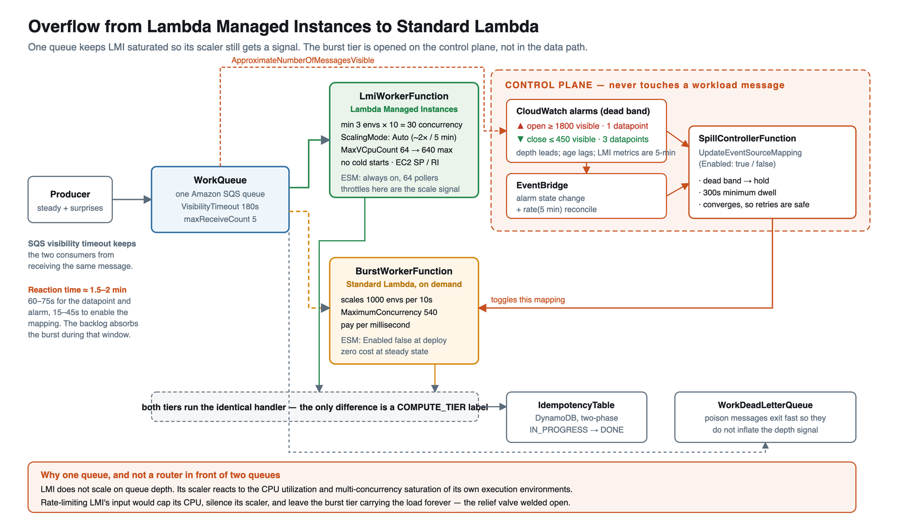

# Overflow from Lambda Managed Instances to Standard Lambda on a traffic burst

This pattern runs a steady Amazon SQS workload on AWS Lambda Managed Instances (LMI) for a cost-optimized, predictable compute baseline, and opens a Standard Lambda burst tier on the **same queue** when the backlog shows that LMI cannot keep up. The baseline is a reservable EC2 footprint. The burst tier costs nothing until it is needed, scales instantly when it is, and closes again once LMI has scaled up to carry the load itself.

Important: this application uses AWS services that can incur charges. You are responsible for the costs incurred in your account. No warranty is implied in this example.

## The constraint that shapes the design

LMI does not scale on queue depth. Its managed scaler reacts to the CPU utilization and the multi-concurrency saturation of the function's own execution environments. That has one consequence that governs everything else:

> **The burst tier must not reduce the load LMI sees.**

A naive design puts a router in front of two queues, admits N messages per second to LMI, and sends the rest to Standard Lambda. It deadlocks. Capping LMI's input rate caps LMI's CPU, which silences LMI's scaler, so LMI never grows and the burst tier carries the excess forever. The relief valve welds itself open, and you pay on-demand Lambda rates for what should have become reserved baseline capacity.

So this pattern:

* Keeps **one queue**. Both tiers poll it. LMI stays saturated for as long as work is available, which is exactly the signal its scaler needs.
* Lets LMI **throttle**. Throttles are not a failure here; they are the scale signal. The SQS event source mapping retries throttled messages, and `ConcurrencyThrottles` / `CPUThrottles` tell you which resource triggered the scale-up.
* Adds no component to the data path. The burst decision is made on the **control plane** by toggling an event source mapping.

## Architecture



```text
                                          ┌────────────────────────────────┐
                                          │  CONTROL PLANE                 │
                                          │                                │
                    GetQueueAttributes    │  EventBridge rate(1 min)       │
                             ┌───────────►│          │                     │
                             │  every 10s │          ▼                     │
                             │            │  SpillController               │
                             │            │  open  >= 1800                 │
                             │            │  close <=  450 + 30s falling   │
                             │            └───────────────────────┼────────┘
                             │                                    │
                             │                        UpdateEventSourceMapping
                             │                            (Enabled true/false)
                             │                                    │
┌──────────┐   ┌─────────────┴──────────┐                         │
│ Producer ├──►│       WorkQueue        │                         │
└──────────┘   │  (single SQS queue)    │                         │
               └───┬────────────────┬───┘                         │
                   │                │                             │
        ESM        │                │  ESM  ◄─────────────────────┘
   (always on,     │                │  (Enabled: false at deploy)
    64 provisioned │                │   MaximumConcurrency: 540
    pollers)       │                │
                   ▼                ▼
        ┌────────────────────┐  ┌──────────────────────┐
        │  LmiWorkerFunction │  │  BurstWorkerFunction │
        │  ── Lambda Managed │  │  ── Standard Lambda  │
        │     Instances      │  │     on demand        │
        │  min 3 EEs x 10    │  │  scales 1000 per 10s │
        │  = 30 concurrency  │  │  1 invoke per env    │
        │  no cold starts    │  │  pay per ms          │
        │  EC2 SP / RI       │  │                      │
        └─────────┬──────────┘  └──────────┬───────────┘
                  │      same handler      │
                  └───────────┬────────────┘
                              ▼
                    ┌──────────────────┐      ┌────────────────────────┐
                    │ IdempotencyTable │      │ WorkDeadLetterQueue    │
                    │  (DynamoDB)      │      │ (maxReceiveCount: 5)   │
                    └──────────────────┘      └────────────────────────┘
```

Two event source mappings on one queue do not double-process. SQS visibility timeout guarantees a message in flight to one consumer is not delivered to the other. The idempotency table covers ordinary at-least-once redelivery, not concurrent delivery.

## How the spill decision works

Depth, not age, and not CPU:

| Signal | Behaviour | Verdict |
| --- | --- | --- |
| `GetQueueAttributes` `ApproximateNumberOfMessages` | **Leads, and is live.** Grows the moment arrival rate exceeds drain rate. One API call, no publish lag. Genuinely approximate, though — see [Known limits](#known-limits). | Use this. |
| `ApproximateNumberOfMessagesVisible` (CloudWatch) | The same number, published on a 1-minute grain. Measured end-to-end lag on this pattern: **2m 15s**. | Charts, not triggers. |
| `ApproximateAgeOfOldestMessage` | **Lags.** Also pinned high by a single stuck message even when the queue is otherwise healthy. | Secondary. |
| LMI `CPUUtilization`, `ConcurrencyThrottles` | Published at **5-minute** intervals. Correct for explaining why LMI is scaling; too coarse to trigger on. | Diagnostics only. |

### Why there is no CloudWatch alarm here

The obvious build is two depth alarms with a dead band, and that is what this pattern used to do. A load test took it apart:

| Stage | Duration |
| --- | --- |
| Backlog grows to the 1,800 threshold | 1m 36s |
| **Metric publish + alarm evaluation** | **2m 15s** |
| Alarm → EventBridge → controller decision | < 1s |
| `UpdateEventSourceMapping` → `Enabled` | 20s |
| **Total** | **4m 11s** |

The controller was never the bottleneck; the alarm was, and it is irreducible. `Period: 60 / EvaluationPeriods: 1` is already the floor for a metric SQS only publishes once a minute, and lowering `SpillOpenDepth` shortens only the first row. So the controller reads the queue instead. `GetQueueAttributes` returns live queue state.

Re-running the same load test against the polling controller:

| Stage | Alarm build | Polling build |
| --- | --- | --- |
| Backlog grows to the 1,800 threshold | 1m 36s | 8s |
| Detect the crossing | 2m 15s (publish + evaluation) | **34s** |
| Decision → burst tier consuming | 20s (to `Enabled`) | 8s (to first invocation) |
| **Crossing → burst tier engaged** | **2m 35s** | **42s** |

3.6 times faster, and 113 seconds of backlog not accumulated. The two builds' last rows are not quite the same measurement — the alarm run was timed to the mapping reporting `Enabled`, the polling run to the first burst worker actually picking up a message, which happens slightly earlier — so if anything the gap is wider than 113 seconds. But note the 34s: that is *not* the 10-second poll interval, and the gap is the interesting part of the result. Two causes, both measured, both covered under [Known limits](#known-limits) — a blind window between invocations, and the approximate counter reading near zero during the first seconds of the burst.

EventBridge's finest schedule is one minute, so the controller is invoked once a minute and then polls in a loop until its invocation is nearly spent. The schedule is still the recovery mechanism: every poll re-reads both the queue and the mapping and converges, so overlapping invocations, a dropped invocation, and a `sam deploy` are all safe.

### The dead band

```
depth
  ▲
  │ ─── SpillOpenDepth (1800) ─────────── open burst tier, immediately
  │
  │        dead band: hold current state
  │
  │ ─── SpillCloseDepth (450) ──────────── close burst tier, if depth is also
  │                                        flat or falling over 30s
  └──────────────────────────────────────► time
```

`SpillOpenDepth` defaults to about 60 seconds of drain at the LMI baseline, and `SpillCloseDepth` to about 15 seconds. Opening is deliberately fast: by the time depth is that high the deficit is established, and every second spent confirming it is a second of backlog. Closing is deliberately slow — the depth trend must be flat or falling over `SpillCloseTrendWindowSeconds`, and `SpillMinimumDwellSeconds` (300s) must have elapsed. Closing early is the expensive mistake: LMI needs about five minutes per doubling, so pulling the relief valve at the first dip sends the queue straight back through the open threshold.

The trend condition is what a depth-only close is missing. Depth dipping under 450 says nothing about whether it is on its way down or on its way back up; the slope does. It is a real improvement over three consecutive datapoints, but it is not a cure — see [Known limits](#known-limits).

Depth samples do not carry across invocations, so a close can only be decided once the trend window has closed inside the current poll loop — in practice the tail end of each minute. Opening carries no such constraint and can happen on any poll.

Reaction time measured end to end was **42 seconds** from the depth crossing to the first burst worker consuming a message. Budget for that rather than for the poll interval: detection is `ControllerPollIntervalSeconds` plus the blind window between invocations plus however long SQS's counter takes to reflect the burst, and enabling the mapping then takes another 8 seconds or so. During all of it the backlog, not the compute tier, is absorbing the burst. If you need to remove the enable time too, set the burst mapping's `MaximumConcurrency` to a floor of 2 and leave it `Enabled` permanently, then have the controller raise and lower `MaximumConcurrency` instead of `Enabled`. That engages in seconds, for the constant cost of two burst invocations always polling.

## Sizing the pattern

Everything follows from the baseline drain rate:

```
LMI baseline concurrency = LmiBaselineExecutionEnvironments x LmiPerEnvironmentConcurrency
                         = 3 x 10 = 30

LMI baseline drain rate  = baseline concurrency / work seconds
                         = 30 / 1.0 = 30 msg/s
```

| `WorkDurationMs` | Arrival rate that saturates the baseline | A 10x burst is |
| --- | --- | --- |
| 100 | 300 msg/s | 3,000 msg/s |
| **1000 (default)** | **30 msg/s** | **300 msg/s** |
| 5000 | 6 msg/s | 60 msg/s |

Then:

* **`LmiMaximumPollers`** must be at least `(LmiMaxVCpuCount x LmiPerEnvironmentConcurrency) / 10`, because each provisioned poller supplies about 10 concurrent invocations. With the defaults that is `(64 x 10) / 10 = 64`. Leaving it at 10 would cap LMI at 100 concurrency and make 54 of the 64 vCPUs unreachable — the pollers, not LMI, would be the ceiling.
* **`BurstMaximumConcurrency`** should be at least `(peak arrival rate - baseline drain rate) x work seconds`, plus headroom to clear the backlog that built up before the valve opened. For a 300 msg/s burst: `(300 - 30) x 1 = 270`, plus roughly 270 of backlog, so 540.
* **`SpillOpenDepth`** = baseline drain rate x 60. **`SpillCloseDepth`** = baseline drain rate x 15.

### What the polling controller costs

`ControllerPollIntervalSeconds` does not change how often the controller is *invoked* — that is fixed at once a minute. It changes how long each invocation stays alive, and Lambda bills duration:

| `ControllerPollIntervalSeconds` | Detection latency | Alive per minute | Controller cost |
| --- | --- | --- | --- |
| 0 (single poll per invocation) | up to 60s | < 1s | negligible |
| **10 (default)** | **up to ~20s** | **~50s, 6 polls** | **~$3.75/month** |
| 30 | up to 60s | ~30s, 2 polls | ~$2.15/month |

Alive-per-minute figures are measured, not estimated. At 128 MB on arm64, and excluding the free tier. `GetQueueAttributes` adds under $0.10/month at the default interval; `GetEventSourceMapping` is a control-plane call and is not billed.

Detection latency is the poll interval *plus* the blind window, because a 60-second invocation cannot cover 60 seconds of wall clock — it stops one reserve short of its timeout, and the next scheduled invocation cannot start early. At the default that is 10s + ~9s. This is why 30 is poor value: two polls cover 30s and leave 30s uncovered, so it detects no faster than a single poll per minute while costing ten times as much.

Set `SpillCloseTrendWindowSeconds` to 0 if you set the interval to 0. Depth samples do not carry across invocations, so a single poll can never establish a slope, and a trend window the loop cannot cover leaves the burst tier unable to close. The controller logs `misconfigured-trend-window` when that happens rather than failing silently.

The function is deliberately 128 MB: it sleeps, makes two API calls, and compares integers. Raising `MemorySize` multiplies straight through to that monthly figure for no benefit. If the polling cost is not worth it for your workload, set the interval to 0 — even a single poll per minute beats the alarm it replaced, because it removes the 2m 15s of publish lag and leaves only the schedule's own granularity.

## Requirements

* An AWS account and permissions to create Lambda, SQS, DynamoDB, CloudWatch, EventBridge, IAM, and Lambda Managed Instances resources.
* AWS CLI installed and configured.
* AWS SAM CLI 1.158.0 or later. Earlier versions do not recognise `AWS::Serverless::CapacityProvider` or the `FunctionScalingConfig` and `CapacityProviderConfig` properties of `AWS::Serverless::Function`.
* Python 3 with boto3 available, for the load-generator scripts.
* A VPC with at least two private subnets and a security group for the LMI capacity provider.
* Egress from those subnets to SQS, DynamoDB, CloudWatch Logs, and CloudWatch. Use NAT gateways or interface VPC endpoints according to your cost and security requirements.
* A Region where Lambda Managed Instances is available.

## Deployment instructions

1. Clone the repository and enter this pattern directory:

   ```bash
   git clone https://github.com/aws-samples/serverless-patterns.git
   cd serverless-patterns/sqs-lmi-standard-lambda-overflow-sam
   ```

2. Validate and build:

   ```bash
   sam validate --lint
   sam build
   ```

3. Deploy, supplying existing private subnet and security-group IDs:

   ```bash
   sam deploy --guided
   ```

   The defaults are sized for a 1-second workload with a 30 msg/s baseline and a 300 msg/s burst. If you change `WorkDurationMs`, recompute `SpillOpenDepth`, `SpillCloseDepth`, and `BurstMaximumConcurrency` from the sizing section above.

4. Confirm the burst tier starts closed:

   ```bash
   aws lambda get-event-source-mapping \
     --uuid "$(aws cloudformation describe-stacks --stack-name <stack-name> \
       --query "Stacks[0].Outputs[?OutputKey=='BurstEventSourceMappingUuid'].OutputValue" \
       --output text)" \
     --query 'State'
   ```

   Expect `"Disabled"`.

`CapacityProviderConfig` cannot be added to, or removed from, an existing Lambda function. It must be set on the first deploy. To move an existing function onto LMI, create a new function resource.

## Testing

Get the queue URL and dashboard link:

```bash
STACK=<stack-name>
QUEUE_URL=$(aws cloudformation describe-stacks --stack-name "$STACK" \
  --query "Stacks[0].Outputs[?OutputKey=='WorkQueueUrl'].OutputValue" --output text)
aws cloudformation describe-stacks --stack-name "$STACK" \
  --query "Stacks[0].Outputs[?OutputKey=='DashboardUrl'].OutputValue" --output text
```

### Smoke test

```bash
aws sqs send-message --queue-url "$QUEUE_URL" \
  --message-body file://events/burst-message.json
sam logs --stack-name "$STACK" --name LmiWorkerFunction --tail
```

The message is processed on the LMI tier. The burst tier stays closed — correctly. A handful of messages never approaches `SpillOpenDepth`, so the controller logs `hold-dead-band` and does nothing. **A small test proves nothing about this pattern.** You need sustained load.

### Scenario 1 — sustained burst: LMI takes over and the valve closes

```bash
chmod +x scripts/*.sh scripts/*.py
./scripts/run_scenarios.sh "$STACK" 1
```

10 minutes of baseline, then a 300 msg/s burst held for 20 minutes, then 10 minutes of cooldown. Measured timeline once the burst starts, from an actual run:

| Time | What happens |
| --- | --- |
| t+0s | Arrival jumps to 300 msg/s. LMI is at its 30-concurrency baseline. Depth climbs. |
| t+8s | Depth crosses `SpillOpenDepth`. |
| t+42s | A poll finally sees a depth above the threshold — see [Known limits](#known-limits) for why this is not t+18s. Controller calls `UpdateEventSourceMapping`. |
| t+50s | First burst worker cold start. Standard Lambda is consuming. |
| t+1m10s | Depth peaks at 13,694 and falls. LMI has scaled its execution environments from 30 to ~270 concurrency. |
| t+2m40s | Depth at 0 and it stays there, queue wait ~100ms. Combined peak drain was 472 msg/s against 300 arriving. |
| t+6m | Dwell elapses and the controller closes the tier. Every open window in the run was exactly 321s — the 300s dwell guard plus one poll — because depth reads 0 from t+2m40s onward, so the guard is the only thing holding the valve open. |
| t+13m | The premature close that matters: depth 0, trend flat, but 305 messages in flight against LMI's ~270 concurrency. Depth rebuilds to 2,861 and it reopens 39 seconds later. |
| t+19m | Burst ends. The tier closes and stays closed. |

Over the whole run the two tiers split the work almost evenly: 165,457 messages on LMI and 144,953 on the burst tier, 46.7% burst. Within each open window LMI's share fell monotonically — 59%, 56%, 42%, 34%, 26% — because Standard Lambda adds environments in seconds while LMI takes tens of seconds, so the faster consumer progressively wins the race for messages on the shared queue. LMI's `CPUUtilization` tracked that decline from 66% to 59%, which is the scaling signal the single-queue design exists to preserve. Capping `BurstMaximumConcurrency` nearer the actual deficit than 540 trades engage speed for a scaler that keeps learning.

The **Work completed per tier** widget is the graph to take to the customer, but be honest about what it shows. The orange Standard Lambda band appears within a minute and then *stays* — with `WorkDurationMs: 1000` on a 4 vCPU instance the work is not CPU-bound enough to push LMI's `CPUUtilization` past ~64%, so LMI adds environments quickly (30 to ~270 concurrency inside 90 seconds, far faster than a 2x-per-5-minutes model predicts) and then plateaus there — `vCPUAllocated` never left 4.0, one `m8g.xlarge`, against a `MaxVCpuCount` of 64. It peaked at 250 msg/s and never reaches 300 msg/s alone, so there is no clean handback in a 20-minute window. If you want to demonstrate the handback, raise `WorkDurationMs` so the work actually saturates vCPU and forces the capacity provider to allocate a second instance.

`BURST_SECONDS` defaults to 1200 to leave room for that. A two-minute burst only ever shows the burst tier.

### Scenario 2 — short spike: the burst tier absorbs it outright

```bash
./scripts/run_scenarios.sh "$STACK" 2
```

A 90-second spike. The burst tier engages and drains the backlog; LMI barely moves, because the spike is over before its scaler has completed a cycle. This is the common case for the "usually steady, surprises sometimes" workload, and it is the case that justifies the burst tier existing at all.

### Watch the controller's reasoning

Every poll logs its decision as JSON, including the case where it deliberately does nothing — so at the default interval there are six lines a minute, each with the depth it saw:

```bash
CONTROLLER=$(aws cloudformation describe-stack-resource --stack-name "$STACK" \
  --logical-resource-id SpillControllerFunction \
  --query 'StackResourceDetail.PhysicalResourceId' --output text)
aws logs tail "/aws/lambda/$CONTROLLER" --since 1h --format short
```

| `action` | Meaning |
| --- | --- |
| `opened-burst-tier` / `closed-burst-tier` | The valve moved. The invocation exits here rather than polling a transitional mapping. |
| `hold-dead-band` | Depth is between the two thresholds, **or** it is under `SpillCloseDepth` but still climbing, **or** the trend window is not covered yet. `depthTrendPerSecond` tells you which. |
| `hold-minimum-dwell` | Close was due, but the tier has not been open for `SpillMinimumDwellSeconds`. |
| `already-in-desired-state` | Nothing to do. |
| `wait-for-transition` | The mapping is mid-update. |
| `conflict-retry-next-poll` | Two invocations overlapped; the next poll converges. |

`depthTrendPerSecond` is the queue's slope in messages per second — negative is draining, positive is falling behind. It is the number to read when the valve is not doing what you expected.

### Confirm the baseline footprint before reserving

```bash
./scripts/run_scenarios.sh "$STACK" 0
```

Read `vCPUAllocated` from the LMI capacity provider widget over the baseline period. That is the number to cover with an EC2 Savings Plan or Reserved Instance, and the number to set `LmiBaselineExecutionEnvironments` from.

## Operational guidance

* **Do not throttle LMI's input.** Any rate limit in front of LMI removes the signal its scaler depends on. Let the queue, not a router, be the buffer.
* **Expect LMI throttles under load, and alarm on the reason rather than the count.** `ConcurrencyThrottles` means raise `PerExecutionEnvironmentMaxConcurrency` or let it scale environments. `CPUThrottles` means raise memory (and therefore vCPU) or lower per-environment concurrency. `MemoryThrottles` means raise memory.
* **Do not set `AverageCPUUtilization` on the capacity provider.** In AWS SAM that property makes the generated `AWS::Lambda::CapacityProvider` use `ScalingMode: Manual` with a target-tracking policy, which gives up the managed Auto scaler's headroom. This pattern depends on that headroom.
* **Keep both tiers at the same `MemorySize`.** Standard Lambda crosses one full vCPU at 1,769 MB. Different memory settings give the tiers different per-invocation service rates and make the comparison graphs misleading.
* **`sam deploy` resets the burst mapping to `Enabled: false`.** This is safe: LMI keeps draining, and the controller's next poll reopens the valve within a minute if depth still warrants it. Do not remove the `rate(1 minute)` schedule — it is the only thing that starts the poll loop, so without it the valve never moves again.
* **Do not alarm on queue depth to drive the valve.** It is the obvious instinct and it costs 2m 15s. Alarm on depth for *paging a human*, where two minutes is irrelevant; poll it for *automation*, where it is most of the reaction time.
* **The controller's `Timeout` and `ControllerPollIntervalSeconds` are coupled.** The loop exits when less than `RESERVED_MILLIS` plus one poll interval of the invocation remains. Raising the interval above the 60s timeout would make the function poll once and exit, silently reverting to single-poll behaviour.
* **`MaxVCpuCount` is a ceiling, not a target.** When LMI reaches it, invocations throttle. They do not queue inside Lambda and they do not fall back to on-demand automatically. The burst tier is what makes reaching that ceiling survivable.
* **Idempotency is a two-phase record.** The worker writes `IN_PROGRESS` before processing and `DONE` after. A single pre-processing write would turn any retryable failure into silent data loss: the redelivery would see the record, treat the message as a duplicate, delete it, and never reach the dead-letter queue. Keep both phases if you adapt the worker.
* **Prefer a business key over the SQS message ID** for `workItemId`. A producer retry creates a new message ID for the same logical work.
* **Watch the dead-letter queue.** `maxReceiveCount: 5` exists so poison messages leave the queue instead of inflating the depth signal that drives the spill decision.

## Known limits

**The valve still oscillates, and the load test reproduced it.** At 05:24:52 the controller closed the tier: depth 0, trend flat, dwell satisfied. 39 seconds later it reopened, because depth had rebuilt to 2,861. Closing had removed 540 concurrency of drain while arrivals were still 300 msg/s and LMI alone was managing about 250 — the deficit was invisible at the moment of the decision.

That is the hard version of the problem, and the trend condition cannot catch it. The trend condition catches depth dipping while still climbing. It cannot catch this, because while the burst tier is open, a flat depth trend proves the *combined* drain keeps up, not that LMI alone would. Depth of 0 with 305 messages in flight looks identical whether LMI is doing all of it or half of it.

What polling changes is the cost of being wrong: the reopen took **39 seconds** instead of the 5.5 minutes the alarm build needed for the same mistake. And `SpillMinimumDwellSeconds` contained it — after the reopen, dwell held the tier open for the rest of the burst, so this happened once rather than repeatedly. A flutter, not a latency incident.

The signal that would have prevented it was in the decision log the whole time. In-flight was ~305 while LMI's own concurrency had scaled to ~270; `inFlight > LMI concurrency` means LMI alone cannot cover the current load, so do not close. The obstacle is getting LMI's *current* concurrency live: comparing against its *baseline* (30) is so conservative it would weld the valve open, and its actual scaled figure is only published on a 5-minute grain. Estimating it as `invocations x duration` from the tier's own EMF output has the same lag problem.

Nothing in the live control-plane APIs closes that gap. `GetQueueAttributes` returns queue-wide numbers; in-flight count is not split by consumer, and the per-tier `MessagesProcessed` metric the workers emit is a CloudWatch metric, so reading it back reintroduces exactly the lag this design removed.

**`ApproximateNumberOfMessages` is approximate enough to matter at burst onset.** In the same test, two consecutive polls read a depth of 0 while the queue genuinely held ~5,600 messages; an independent client sampling the same queue read 2,649, then 1, then 8,353 over 23 seconds. This cost about 25 of the 35 seconds between the threshold crossing and the decision. The practical floor on detection is not `ControllerPollIntervalSeconds` — it is when SQS's estimate catches up with a sudden change in arrival rate. It is worth knowing that a single spurious low reading can also satisfy the close condition; the dead band, the trend window and the dwell guard are what keep that from acting on one bad sample.

**There is a blind window every minute.** A 60-second invocation cannot cover 60 seconds: it stops `RESERVED_MILLIS` plus one poll interval short of its timeout, and EventBridge cannot start the next one early. Measured at the default interval, invocations run 50.6s, leaving ~9.4s unwatched. Shrinking `RESERVED_MILLIS` below a second or two trades that for the risk of an invocation dying mid-`UpdateEventSourceMapping`.

If you need it eliminated rather than made cheap, the signal has to come from the data path: have the worker compare each message's dwell time (`SentTimestamp` to now, which it already computes for `QueueWaitMillis`) against a threshold, and let a single invocation per cooldown window trip the valve via a conditional write. That gives per-tier truth with no metric lag, at the cost of putting control logic in the data path.

**A stuck `Disabling` transition holds the valve open.** The controller treats every transitional mapping state as "wait". If a mapping stays transitional, the tier stays where it is until the state resolves. This is the safe failure direction — the valve fails open, costing money rather than latency — but it is worth an alarm on `BurstTierOpen` staying at 1 for longer than any legitimate burst.

## Cleanup

```bash
aws cloudformation delete-stack --stack-name <stack-name>
aws cloudformation wait stack-delete-complete --stack-name <stack-name>
```

Deleting the stack terminates the LMI instances. Confirm the capacity provider is gone before you stop watching for charges:

```bash
aws lambda list-capacity-providers --query 'CapacityProviders[].CapacityProviderName'
```

## Resources

* [Lambda Managed Instances](https://docs.aws.amazon.com/lambda/latest/dg/lambda-managed-instances.html)
* [Scaling Lambda Managed Instances](https://docs.aws.amazon.com/lambda/latest/dg/lambda-managed-instances-scaling.html)
* [CloudWatch metrics for Lambda Managed Instances](https://docs.aws.amazon.com/lambda/latest/dg/lambda-managed-instances-monitoring-metrics.html)
* [AWS::Serverless::CapacityProvider](https://docs.aws.amazon.com/serverless-application-model/latest/developerguide/sam-resource-capacityprovider.html)
* [Using Lambda with Amazon SQS](https://docs.aws.amazon.com/lambda/latest/dg/with-sqs.html)
* [Configuring provisioned mode for event source mappings](https://docs.aws.amazon.com/lambda/latest/dg/invocation-eventsourcemapping.html)

----
Copyright 2026 Amazon.com, Inc. or its affiliates. All Rights Reserved.

SPDX-License-Identifier: MIT-0
